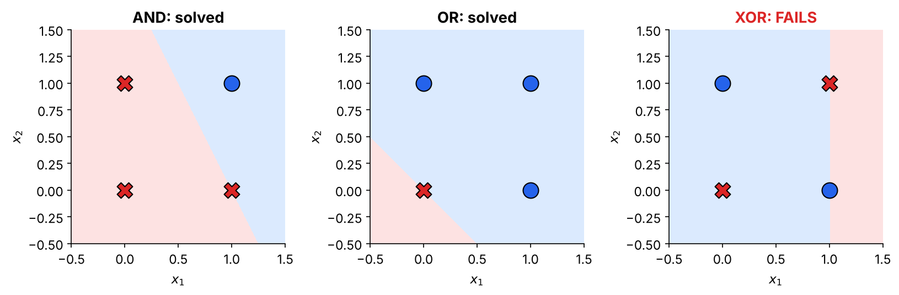
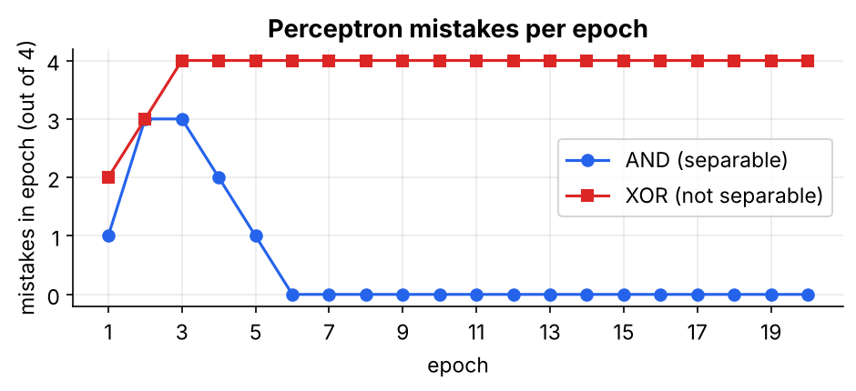

# 01 · Thresholded Perceptron

**Topic:** Perceptron and Gradient Descent · **Code:** `01_thresholded_perceptron.py` / `.ipynb`

> 📘 For a more detailed walk-through (with the full AND-gate trace and the XOR proof), read **Section 2** of
> **[Deep Learning Internals - Perceptron to Sigmoid Simplified.pdf](../Deep%20Learning%20Internals%20-%20Perceptron%20to%20Sigmoid%20Simplified.pdf)**.

---

## 1. What one neuron computes


A perceptron multiplies each input $x_i$ by a **weight** $w_i$ (how important that input is), adds everything up, and makes a hard yes/no decision:

$$net=\sum_{i=0}^{n} w_i x_i = w_0 + w_1x_1+\dots+w_nx_n \qquad\qquad y=\begin{cases}+1 & \text{if } net>0\\ -1 & \text{otherwise}\end{cases}$$

**Everyday example: "Should I go to the cricket match?"**
Inputs: weekend? $x_1$, friend coming? $x_2$, raining? $x_3$ (each 0 or 1). Weights: $w_1=+2,\;w_2=+1,\;w_3=-3$, bias $w_0=-1.5$.

| Situation | $net$ | Decision |
|---|---|---|
| Saturday, friend, no rain | $-1.5+2+1-0=1.5$ | **+1 → go** |
| Saturday, friend, raining | $-1.5+2+1-3=-1.5$ | **−1 → stay home** |

### Why the bias $x_0=1$?
Without $w_0$, an all-zero input always gives $net=0$, so the neuron has no default opinion. A constant input $x_0=1$ with its own weight lets the decision line **move away from the origin**.

```python
X_bias = np.c_[np.ones((X.shape[0], 1)), X]   # [0, 1]  ->  [1, 0, 1]
```

## 2. The picture: one straight line

The border where the output flips is $w_0+w_1x_1+w_2x_2=0$, which is a **straight line** in 2-D (a *hyperplane* in more dimensions). Learning means moving and rotating that line until the YES and NO points are on the correct sides.

## 3. The learning rule

$$w_i \leftarrow w_i+\Delta w_i,\qquad \Delta w_i=\eta\,(t-o)\,x_i$$

| target $t$ | output $o$ | $t-o$ | effect |
|---|---|---|---|
| +1 | +1 | 0 | correct, no change |
| −1 | −1 | 0 | correct, no change |
| +1 | −1 | +2 | said NO, should be YES: weights of active inputs go **up** |
| −1 | +1 | −2 | said YES, should be NO: weights of active inputs go **down** |

**Intuition:** only inputs that were switched on ($x_i\neq0$) get blamed. An input that was 0 couldn't have caused the mistake.

## 4. Worked example: AND gate (exact numbers from the code)

Targets $(0,0)\to-1,\;(0,1)\to-1,\;(1,0)\to-1,\;(1,1)\to+1$. Start at $\vec w=(0,0,0)$ with $\eta=0.1$.

| input | $t$ | $net$ | $o$ | $\Delta\vec w$ | new $\vec w$ |
|---|---|---|---|---|---|
| (0,0) | −1 | 0 | −1 | (0,0,0) | (0,0,0) |
| (0,1) | −1 | 0 | −1 | (0,0,0) | (0,0,0) |
| (1,0) | −1 | 0 | −1 | (0,0,0) | (0,0,0) |
| (1,1) | +1 | 0 | −1 | 0.1·2·(1,1,1) | (0.2,0.2,0.2) |

Mistakes per epoch go 1, 3, 3, 2, 1, **0**. The final weights are $\vec w=(-0.4,\,0.4,\,0.2)$, so $net=-0.4+0.4x_1+0.2x_2$, which is positive only for $(1,1)$. ✅

## 5. Where it breaks: XOR



**A short proof that XOR is impossible.** XOR needs:
- $(0,0)\to$ NO: $w_0\le0$
- $(1,1)\to$ NO: $w_0+w_1+w_2\le0$
- $(0,1)\to$ YES: $w_0+w_2>0$
- $(1,0)\to$ YES: $w_0+w_1>0$

Adding the two YES lines gives $2w_0+w_1+w_2>0$. Adding the two NO lines gives $2w_0+w_1+w_2\le0$. That's a contradiction, so no straight line can do XOR.



On XOR the weights go round in a circle forever. Every epoch ends at $\vec w=(0.2,-0.2,0)$ with all 4 examples misclassified.

> ⚠️ **Two problems to fix next:** (1) one line isn't enough, and (2) the step function has slope 0, so we can't tell how to update a neuron inside a network. Removing the threshold is the first fix (see folder 02).

## 6. Code walk-through

```python
def fit(self, X, y):
    X_bias = np.c_[np.ones((X.shape[0], 1)), X]       # add x0 = 1
    self.w = np.zeros(X_bias.shape[1])                # start with no opinion
    for _ in range(self.epochs):                      # passes over the data
        for xi, target in zip(X_bias, y):             # one example at a time
            net = np.dot(xi, self.w)                  # weighted sum
            output = 1 if net > 0 else -1             # hard step
            self.w += self.eta * (target - output) * xi   # perceptron rule
```

| Keyword | Meaning |
|---|---|
| `np.c_[...]` | glues columns side by side (adds the bias column) |
| `np.dot(xi, w)` | weighted sum $\sum_i w_ix_i$ |
| `np.where(cond, 1, -1)` | step function applied to many points at once (in `predict`) |
| `plt.contourf` | colours the plane by prediction, showing the decision line |

## To implement
- [x] Perceptron with bias term ($x_0=1$)
- [x] Perceptron rule: `delta_w = eta * (t - o) * x`
- [x] Train on AND / OR and plot the separating hyperplane
- [x] Show failure on non-separable data (XOR)

**Next:** [02 - Unthresholded Perceptron and Delta Rule](../02%20-%20Unthresholded%20Perceptron%20and%20Delta%20Rule/)
