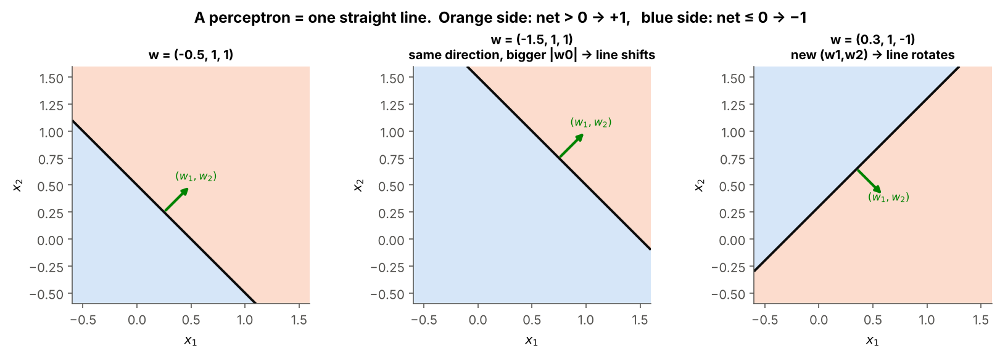
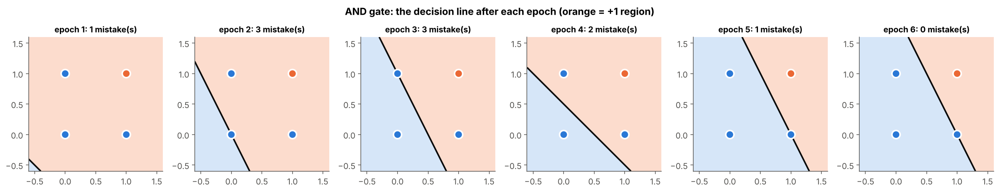
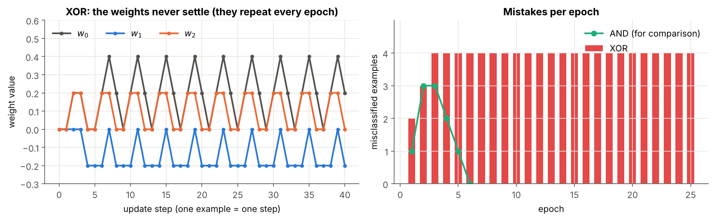

# 01 · Thresholded Perceptron

> **Module:** [01 - Perceptron and Gradient Descent](../) · **Notebook:** [`01_thresholded_perceptron.ipynb`](01_thresholded_perceptron.ipynb) · **Script:** `01_thresholded_perceptron.py`
> **Course notes:** "Perceptron" (page 2) · **Further reading:** Section 2 of [Deep Learning Internals - Perceptron to Sigmoid Simplified.pdf](../Deep%20Learning%20Internals%20-%20Perceptron%20to%20Sigmoid%20Simplified.pdf), Tom Mitchell *Machine Learning* Ch. 4

---

## 📌 The core idea in one sentence

A perceptron **adds up its inputs, each multiplied by a weight, and answers YES (+1) if the total is positive, NO (−1) otherwise**. Geometrically it draws **one straight line** through the input space, and its learning rule nudges that line every time it gets an example wrong.


---

## 1. Why copy the brain?

| Fact (from the notes) | Value | What it tells us |
|---|---|---|
| Neurons | $\approx 10^{11}$ | huge number of **very simple** units |
| Connections per neuron | $\approx 10^{4}$ | each unit listens to many others |
| Switching time | $\approx 10^{-3}$ s | each unit is slow |
| Decision time (e.g. recognising a face) | $\approx 10^{-1}$ s | only $10^{-1}/10^{-3}=100$ sequential steps are possible |

100 slow steps is far too few for a long program. So the brain must use **parallel processing**, a **distributed representation** (knowledge is spread over many connection strengths, not stored in one place) and **no explicit algorithm** (the strengths are learned). An artificial neural network copies this: many simple units + learnable weights. The perceptron is that simple unit.

---

## 2. The variables you need first

| Symbol | Meaning in plain words | Example (AND gate) |
|---|---|---|
| $n$ | number of real inputs | $2$ |
| $x_1,\dots,x_n$ | input values (features) of one example | $x_1=1,\ x_2=0$ |
| $x_0$ | **bias input**, always equal to $1$ | $1$ |
| $\vec x=(x_0,\dots,x_n)$ | the full input vector | $(1,1,0)$ |
| $w_i$ | **weight** of input $i$: how strongly it pushes towards YES (+) or NO (−) | $w_1=0.4$ |
| $w_0$ | **bias weight**: the default opinion when every real input is 0 | $w_0=-0.4$ |
| $net$ | the **net input** (weighted sum) | $-0.4+0.4\cdot1+0.2\cdot0=0$ |
| $o$ (also $y$) | the **output**, $+1$ or $-1$ | $-1$ |
| $t$ | the **target**: the correct answer from the dataset | $-1$ |
| $\eta$ | **learning rate**: size of each correction | $0.1$ |
| $D$ | the training set of pairs $(\vec x,t)$ | the 4 rows of the AND table |

---

## 3. What the neuron computes

**Step 1, add up the evidence:**

$$net=\sum_{i=0}^{n}w_i\ x_i=w_0+w_1x_1+\dots+w_nx_n=\vec w\cdot\vec x$$

**Step 2, make a hard decision (the threshold / step function):**

$$o=\begin{cases}+1 & \text{if } net>0\cr  -1 & \text{otherwise}\end{cases}$$

### 🏏 Worked example: "Should I go to the cricket match?"

Inputs: weekend? $x_1$, friend coming? $x_2$, raining? $x_3$ (each 0 or 1). Weights $w_1=+2,\ w_2=+1,\ w_3=-3$ and bias $w_0=-1.5$ ("by default I'm lazy").

| Situation | $\vec x=(x_0,x_1,x_2,x_3)$ | $net=\vec w\cdot\vec x$ | $o$ |
|---|---|---|---|
| Saturday, friend, no rain | $(1,1,1,0)$ | $-1.5+2+1+0=1.5$ | **+1 → go** |
| Saturday, friend, raining | $(1,1,1,1)$ | $-1.5+2+1-3=-1.5$ | **−1 → stay home** |
| Weekday, friend, no rain | $(1,0,1,0)$ | $-1.5+0+1+0=-0.5$ | **−1** |
| Saturday, alone, no rain | $(1,1,0,0)$ | $-1.5+2+0+0=0.5$ | **+1** |

### Why the bias $x_0=1$?

Without $w_0$, the all-zero input always gives $net=0$, and the decision line is forced through the origin. A constant input $x_0=1$ with its own weight lets the line **slide away from the origin**. (Notes: *"do not want output to be 0 when all inputs are 0."*)

---

## 4. The picture: one straight line (a hyperplane)

The decision flips where $net=0$. With two inputs:

$$w_0+w_1x_1+w_2x_2=0\quad\Longleftrightarrow\quad x_2=-\frac{w_1}{w_2}x_1-\frac{w_0}{w_2}$$

This is a **straight line**. In $n$ dimensions it is a flat sheet called a **hyperplane**.

- $(w_1,w_2)$ is **perpendicular** to the line and points to the YES side.
- Changing $w_0$ **shifts** the line; changing $(w_1,w_2)$ **rotates** it.
- Learning = moving the line until YES points and NO points sit on opposite sides.



---

## 5. The perceptron learning rule

For every training example, compare the output $o$ with the target $t$ and correct each weight:

$$\boxed{\ w_i\leftarrow w_i+\Delta w_i,\qquad \Delta w_i=\eta\ (t-o)\ x_i\ }$$

| $t$ | $o$ | $t-o$ | Effect on $w_i$ | Intuition |
|---|---|---|---|---|
| +1 | +1 | 0 | none | correct, leave it alone |
| −1 | −1 | 0 | none | correct, leave it alone |
| +1 | −1 | +2 | goes **up** by $2\eta x_i$ | said NO, should be YES → raise $net$ |
| −1 | +1 | −2 | goes **down** by $2\eta x_i$ | said YES, should be NO → lower $net$ |

**Only active inputs are blamed.** If $x_i=0$ that input could not have caused the mistake, so $\Delta w_i=0$.

**Why it moves in the right direction.** After a "should be YES" update the new net input on the same example is

$$net_{new}=\sum_i(w_i+2\eta x_i)\ x_i=net_{old}+2\eta\sum_i x_i^2\ >\ net_{old}.$$

So the example is pushed towards the correct side every time.

---

## 6. Worked example: learning AND (exact numbers from the notebook)

Targets: $(0,0)\to-1,\ (0,1)\to-1,\ (1,0)\to-1,\ (1,1)\to+1$. Start at $\vec w=(0,0,0)$, $\eta=0.1$. The first two epochs, every single update:

```text
ep1 x=[0. 0.] t=-1 net=+0.00 o=-1 Δw=[0. 0. 0.] → w=[0. 0. 0.]
ep1 x=[0. 1.] t=-1 net=+0.00 o=-1 Δw=[0. 0. 0.] → w=[0. 0. 0.]
ep1 x=[1. 0.] t=-1 net=+0.00 o=-1 Δw=[0. 0. 0.] → w=[0. 0. 0.]
ep1 x=[1. 1.] t=+1 net=+0.00 o=-1 Δw=[0.2 0.2 0.2] → w=[0.2 0.2 0.2]
ep2 x=[0. 0.] t=-1 net=+0.20 o=+1 Δw=[-0.2  0.   0. ] → w=[0.  0.2 0.2]
ep2 x=[0. 1.] t=-1 net=+0.20 o=+1 Δw=[-0.2  0.  -0.2] → w=[-0.2  0.2  0. ]
ep2 x=[1. 0.] t=-1 net=+0.00 o=-1 Δw=[0. 0. 0.] → w=[-0.2  0.2  0. ]
ep2 x=[1. 1.] t=+1 net=+0.00 o=-1 Δw=[0.2 0.2 0.2] → w=[0.  0.4 0.2]
```

Check one line by hand, e.g. the 4th update: $net=0$ so $o=-1$ but $t=+1$. Then $\Delta\vec w=0.1\times(1-(-1))\times(1,1,1)=(0.2,0.2,0.2)$.

Training to the end:

```text
mistakes per epoch : [1, 3, 3, 2, 1, 0]
final weights w    : [-0.4  0.4  0.2]  (w0, w1, w2)
predictions        : [-1 -1 -1  1]   targets: [-1 -1 -1  1]
```

So the learned rule is $net=-0.4+0.4x_1+0.2x_2$, which is positive **only** for $(1,1)$. ✅



OR and NAND are learned the same way. XOR is not:


---

## 7. Where it breaks: XOR

XOR needs these four conditions at once:

| Input | Target | Condition |
|---|---|---|
| (0,0) | −1 | $w_0\le0$ |
| (1,1) | −1 | $w_0+w_1+w_2\le0$ |
| (0,1) | +1 | $w_0+w_2>0$ |
| (1,0) | +1 | $w_0+w_1>0$ |

Add the two "+1" rows: $2w_0+w_1+w_2>0$. Add the two "−1" rows: $2w_0+w_1+w_2\le0$. **Contradiction**, so no single line can compute XOR. The learning rule therefore never stops: the weights cycle forever.

```text
mistakes per epoch: [2, 3, 4, 4, 4, 4, 4, 4, 4, 4] ...
weights at the end of epochs 1-5:
  epoch 1: w = [ 0.  -0.2  0. ]
  epoch 2: w = [ 0.2 -0.2  0. ]
  epoch 3: w = [ 0.2 -0.2  0. ]
  epoch 4: w = [ 0.2 -0.2  0. ]
  epoch 5: w = [ 0.2 -0.2  0. ]
```



> ⚠️ **Two problems to fix next**
> 1. **One line is not enough**, so we will need layers of neurons.
> 2. **The step function has slope 0**, so inside a network there is no signal telling a hidden neuron how to change (notes: *"do not know how to update intermediate neuron"*). Removing the threshold is the first fix → [02 - Unthresholded Perceptron and Delta Rule](../02%20-%20Unthresholded%20Perceptron%20and%20Delta%20Rule/).

**Perceptron convergence theorem.** If the data **is** linearly separable, the rule finds a separating line in a finite number of updates (notes: *"if data linearly separable, it will find the hyperplane"*). The notebook shows this on 89 random separable points.

---

## 8. Code, step by step

| Step | Code | Maths |
|---|---|---|
| 1. Add the bias input | `Xb = np.c_[np.ones((X.shape[0], 1)), X]` | $x_0=1$ |
| 2. Start with no opinion | `self.w = np.zeros(Xb.shape[1])` | $\vec w=\vec0$ |
| 3. Visit examples one at a time | `for xi, ti in zip(Xb, t):` | – |
| 4. Weighted sum | `net = np.dot(self.w, xi)` | $net=\vec w\cdot\vec x$ |
| 5. Threshold | `o = 1 if net > 0 else -1` | $o=\pm1$ |
| 6. Correction for all weights at once | `dw = self.eta * (ti - o) * xi` | $\Delta w_i=\eta(t-o)x_i$ |
| 7. Apply it | `self.w += dw` | $w_i\leftarrow w_i+\Delta w_i$ |
| 8. Predict many points at once | `np.where(Xb @ self.w > 0, 1, -1)` | step on every row |

| NumPy keyword | Meaning |
|---|---|
| `np.c_[a, b]` | glue arrays side by side as columns |
| `np.dot(a, b)` / `a @ b` | dot product / matrix product |
| `np.where(cond, 1, -1)` | elementwise "if cond then 1 else −1" |
| `plt.contourf` | colour the plane by prediction to show the decision regions |

### Full code

<details>
<summary><b>Click to expand: the complete perceptron (copy-paste ready)</b></summary>

```python
import numpy as np

class ThresholdedPerceptron:
    """A single perceptron:  o = +1 if w·x > 0 else -1,  trained with  Δw = η (t - o) x."""

    def __init__(self, learning_rate=0.1, epochs=10):
        self.eta = learning_rate          # η : step size of every correction
        self.epochs = epochs              # how many passes over the dataset
        self.w = None                     # weights [w0, w1, ..., wn], created in fit()

    @staticmethod
    def add_bias(X):
        """Prepend the constant input x0 = 1 to every example (row)."""
        return np.c_[np.ones((X.shape[0], 1)), X]

    def fit(self, X, t, verbose=False):
        Xb = self.add_bias(X)                         # shape (N, n+1)
        self.w = np.zeros(Xb.shape[1])                # start with "no opinion"
        self.w_history = [self.w.copy()]              # weights after every single example
        self.mistakes = []                            # number of errors in each epoch
        for epoch in range(self.epochs):
            errors = 0
            for xi, ti in zip(Xb, t):                 # one example at a time (online learning)
                net = np.dot(self.w, xi)              # step 1: weighted sum
                o = 1 if net > 0 else -1              # step 2: hard threshold
                dw = self.eta * (ti - o) * xi         # perceptron rule
                if verbose:
                    print(f"ep{epoch+1} x={xi[1:]} t={ti:+d} net={net:+.2f} o={o:+d} "
                          f"Δw={dw + 0.0} → w={self.w + dw + 0.0}")
                self.w += dw
                errors += int(ti != o)
                self.w_history.append(self.w.copy())
            self.mistakes.append(errors)
            if errors == 0 and not verbose:           # every example correct → converged
                break
        return self

    def predict(self, X):
        """Vectorised prediction for many examples at once."""
        return np.where(self.add_bias(X) @ self.w > 0, 1, -1)


# ---- usage ----
X = np.array([[0, 0], [0, 1], [1, 0], [1, 1]], dtype=float)
t_and = np.array([-1, -1, -1, 1])
p = ThresholdedPerceptron(learning_rate=0.1, epochs=20).fit(X, t_and)
print(p.w, p.mistakes, p.predict(X))          # [-0.4 0.4 0.2] [1, 3, 3, 2, 1, 0] [-1 -1 -1 1]
```
</details>

---

## 9. What is in the notebook

| Section | Content | Figure |
|---|---|---|
| 1–3 | brain facts, variable table, cricket example computed in code | – |
| 4 | geometry: shift vs rotate the line | half-plane plots |
| 5 | one update visualised before/after | before/after plots |
| 6 | the commented `ThresholdedPerceptron` class | – |
| 7 | full AND trace, line after every epoch, OR / NAND / XOR | small multiples |
| 8 | XOR proof, cycling weights, mistakes never reach 0 | weight trajectory |
| 9 | convergence theorem on 89 random separable points | mistakes → 0 |

```bash
pip install numpy matplotlib jupyter
jupyter notebook 01_thresholded_perceptron.ipynb
```

## ✍️ Exercises
1. Re-run AND with $\eta=1$. Why do the mistakes per epoch stay the same? *(Starting from $\vec w=\vec0$, $\eta$ only rescales $\vec w$.)*
2. Shuffle the order of the four examples. Does it still converge? To the same line?
3. Train a 3-input majority gate.
4. Why can't a perceptron fit the notes' example $x=1,2,3\to y=2,6,10$? *(It only outputs ±1. That is a regression task, solved in the next folder.)*

**Next:** [02 - Unthresholded Perceptron and Delta Rule](../02%20-%20Unthresholded%20Perceptron%20and%20Delta%20Rule/)
