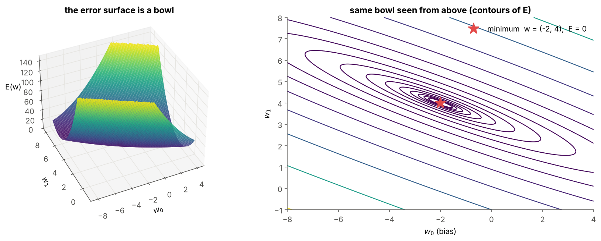
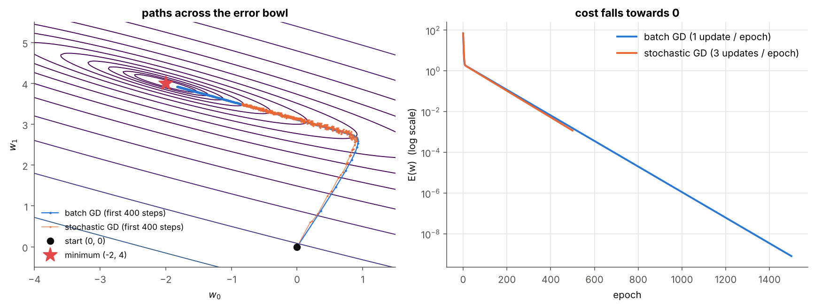
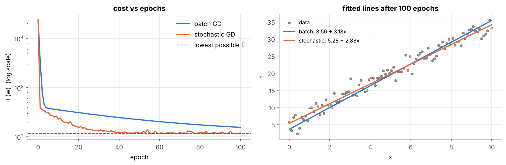
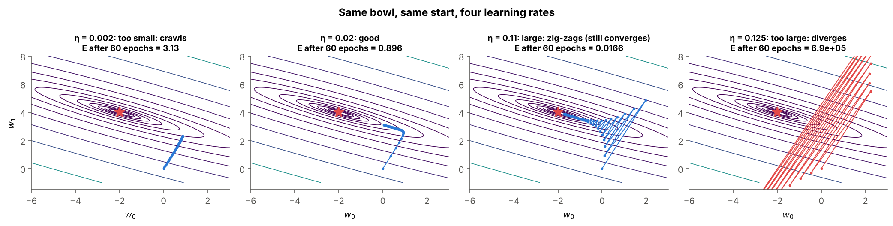

# 02 · Unthresholded Perceptron and the Delta Rule

> **Module:** [01 - Perceptron and Gradient Descent](../) · **Notebook:** [`02_unthresholded_delta_rule.ipynb`](02_unthresholded_delta_rule.ipynb) · **Script:** `02_unthresholded_delta_rule.py`
> **Course notes:** "Unthresholded perceptron", "Cost function", "Gradient of cost function" (pages 2–3) · **Further reading:** Section 3 of [the module guide PDF](../Deep%20Learning%20Internals%20-%20Perceptron%20to%20Sigmoid%20Simplified.pdf), Mitchell §4.4

---

## 📌 The core idea in one sentence

**Delete the step function**, so the neuron outputs a real number; then define one number $E$ that measures the total error, and **walk downhill on $E$** by moving every weight against its slope. That walk is **gradient descent**, and the resulting update is the **delta rule**.

---

## 1. Why remove the threshold?

The step function from folder 01 has **slope 0 everywhere** (and no slope at 0). A tiny change in a weight changes nothing until the output suddenly flips, so it gives no hint about *which way* or *how much* to change the weight. Being "a bit wrong" and "very wrong" look identical.

The **unthresholded perceptron** (also called a *linear unit*) simply outputs the weighted sum:

$$o(\vec x)=\vec w\cdot\vec x=w_0+w_1x_1+\dots+w_nx_n$$

Now an output of 5.7 against a target of 6 tells us "0.3 too low", and calculus can tell us how each weight affects that.

---

## 2. The variables you need first

| Symbol | Meaning | Example (notes' data) |
|---|---|---|
| $D$ | training set; $d$ is one example in it | 3 examples |
| $\vec x_d$ | input vector of example $d$ (with $x_{0,d}=1$) | $(1,\ 2)$ |
| $x_{i,d}$ | input $i$ of example $d$ | $x_{1,3}=3$ |
| $t_d$ | **target**: the true value from the dataset | $10$ |
| $\vec w$ | weights $(w_0,\dots,w_n)$ | $(-2,\ 4)$ |
| $o_d=\vec w\cdot\vec x_d$ | **output** for example $d$ | $10$ |
| $t_d-o_d$ | signed **error** on example $d$ | $0$ |
| $E(\vec w)$ | **cost**: total error as one number | $0$ |
| $\nabla E$ | **gradient**: vector of slopes $\partial E/\partial w_i$ | – |
| $\eta$ | **learning rate** (step size) | $0.02$ |

---

## 3. The cost function: one number for "how bad"

$$\boxed{E(\vec w)=\frac12\sum_{d\in D}(t_d-o_d)^2}$$

- **Square:** positive and negative errors can't cancel, and big errors count much more.
- **½:** cancels the 2 that appears when we differentiate.
- The data are fixed, so **$E$ depends only on $\vec w$**. Learning = finding the lowest point of $E$.

**Example from the notes:** $x=1,2,3\to y=2,6,10$. The thresholded perceptron "won't work" here (it only outputs ±1), but a linear unit can fit it exactly with $w_0=-2,\ w_1=4$ ($y=4x-2$).

| $\vec w$ | outputs $o$ | $E$ |
|---|---|---|
| $(0,0)$ | $(0,0,0)$ | $\tfrac12(4+36+100)=70$ |
| $(0,3)$ | $(3,6,9)$ | $\tfrac12(1+0+1)=1$ |
| $(-2,4)$ | $(2,6,10)$ | $0$ |

Because $o$ is linear in $\vec w$ and $E$ squares it, **$E$ is a bowl** with one lowest point:



The contours are long thin ellipses: steep in one direction, almost flat in the other. Keep that in mind; it explains the path of gradient descent below.

---

## 4. The gradient and the delta rule

**Intuition: walking downhill in fog.** You can't see the bottom, but you can feel the slope under your feet. The gradient is that slope in every weight direction:

$$\nabla E(\vec w)=\left[\frac{\partial E}{\partial w_0},\frac{\partial E}{\partial w_1},\dots,\frac{\partial E}{\partial w_n}\right]$$

It points **uphill**, so we step the other way: $\ \vec w\leftarrow\vec w-\eta\ \nabla E$.

### Derivation, one step at a time

$$\begin{aligned} \frac{\partial E}{\partial w_i} &=\frac{\partial}{\partial w_i}\frac12\sum_d(t_d-o_d)^2 =\frac12\sum_d 2(t_d-o_d)\frac{\partial(t_d-o_d)}{\partial w_i} &&\text{chain rule}\cr &=\sum_d(t_d-o_d)\ \frac{\partial}{\partial w_i}\big(t_d-\vec w\cdot\vec x_d\big) =\sum_d(t_d-o_d)(-x_{i,d}) &&t_d\text{ is a constant} \end{aligned}$$

$$\boxed{\frac{\partial E}{\partial w_i}=-\sum_{d\in D}(t_d-o_d)\ x_{i,d}}\qquad\Longrightarrow\qquad\boxed{\Delta w_i=\eta\sum_{d\in D}(t_d-o_d)\ x_{i,d}}$$

This is the **delta rule** (LMS / Widrow–Hoff rule). It looks like the perceptron rule, but $o$ is now a real number, so $(t-o)$ says **how much** we are wrong. In matrix form (rows of $X$ = examples): $\nabla E=-X^\top(\vec t-\vec o)$.

The notebook checks this formula against a brute-force slope $\frac{E(w_i+\varepsilon)-E(w_i-\varepsilon)}{2\varepsilon}$; both give $\nabla E=(-7.5,\ -20)$ at $\vec w=(0.5,1.5)$.

### Worked example: the first three steps by hand ($\eta=0.02$)

```text
start: w = [0. 0.]  E = 70.0
step 1: o = [0. 0. 0.], t - o = [ 2.  6. 10.], ∇E = [-18. -44.], new w = [0.36 0.88], E = 32.316
step 2: o = [1.24 2.12 3.  ], t - o = [0.76 3.88 7.  ], ∇E = [-11.64 -29.52], new w = [0.5928 1.4704], E = 15.524
step 3: o = [2.0632 3.5336 5.004 ], t - o = [-0.0632  2.4664  4.996 ], ∇E = [ -7.3992 -19.8576], new w = [0.7408 1.8676], E = 8.032
```

Step 1 by hand: errors $=(2,6,10)$, so $\partial E/\partial w_0=-(2+6+10)=-18$ and $\partial E/\partial w_1=-(2\cdot1+6\cdot2+10\cdot3)=-44$. Then $\Delta\vec w=-0.02\times(-18,-44)=(0.36,\ 0.88)$. ✅

---

## 5. Batch vs stochastic gradient descent

| | **Batch** GD | **Stochastic (incremental)** GD |
|---|---|---|
| Update after | all examples | every single example |
| Rule | $\Delta w_i=\eta\sum_d(t_d-o_d)x_{i,d}$ | $\Delta w_i=\eta(t_d-o_d)x_{i,d}$ |
| Direction | the exact gradient | a noisy estimate |
| Path | smooth | jittery |
| Good for | small data | large data (many cheap updates) |

```text
batch GD      → w = [-1.9999  4.    ]   E = 7.93e-10
stochastic GD → w = [-1.9261  3.968 ]   E = 1.17e-03   (constant η keeps it jittering near the minimum)
exact answer  → w = [-2.  4.]
```



Both paths rush down the steep wall first, then crawl along the flat valley floor. On 100 noisy points around $y=3x+5$, stochastic GD gets 100 updates per epoch and reaches the best line much sooner, while batch GD still has the intercept wrong after 100 epochs:

```text
batch GD      w = [3.5593 3.1807]   E =    155.7
stochastic GD w = [5.2835 2.8833]   E =    118.9
least squares w = [5.319  2.9161]   E =    116.4  (the true minimum)
```



---

## 6. The learning rate $\eta$



- **Too small** → tiny steps, very slow.
- **Good** → steady progress.
- **Large** → overshoots across the valley and zig-zags (can still converge).
- **Too large** → every step overshoots more than the last, and $E$ explodes.

For batch GD on a quadratic bowl the limit is $\eta<2/\lambda_{max}$, where $\lambda_{max}$ is the largest eigenvalue of $X^\top X$ (the steepest curvature). Here $\lambda_{max}\approx16.7$, so $\eta<0.12$.

---

## 7. Delta rule as a classifier, and XOR again

Train on ±1 targets with the delta rule, then threshold only at prediction time:

```text
AND: w = [-1.5  1.   1. ],  raw outputs o = [-1.5 -0.5 -0.5  0.5],  thresholded = [-1 -1 -1  1],  accuracy = 100%
XOR: w = [0. 0. 0.],  raw outputs o = [0. 0. 0. 0.],  thresholded = [-1 -1 -1 -1],  accuracy = 50%
```

Unlike the perceptron, the delta rule **always converges** (to the least-squares weights), even on non-separable data. On XOR, though, the best straight line is $\vec w=\vec0$: useless. **A single linear unit still can't do XOR**, and stacking linear units doesn't help (notes: *"network of linear neurons will have same effect as a single neuron"*). That needs non-linearity → [03 - Sigmoid Unit](../03%20-%20Sigmoid%20Unit%20and%20Non-linearity/).

---

## 8. Code, step by step

| Step | Code | Maths |
|---|---|---|
| 1. Add bias column | `Xb = np.c_[np.ones((X.shape[0], 1)), X]` | $x_0=1$ |
| 2. Outputs for all examples | `o = Xb @ self.w` | $o_d=\vec w\cdot\vec x_d$ |
| 3. Cost | `0.5 * np.sum((t - Xb @ self.w) ** 2)` | $E=\tfrac12\sum(t_d-o_d)^2$ |
| 4. Gradient | `grad = -Xb.T @ (t - o)` | $\partial E/\partial w_i=-\sum_d(t_d-o_d)x_{i,d}$ |
| 5. Batch step | `self.w = self.w - self.eta * grad` | $\vec w\leftarrow\vec w-\eta\nabla E$ |
| 6. Stochastic step | `self.w += self.eta * (t[d] - o_d) * Xb[d]` | $\Delta w_i=\eta(t_d-o_d)x_{i,d}$ |
| 7. Shuffle each epoch | `self.rng.permutation(len(t))` | random visiting order |

**Why `Xb.T @ (t - o)` is the sum.** Row $i$ of `Xb.T` holds $x_{i,d}$ for every example $d$, so the product gives $\sum_d x_{i,d}(t_d-o_d)$ for every $i$ at once.

### Full code

<details>
<summary><b>Click to expand: the complete linear unit with batch and stochastic GD</b></summary>

```python
import numpy as np

class LinearUnit:
    """Unthresholded perceptron  o = w·x,  trained with the delta rule (gradient descent on E)."""

    def __init__(self, learning_rate=0.01, epochs=50, mode="batch", seed=0):
        self.eta = learning_rate      # η : step size
        self.epochs = epochs          # passes over the data
        self.mode = mode              # "batch" or "stochastic"
        self.rng = np.random.default_rng(seed)

    @staticmethod
    def add_bias(X):
        return np.c_[np.ones((X.shape[0], 1)), X]          # x0 = 1 for every example

    def cost(self, Xb, t):
        return 0.5 * np.sum((t - Xb @ self.w) ** 2)       # E(w) = 1/2 Σ (t_d - o_d)^2

def batch_step(self, Xb, t):
    """Delta rule, batch version: ONE update using the gradient summed over all examples."""
    o = Xb @ self.w                            # outputs for ALL examples
    grad = -Xb.T @ (t - o)                     # ∂E/∂w_i = -Σ_d (t_d - o_d) x_id
    self.w = self.w - self.eta * grad          # one step downhill
    self.w_history.append(self.w.copy())

LinearUnit.batch_step = batch_step

def stochastic_epoch(self, Xb, t):
    """Delta rule, incremental version: one small update per example, in random order."""
    for d in self.rng.permutation(len(t)):
        o_d = Xb[d] @ self.w                                   # output for example d only
        self.w = self.w + self.eta * (t[d] - o_d) * Xb[d]      # Δw = η (t_d - o_d) x_d
        self.w_history.append(self.w.copy())

LinearUnit.stochastic_epoch = stochastic_epoch

def fit(self, X, t, w_init=None):
    Xb = self.add_bias(X)
    self.w = np.zeros(Xb.shape[1]) if w_init is None else np.array(w_init, float)
    self.cost_history = [self.cost(Xb, t)]             # E before any training
    self.w_history = [self.w.copy()]
    for epoch in range(self.epochs):
        if self.mode == "batch":
            self.batch_step(Xb, t)                     # 1 update per epoch
        else:
            self.stochastic_epoch(Xb, t)               # N updates per epoch
        self.cost_history.append(self.cost(Xb, t))     # E after this epoch
    self.w_history = np.array(self.w_history)
    return self

LinearUnit.fit = fit

def predict(self, X):
    return self.add_bias(X) @ self.w

LinearUnit.predict = predict


# ---- usage: the data from the notes ----
x = np.array([[1.0], [2.0], [3.0]])
t = np.array([2.0, 6.0, 10.0])
batch = LinearUnit(learning_rate=0.02, epochs=1500, mode="batch").fit(x, t)
sgd = LinearUnit(learning_rate=0.02, epochs=500, mode="stochastic").fit(x, t)
print(batch.w, sgd.w)        # both close to [-2, 4]
```
</details>

---

## 9. What is in the notebook

| Section | Content |
|---|---|
| 2 | step vs linear output and their slopes |
| 3 | the cost on the notes' data, 3-D bowl + contour plot |
| 4 | step-by-step derivation, analytic vs numerical gradient |
| 5 | commented `LinearUnit` class (batch + stochastic) |
| 6 | first three steps by hand, paths across the bowl, fitted line over time |
| 7 | four learning rates side by side |
| 8 | batch vs stochastic on 100 noisy points |
| 9 | delta rule on AND (works) and XOR (fails) |

```bash
jupyter notebook 02_unthresholded_delta_rule.ipynb
```

## ✍️ Exercises
1. Find the largest $\eta$ that still converges on the notes' data and compare it with $2/\lambda_{max}$ (`np.linalg.eigvalsh(Xb.T @ Xb)`).
2. Standardise $x$ before training on the noisy data. Why does batch GD now converge in a few epochs? *(The bowl becomes round.)*
3. Implement mini-batch GD (update every 10 examples).
4. Use the mean $\tfrac1{2N}\sum$ instead of $\tfrac12\sum$. How must $\eta$ change?

**Previous:** [01 - Thresholded Perceptron](../01%20-%20Thresholded%20Perceptron/) · **Next:** [03 - Sigmoid Unit and Non-linearity](../03%20-%20Sigmoid%20Unit%20and%20Non-linearity/)
