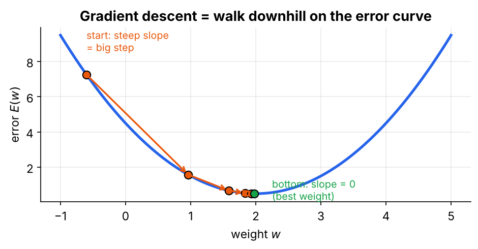
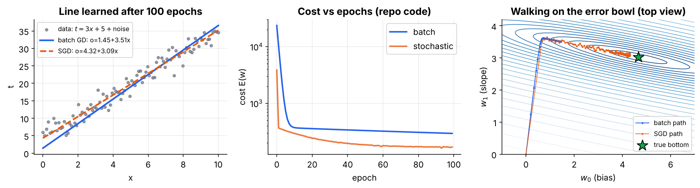

# 02 · Unthresholded Perceptron and the Delta Rule

**Topic:** Perceptron and Gradient Descent · **Code:** `02_unthresholded_delta_rule.py` / `.ipynb`

> 📘 For the full derivation, a hand-computed gradient step and more figures, read **Section 3** of
> **[Deep Learning Internals - Perceptron to Sigmoid Simplified.pdf](../Deep%20Learning%20Internals%20-%20Perceptron%20to%20Sigmoid%20Simplified.pdf)**.

---

## 1. Remove the step

The step function only says *right* or *wrong*, and its slope is 0. So we remove it. The output becomes the raw weighted sum:

$$o(\vec x)=\vec w\cdot\vec x=w_0+w_1x_1+\dots+w_nx_n$$

Now an output of 3.7 against a target of 4 tells us we're off by **0.3**, not just "wrong".

## 2. One number for "how bad": the cost function

$$E(\vec w)=\frac12\sum_{d\in D}(t_d-o_d)^2$$

- **Why square?** Too-high and too-low errors both count, and big mistakes count much more.
- **Why ½?** When we differentiate, the 2 from the square cancels it.
- $E$ depends only on the weights. Learning means finding the $\vec w$ at the bottom of this bowl.

## 3. Roll downhill: gradient descent



Think of walking down a hill in fog: you can't see the valley, but you can feel the slope under your feet. The **gradient** is that slope. It points uphill, so we step the other way:

$$\vec w\leftarrow\vec w-\eta\,\nabla E,\qquad \nabla E=\Big[\tfrac{\partial E}{\partial w_0},\dots,\tfrac{\partial E}{\partial w_n}\Big]$$

## 4. Computing the gradient

$$\frac{\partial E}{\partial w_i}=\frac12\sum_d 2(t_d-o_d)\cdot\frac{\partial(t_d-o_d)}{\partial w_i}=\sum_d (t_d-o_d)(-x_{i,d})=-\sum_d(t_d-o_d)\,x_{i,d}$$

Stepping against it gives the **Delta rule** (also called LMS or Widrow–Hoff):

$$\boxed{\Delta w_i=\eta\sum_{d\in D}(t_d-o_d)\,x_{i,d}}$$

It has the same form as the perceptron rule, except that $(t-o)$ is now a *size* of error. Small errors give small updates.

### Example: one step by hand
One point $x=2$, $t=7$; start at $w_0=0,\,w_1=1$ with $\eta=0.05$.
- $o=0+1\cdot2=2$, error $=5$, $E=12.5$
- $\Delta w_0=0.05\cdot5\cdot1=0.25$, $\Delta w_1=0.05\cdot5\cdot2=0.5$
- New output $=0.25+1.5\cdot2=3.25$, new $E=7.03$ ✅. The weight with the bigger input took more of the blame.

## 5. Batch vs stochastic

| | Batch GD | Stochastic (incremental) GD |
|---|---|---|
| Uses | all examples, then one step | one example, then one step |
| Steps per epoch | 1 | $N$ |
| Path | smooth but slow | noisy but fast |



The experiment fits 100 points on $t=3x+5$ plus noise for 100 epochs. **SGD** reaches $o=4.32+3.09x$, close to the best possible line $4.65+3.03x$. **Batch GD** gets the slope (3.51) but its bias is still only 1.45. The error bowl is a long, narrow **valley**: very sensitive to the slope, barely sensitive to the bias. With one learning rate for both, batch GD crawls along the valley floor. This problem is what later motivates feature scaling, momentum and Adam.

## 6. Code walk-through

```python
if self.mode == 'batch':
    outputs  = np.dot(X_bias, self.w)        # o_d for all examples
    errors   = y - outputs                   # t_d - o_d
    cost     = 0.5 * np.sum(errors ** 2)     # E(w)
    gradient = -np.dot(X_bias.T, errors)     # -sum_d (t_d - o_d) x_id
    self.w  -= self.eta * gradient           # one step downhill
elif self.mode == 'stochastic':
    for i in np.random.permutation(N):       # shuffled order
        error = y[i] - np.dot(X_bias[i], self.w)
        self.w -= self.eta * (-error * X_bias[i])    # step after every example
```

| Keyword | Meaning |
|---|---|
| `X_bias.T @ errors` | computes $\sum_d (t_d-o_d)x_{i,d}$ for **every** weight $i$ in one go |
| `0.5 * np.sum(errors**2)` | the cost $E$ |
| `np.random.permutation(N)` | shuffles the order each epoch for SGD |

> **Note:** this file **sums** over the 100 examples instead of averaging (no `/ N`). The gradient is therefore about 100× bigger, which is why the batch learning rate is tiny (`1e-4`). Dividing by $N$ would allow a larger $\eta$.

> ⚠️ **Learning rate:** too small means painfully slow progress. Too big means you jump over the bottom and the cost can explode. Always plot the cost curve.

## To implement
- [x] Linear unit and squared-error cost
- [x] Batch gradient descent using the gradient of E
- [x] Stochastic / incremental variant
- [x] Plot cost vs iterations

**Previous:** [01 - Thresholded Perceptron](../01%20-%20Thresholded%20Perceptron/) · **Next:** [03 - Sigmoid Unit and Non-linearity](../03%20-%20Sigmoid%20Unit%20and%20Non-linearity/)
