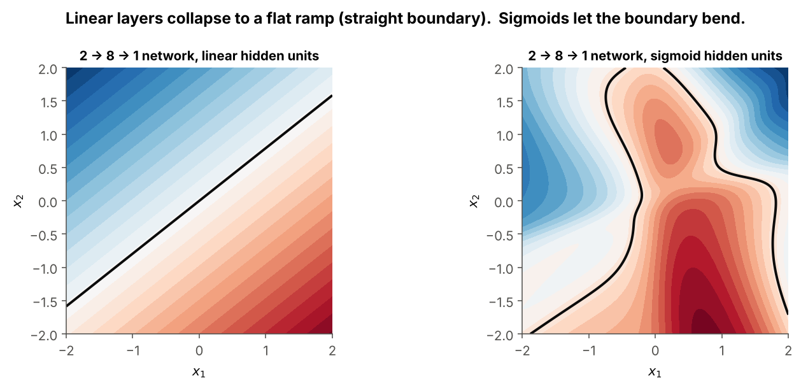
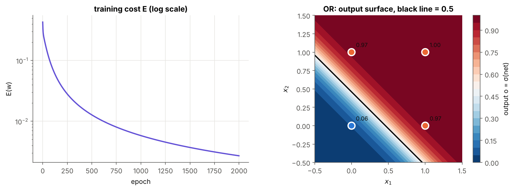

# 03 · Sigmoid Unit and Non-linearity

> **Module:** [01 - Perceptron and Gradient Descent](../) · **Notebook:** [`03_sigmoid_unit_non_linearity.ipynb`](03_sigmoid_unit_non_linearity.ipynb) · **Script:** `03_sigmoid_unit_non_linearity.py`
> **Course notes:** page 3 (*"Network of linear neurons will have same effect as a single neuron. Need non-linear, cont., diff. … ⇒ Sigmoid"*) · **Further reading:** Section 4 of [the module guide PDF](../Deep%20Learning%20Internals%20-%20Perceptron%20to%20Sigmoid%20Simplified.pdf), Mitchell §4.5.1

---

## 📌 The core idea in one sentence

Stacking **linear** neurons gains nothing (the layers collapse into one), and the **step** neuron can't be trained, so we use the **sigmoid** $\sigma(x)=\frac1{1+e^{-x}}$: a *smooth step* that is non-linear (layers stay useful), differentiable (gradient descent works) and has the cheap slope $\sigma'=y(1-y)$.

---

## 1. The variables you need first

| Symbol | Meaning | Example |
|---|---|---|
| $\vec x$ | input vector, with bias $x_0=1$ | $(1,0,1)$ |
| $\vec w$ | weights of one unit | $(-2,5,5)$ |
| $net=\vec w\cdot\vec x$ | net input | $3$ |
| $\sigma(\cdot)$ | the sigmoid (logistic) function | – |
| $o=\sigma(net)$ | output of a sigmoid unit, in $(0,1)$ | $0.953$ |
| $y$ | the notes' name for $\sigma$'s output | – |
| $t_d,\ o_d$ | target and output for example $d$ | $1,\ 0.953$ |
| $E=\tfrac12\sum_d(t_d-o_d)^2$ | squared-error cost | – |
| $\delta_d$ | **error term** of the unit for example $d$ | – |
| $W_1,W_2$ | weight matrices of two stacked layers (one row per neuron) | $4\times3,\ 2\times4$ |

---

## 2. Why stacked linear layers collapse

Layer 1 computes $\vec h=W_1\vec x$, layer 2 computes $\vec o=W_2\vec h$. Substitute:

$$\vec o=W_2(W_1\vec x)=(W_2W_1)\ \vec x=W_3\ \vec x$$

A product of matrices is just another matrix, so **two linear layers = one linear layer** (doubling then tripling = multiplying by 6). Ten linear layers still draw one straight line.

```python
out_stacked = W2 @ (W1 @ X)    # x -> layer 1 -> layer 2
out_single  = (W2 @ W1) @ X    # one combined layer
np.allclose(out_stacked, out_single)   # True (max difference 4e-16)
```



*Same random 2→8→1 weights. Left: linear hidden units give a flat ramp with a straight boundary. Right: sigmoid hidden units let the boundary bend.*

---

## 3. What a good activation needs

| Requirement (from the notes) | Why | Step | Linear | Sigmoid |
|---|---|---|---|---|
| Non-linear | otherwise layers collapse | ✅ | ❌ | ✅ |
| Continuous and differentiable | gradient descent needs a slope | ❌ | ✅ | ✅ |
| Step-like ("simulate activation of a neuron") | a neuron fires or it doesn't | ✅ | ❌ | ✅ |

---

## 4. The sigmoid and its derivative

$$\boxed{\sigma(x)=\frac{1}{1+e^{-x}}}$$

| $x$ | −5 | −2 | −1 | 0 | 1 | 2 | 5 |
|---|---|---|---|---|---|---|---|
| $\sigma(x)$ | 0.007 | 0.119 | 0.269 | **0.5** | 0.731 | 0.881 | 0.993 |

**Intuition: a soft yes/no.** Very negative input → about 0 (NO), very positive → about 1 (YES), near 0 → unsure. The output can be read as a probability.

### Derivative, step by step

Let $y=\sigma(x)=(1+e^{-x})^{-1}$.

$$\frac{dy}{dx}=-(1+e^{-x})^{-2}\cdot(-e^{-x})=\frac{e^{-x}}{(1+e^{-x})^2} =\underbrace{\frac{1}{1+e^{-x}}}_{y}\cdot\underbrace{\frac{e^{-x}}{1+e^{-x}}}_{1-y} \quad\Longrightarrow\quad\boxed{\sigma'(x)=y\ (1-y)}$$

Once the forward pass has $y$, the slope costs **one multiplication**. The notebook checks it against a numerical slope (max difference $1.4\times10^{-11}$).


- The slope is largest (**0.25**) at $x=0$ and almost **0** at the ends. When a unit sits at the flat ends it is **saturated** and learns very slowly.
- $\sigma(kx)$ gets steeper as $k$ grows and becomes the step function as $k\to\infty$. The sigmoid neuron is a smooth generalisation of the perceptron.

---

## 5. Gradient descent for one sigmoid unit

Output $o_d=\sigma(net_d)$, $net_d=\vec w\cdot\vec x_d$, cost $E=\frac12\sum_d(t_d-o_d)^2$. The chain rule now has three links:

$$\frac{\partial E}{\partial w_i}=\sum_d\underbrace{\frac{\partial E}{\partial o_d}}_{-(t_d-o_d)}\cdot\underbrace{\frac{\partial o_d}{\partial net_d}}_{o_d(1-o_d)}\cdot\underbrace{\frac{\partial net_d}{\partial w_i}}_{x_{i,d}}$$

$$\boxed{\delta_d=(t_d-o_d)\ o_d(1-o_d)}\qquad\boxed{\Delta w_i=\eta\sum_d\delta_d\ x_{i,d}}$$

The only change from the delta rule is the extra factor $o_d(1-o_d)$. The notes: *"activation function changes, only this partial derivative changes."* The error term $\delta$ is the building block of backpropagation in module 02.

### Worked example: learning OR (targets 0/1)

```text
learned w = [-2.8436  6.1796  6.1796]
outputs   = [0.055  0.9656 0.9656 0.9999]   targets: [0. 1. 1. 1.]
E: start 0.429 → end 0.0027
```



The output is now a smooth confidence, but the 0.5 boundary is **still a straight line**.

---

## 6. XOR: one sigmoid fails, one hidden layer succeeds

> ⚠️ **Misconception:** "the sigmoid is non-linear, so one sigmoid neuron can do XOR." False. $\sigma$ only increases, so $\sigma(net)>0.5\iff net>0$, and the boundary is still the line $net=0$. In the notebook, a single sigmoid trained on XOR outputs $0.5$ for every input.

Non-linearity pays off only when units are **stacked**. XOR $=$ AND(OR, NAND), and each of those is one line:

| Unit | Weights $(w_0,w_1,w_2)$ | Computes |
|---|---|---|
| hidden $h_1$ | $(-10,20,20)$ | OR |
| hidden $h_2$ | $(30,-20,-20)$ | NAND |
| output | $(-30,20,20)$ on $(1,h_1,h_2)$ | AND |


① each hidden unit draws one line, ② in the hidden space $(h_1,h_2)$ the four points become separable by one line, ③ the network's output is a band. **Each layer re-represents the data so the next layer's job is easier.** Here we set the hidden weights by hand; learning them is what **backpropagation** does.

---

## 7. Warning sign: the vanishing gradient

$\sigma'\le0.25$, so a gradient passing through $L$ sigmoid layers is multiplied by at most $0.25^L$. After 10 layers that is about $10^{-6}$. This is the **vanishing gradient problem**, measured properly in module 02 and the reason ReLU and LSTMs exist.

---

## 8. Code, step by step

| Step | Code | Maths |
|---|---|---|
| 1. Sigmoid | `1.0 / (1.0 + np.exp(-z))` | $\sigma(z)$ |
| 2. Forward for all examples | `o = sigmoid(Xb @ self.w)` | $o_d=\sigma(\vec w\cdot\vec x_d)$ |
| 3. Cost | `0.5 * np.sum((t - o) ** 2)` | $E$ |
| 4. Error term | `delta = (t - o) * o * (1 - o)` | $\delta_d=(t_d-o_d)o_d(1-o_d)$ |
| 5. Update | `self.w += self.eta * Xb.T @ delta` | $w_i\leftarrow w_i+\eta\sum_d\delta_dx_{i,d}$ |

`*` is **elementwise** multiplication in NumPy; `@` is the matrix product that does the sum over examples.

### Full code

<details>
<summary><b>Click to expand: sigmoid unit + hand-built XOR network</b></summary>

```python
import numpy as np

def sigmoid(z):
    return 1.0 / (1.0 + np.exp(-z))                    # σ(z) ∈ (0, 1)

class SigmoidNeuron:
    """o = σ(w·x), trained by batch gradient descent on E = 1/2 Σ_d (t_d - o_d)^2."""

    def __init__(self, learning_rate=0.5, epochs=1000, seed=0):
        self.eta, self.epochs = learning_rate, epochs
        self.rng = np.random.default_rng(seed)

    @staticmethod
    def add_bias(X):
        return np.c_[np.ones((X.shape[0], 1)), X]       # x0 = 1

def predict_proba(self, X):
    return sigmoid(self.add_bias(X) @ self.w)

SigmoidNeuron.predict_proba = predict_proba

def train_step(self, Xb, t):
    o = sigmoid(Xb @ self.w)                    # forward: o_d = σ(net_d)
    E = 0.5 * np.sum((t - o) ** 2)              # cost before this step
    delta = (t - o) * o * (1 - o)               # δ_d = (t_d - o_d) o_d (1 - o_d)
    self.w += self.eta * Xb.T @ delta           # Δw_i = η Σ_d δ_d x_id
    return E

SigmoidNeuron.train_step = train_step

def fit(self, X, t):
    Xb = self.add_bias(X)
    self.w = self.rng.normal(0, 0.5, Xb.shape[1])  # small random start
    self.loss_history = [self.train_step(Xb, t) for _ in range(self.epochs)]
    return self

SigmoidNeuron.fit = fit


def xor_net(X):
    """Hand-wired 2-2-1 sigmoid network computing XOR = AND(OR, NAND)."""
    h1 = sigmoid(-10 + 20 * X[:, 0] + 20 * X[:, 1])   # OR
    h2 = sigmoid(30 - 20 * X[:, 0] - 20 * X[:, 1])    # NAND
    return sigmoid(-30 + 20 * h1 + 20 * h2)           # AND


X = np.array([[0, 0], [0, 1], [1, 0], [1, 1]], dtype=float)
neuron = SigmoidNeuron(learning_rate=0.5, epochs=2000).fit(X, np.array([0, 1, 1, 1.0]))
print(neuron.predict_proba(X).round(3))   # ≈ [0.055 0.966 0.966 1.0]  (OR)
print(xor_net(X).round(3))                # [0. 1. 1. 0.]               (XOR)
```
</details>

---

## 9. What is in the notebook

| Section | Content |
|---|---|
| 2 | collapse proof in code; linear vs sigmoid network output maps |
| 4 | sigmoid, derivative, numerical check, $\sigma(kx)\to$ step |
| 5 | derivation, commented `SigmoidNeuron`, OR training and output surface |
| 6 | single sigmoid on XOR; hand-built 2-2-1 network in three views |
| 7 | product of slopes vs depth (vanishing gradient preview) |

```bash
jupyter notebook 03_sigmoid_unit_non_linearity.ipynb
```

## ✍️ Exercises
1. Use $\tanh$ instead (output in $(-1,1)$, derivative $1-y^2$) and train OR with ±1 targets.
2. Divide every weight in `xor_net` by 10. What happens and why?
3. Start `SigmoidNeuron` on AND from huge weights like $(-50,1,1)$. Why is learning so slow at first?
4. Prove $1-\sigma(x)=\sigma(-x)$.

**Previous:** [02 - Unthresholded Perceptron and Delta Rule](../02%20-%20Unthresholded%20Perceptron%20and%20Delta%20Rule/) · **Next module:** [02 - Feed-Forward Networks and Backpropagation](../../02%20-%20Feed-Forward%20Networks%20and%20Backpropagation/)
