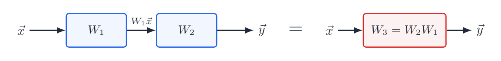
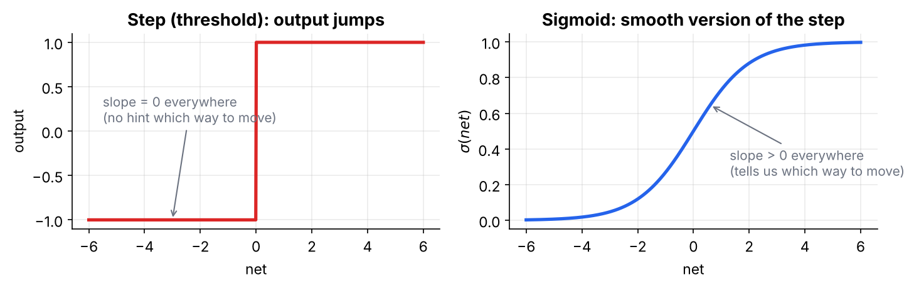
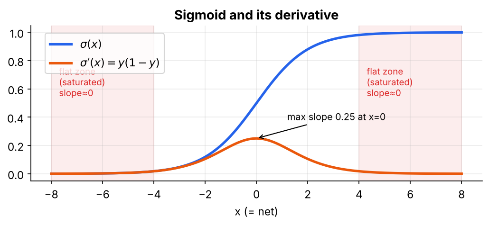
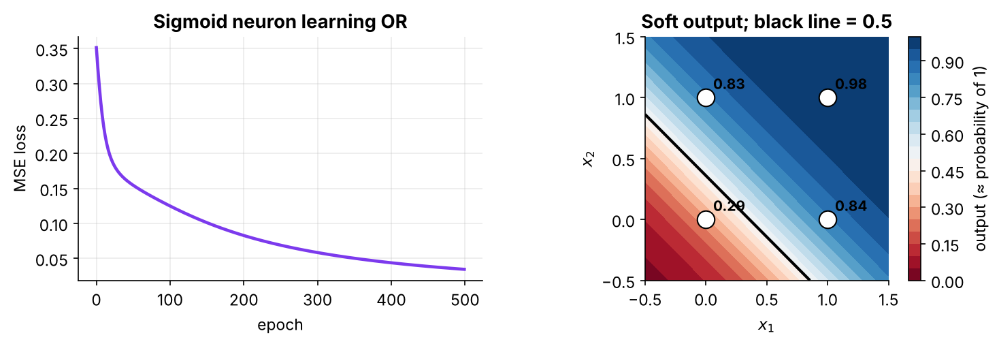
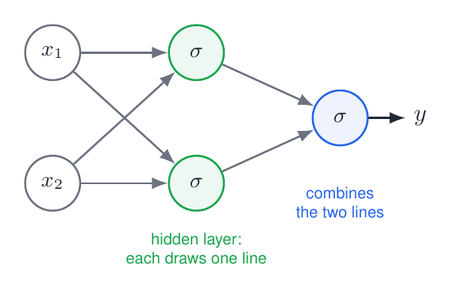
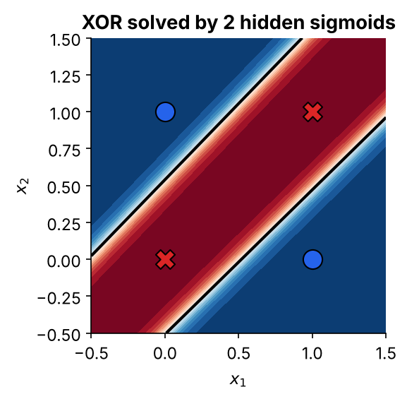

# 03 · Sigmoid Unit and Non-linearity

**Topic:** Perceptron and Gradient Descent · **Code:** `03_sigmoid_unit_non_linearity.py` / `.ipynb`

> 📘 For the derivative worked out line by line, the OR-gate results and the XOR network, read **Section 4** of
> **[Deep Learning Internals - Perceptron to Sigmoid Simplified.pdf](../Deep%20Learning%20Internals%20-%20Perceptron%20to%20Sigmoid%20Simplified.pdf)**.

---

## 1. The problem: linear layers collapse



$$\vec y=W_2(W_1\vec x)=(W_2W_1)\vec x=W_3\vec x$$

With plain numbers: one layer multiplies by 2 and the next by 3, so together they multiply by 6. A single layer could do that. **Ten linear layers still draw one straight line.** The code proves it numerically:

```python
output_stacked   = np.dot(np.dot(X, W1), W2)   # X -> layer 1 -> layer 2
output_collapsed = np.dot(X, np.dot(W1, W2))   # one combined layer
np.allclose(output_stacked, output_collapsed)  # True
```

## 2. What we need

An activation that is (1) **non-linear**, so layers don't collapse, (2) **continuous and differentiable**, so gradient descent works, and (3) **step-like**, so it behaves like a neuron firing.



## 3. The sigmoid

$$\sigma(x)=\frac{1}{1+e^{-x}}$$

| $x$ | −5 | −2 | −1 | 0 | 1 | 2 | 5 |
|---|---|---|---|---|---|---|---|
| $\sigma(x)$ | 0.007 | 0.119 | 0.269 | **0.5** | 0.731 | 0.881 | 0.993 |

Read it as a "soft yes/no": very negative inputs give almost 0, very positive inputs give almost 1, and 0 gives exactly 0.5.

## 4. Its derivative: $y(1-y)$

With $y=\sigma(x)$:

$$\frac{dy}{dx}=\frac{e^{-x}}{(1+e^{-x})^2}=\underbrace{\frac{1}{1+e^{-x}}}_{y}\cdot\underbrace{\frac{e^{-x}}{1+e^{-x}}}_{1-y}=y(1-y)$$

We already know $y$ from the forward pass, so the slope costs one multiplication. At $x=0$: $0.5\times0.5=0.25$ (the maximum). At $x=5$: $\approx0.007$, which is almost flat.



> ⚠️ In the flat "saturated" zones the slope is ≈ 0. Repeated across many layers, this causes **vanishing gradients** (see module 02, folder 04).

## 5. Training one sigmoid neuron

The chain rule has three links:

$$\frac{\partial E}{\partial w_i}=\underbrace{-(t-o)}_{\text{how wrong}}\cdot\underbrace{o(1-o)}_{\text{how sensitive}}\cdot\underbrace{x_i}_{\text{how much this input contributed}}$$

Compared with the linear unit, only the middle factor is new. If you change the activation function, only that factor changes.

```python
def sigmoid(x):            return 1 / (1 + np.exp(-x))
def sigmoid_derivative(y): return y * (1 - y)               # uses the OUTPUT

net    = np.dot(X_bias, self.w)                             # forward: weighted sum
output = sigmoid(net)                                       # forward: squash
error  = y - output                                         # (t - o)
delta  = error * sigmoid_derivative(output)                 # (t - o) * o(1 - o)
gradient = -np.dot(X_bias.T, delta) / X.shape[0]            # times input, mean over examples
self.w  -= self.eta * gradient                              # step downhill
```

### Result on the OR gate (500 epochs, $\eta=0.5$)

| input | (0,0) | (0,1) | (1,0) | (1,1) |
|---|---|---|---|---|
| target | 0 | 1 | 1 | 1 |
| output | 0.287 | 0.835 | 0.837 | 0.985 |

Final $\vec w\approx(-0.91,\,2.54,\,2.53)$. Check $(0,1)$: $\sigma(-0.91+2.53)=\sigma(1.62)=0.835$ ✅. The loss fell from 0.351 to 0.034.



## 6. A single sigmoid still can't do XOR

The border $\sigma(net)=0.5$ means $net=0$, which is still a straight line. The sigmoid's power appears only in **layers**. Two hidden sigmoids each draw one line, and the output neuron combines them:

| network | learned boundary |
|---|---|
|  |  |

Trained outputs: $(0,0)\to0.01,\;(0,1)\to0.99,\;(1,0)\to0.99,\;(1,1)\to0.01$. Training the hidden weights is the job of **backpropagation**, covered in the next module.

| Keyword | Meaning |
|---|---|
| `1 / (1 + np.exp(-x))` | sigmoid, applied element-wise |
| `y * (1 - y)` | sigmoid derivative computed from the output |
| `np.allclose` | checks the stacked and collapsed outputs are equal |

## To implement
- [x] Sigmoid and its derivative $y(1-y)$
- [x] Demonstrate that stacked linear layers equal a single layer
- [x] Train a single sigmoid neuron

**Previous:** [02 - Unthresholded Perceptron and Delta Rule](../02%20-%20Unthresholded%20Perceptron%20and%20Delta%20Rule/) · **Next module:** [02 - Feed-Forward Networks and Backpropagation](../../02%20-%20Feed-Forward%20Networks%20and%20Backpropagation/)
