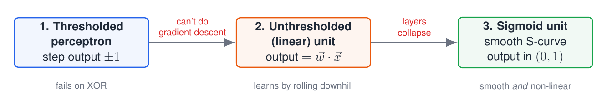
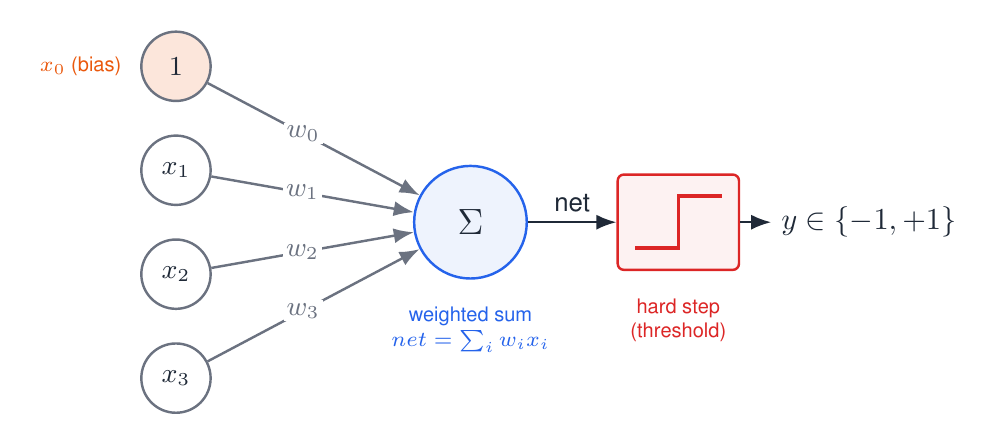
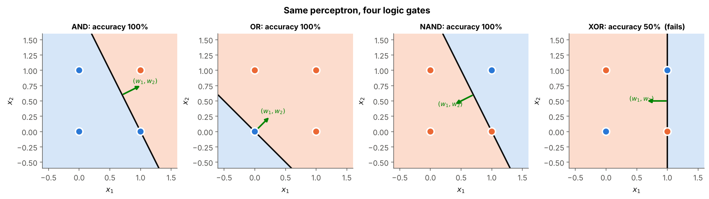
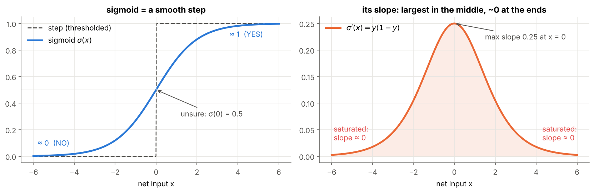
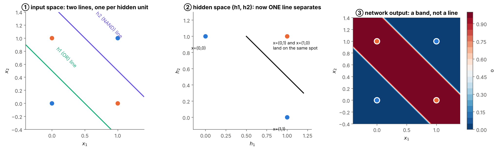

# 01 · Perceptron and Gradient Descent

**From a single artificial neuron to gradient-based learning.**

This module builds one neuron, shows exactly where it breaks, and fixes it twice. Each fix is a small change to the maths and a small change to the code. By the end you will know *why* modern networks use smooth activation functions such as the sigmoid, and you will be ready for backpropagation in module 02.

> 📘 **Full guide:** [Deep Learning Internals - Perceptron to Sigmoid Simplified.pdf](Deep%20Learning%20Internals%20-%20Perceptron%20to%20Sigmoid%20Simplified.pdf) (13 pages: intuition, maths, worked examples, code walk-throughs, self-check questions).
> 📝 **Course notes:** pages 2–3 of the handwritten notes (brain facts, perceptron, unthresholded perceptron, cost function, gradient, sigmoid).
> 📗 **Book:** Tom Mitchell, *Machine Learning*, Chapter 4 (Artificial Neural Networks).



---

## 🧭 The story in three steps

| Step | Problem it solves | Problem it leaves | Folder |
|---|---|---|---|
| **1. Thresholded perceptron** | learns any rule that one straight line can express | can't do XOR; the step has no slope, so it can't be trained inside a network | [01](01%20-%20Thresholded%20Perceptron/) |
| **2. Linear unit + delta rule** | removes the step → a smooth error we can roll down (gradient descent) | stacked linear units collapse into one, so still one line | [02](02%20-%20Unthresholded%20Perceptron%20and%20Delta%20Rule/) |
| **3. Sigmoid unit** | smooth *and* non-linear → layers stay useful *and* trainable | how to train the hidden layers? → **backpropagation** (module 02) | [03](03%20-%20Sigmoid%20Unit%20and%20Non-linearity/) |

---

## Why copy the brain?

| Fact (from the notes) | Number | What it tells us |
|---|---|---|
| Neurons | $\approx 10^{11}$ | a huge number of **very simple** units |
| Connections per neuron | $\approx 10^{4}$ | each unit listens to many others |
| Switching time of a neuron | $\approx 10^{-3}$ s | each unit is **slow**... |
| Time to recognise a face | $\approx 10^{-1}$ s | ...so only ~100 steps can happen one after another |

With only about 100 slow steps, the brain can't be running a long sequential program. It must do **lots of simple work in parallel**, with knowledge spread across connection strengths (*distributed representation*) that were **learned** rather than coded. Artificial neural networks copy this idea: many simple units plus learnable weights.

---

## Notation used in this module

Read this table once; every formula below uses only these symbols.

| Symbol | Meaning |
|---|---|
| $x_1,\dots,x_n$ | the inputs (features) of one example |
| $x_0=1$ | the **bias input**, always 1, so the decision line can move away from the origin |
| $w_0,\dots,w_n$ | the **weights**: how strongly each input pushes towards YES (+) or NO (−) |
| $net=\sum_{i=0}^n w_ix_i=\vec w\cdot\vec x$ | the **net input** (weighted sum) |
| $o$ | the unit's **output** (the notes also write $y$) |
| $t$ | the **target**, the correct answer from the dataset |
| $D$, $d$ | the training set, and one example in it ($t_d,o_d,x_{i,d}$ belong to example $d$) |
| $\eta$ | the **learning rate** (step size) |
| $E(\vec w)$ | the **cost**: total error as a function of the weights |
| $\nabla E$ | the **gradient**: vector of slopes $\partial E/\partial w_i$ |
| $\sigma(x)$ | the **sigmoid** $1/(1+e^{-x})$ |

---

## 1 · Thresholded perceptron → [folder](01%20-%20Thresholded%20Perceptron/)



$$net=\sum_{i=0}^{n} w_i x_i ,\qquad o=\begin{cases}+1 & net>0\\ -1 & \text{otherwise}\end{cases},\qquad \Delta w_i=\eta\,(t-o)\,x_i$$

The perceptron draws **one straight line** (a hyperplane) and says YES on one side. The rule only changes weights after a mistake, and only for inputs that were switched on. It learns AND, OR and NAND, but **can never learn XOR**: the four XOR conditions add up to a contradiction.



## 2 · Unthresholded perceptron and the delta rule → [folder](02%20-%20Unthresholded%20Perceptron%20and%20Delta%20Rule/)

Remove the step: $o=\vec w\cdot\vec x$. Now we can measure *how wrong* we are and roll downhill on a smooth error bowl:

$$E(\vec w)=\tfrac12\sum_{d\in D}(t_d-o_d)^2,\qquad \frac{\partial E}{\partial w_i}=-\sum_d(t_d-o_d)\,x_{i,d},\qquad \Delta w_i=\eta\sum_d (t_d-o_d)\,x_{i,d}$$

Worked on the notes' own data ($x=1,2,3\to y=2,6,10$), gradient descent finds $o=-2+4x$:


## 3 · Sigmoid unit and non-linearity → [folder](03%20-%20Sigmoid%20Unit%20and%20Non-linearity/)

Stacked linear layers **collapse into one** ($W_2W_1\vec x=W_3\vec x$). The sigmoid is a smooth, differentiable version of the step that prevents this collapse:

$$\sigma(x)=\frac{1}{1+e^{-x}},\qquad \sigma'(x)=y\,(1-y),\qquad \Delta w_i=\eta\sum_d\underbrace{(t_d-o_d)\,o_d(1-o_d)}_{\delta_d}\,x_{i,d}$$



With one hidden layer of sigmoids, XOR becomes easy: the hidden layer re-maps the points so that one line separates them.



---

## Side-by-side summary

| | Thresholded perceptron | Linear unit (Delta rule) | Sigmoid unit |
|---|---|---|---|
| Output | $\text{step}(\vec w\cdot\vec x)\in\{-1,+1\}$ | $\vec w\cdot\vec x$ | $\sigma(\vec w\cdot\vec x)\in(0,1)$ |
| Error measured as | right / wrong | $\tfrac12\sum(t-o)^2$ | $\tfrac12\sum(t-o)^2$ |
| Update $\Delta w_i$ | $\eta(t-o)x_i$ | $\eta\sum_d(t_d-o_d)x_{i,d}$ | $\eta\sum_d(t_d-o_d)\,o_d(1-o_d)\,x_{i,d}$ |
| Differentiable? | ❌ | ✅ | ✅ |
| Useful when stacked? | can't be trained | ❌ collapses | ✅ non-linear |
| Converges on non-separable data? | ❌ cycles forever | ✅ (least-squares fit) | ✅ |
| XOR with one unit? | ❌ | ❌ | ❌ (needs a hidden layer) |

> ⚠️ **A common misconception:** a *single* sigmoid neuron still draws a straight boundary and **can't** solve XOR. You need at least one hidden layer, which is exactly what module 02 trains with backpropagation.

---

## What each notebook shows

| Notebook | Highlights | Key figures |
|---|---|---|
| [`01_thresholded_perceptron.ipynb`](01%20-%20Thresholded%20Perceptron/01_thresholded_perceptron.ipynb) | cricket example, line geometry, full AND trace, XOR proof and cycling weights, convergence theorem | `c1_perceptron_geometry`, `c1_and_epochs`, `c1_xor_failure` |
| [`02_unthresholded_delta_rule.ipynb`](02%20-%20Unthresholded%20Perceptron%20and%20Delta%20Rule/02_unthresholded_delta_rule.ipynb) | 3-D error bowl, derivation + numerical check, steps by hand, batch vs stochastic paths, learning-rate sweep | `c1_error_bowl`, `c1_gd_paths`, `c1_learning_rates`, `c1_batch_vs_sgd` |
| [`03_sigmoid_unit_non_linearity.ipynb`](03%20-%20Sigmoid%20Unit%20and%20Non-linearity/03_sigmoid_unit_non_linearity.ipynb) | collapse proof, sigmoid + derivative, OR surface, XOR with a hidden layer, vanishing-gradient preview | `c1_linear_vs_sigmoid_net`, `c1_sigmoid_or`, `c1_xor_hidden_layer` |

Every notebook has: a variable table before any formula, step-by-step derivations, fully commented code, plots for every idea, a summary table and exercises. Outputs are pre-rendered, so the notebooks read well on GitHub without running them.

---

## Folder structure

```
01 - Perceptron and Gradient Descent/
├── README.md                                                    ← you are here
├── Deep Learning Internals - Perceptron to Sigmoid Simplified.pdf   ← full guide
├── figures/                                                     ← all images used in the READMEs
├── 01 - Thresholded Perceptron/                   README + .py + .ipynb
├── 02 - Unthresholded Perceptron and Delta Rule/  README + .py + .ipynb
└── 03 - Sigmoid Unit and Non-linearity/           README + .py + .ipynb
```

## Quick start

```bash
pip install numpy matplotlib jupyter
jupyter notebook          # open any of the three notebooks
python "01 - Thresholded Perceptron/01_thresholded_perceptron.py"   # or run a plain script
```

Everything uses only NumPy and Matplotlib and runs in seconds on a laptop.

## Topics
- [x] 01 - Thresholded Perceptron
- [x] 02 - Unthresholded Perceptron and Delta Rule
- [x] 03 - Sigmoid Unit and Non-linearity

**Next module:** [02 - Feed-Forward Networks and Backpropagation](../02%20-%20Feed-Forward%20Networks%20and%20Backpropagation/)
