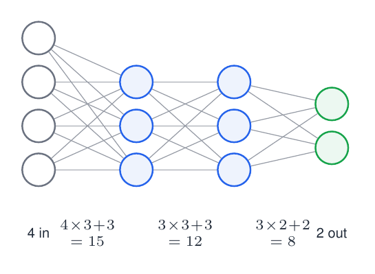

# 01 · Architecture and Parameter Counting

How big is a feed-forward network? This notebook teaches you to read a layer-size list like `[784, 128, 64, 10]` and work out its **parameters, memory, FLOPs and stored activations**, both in your head and in code.

> 📘 For more explanation and figures, read **Section 1** of **[FFNN_Backpropagation_Guide Simplified.pdf](../FFNN_Backpropagation_Guide%20Simplified.pdf)**.

---

## 1. The one formula you need

A **fully-connected** (dense) layer connects every neuron of the previous layer to every neuron of this one. Each connection (arrow) is one weight, and each neuron also owns one bias:

$$\#\text{params}_l=\underbrace{n_{l-1}\times n_l}_{\text{weights}}+\underbrace{n_l}_{\text{biases}}\qquad\qquad \#\text{params}=\sum_{l=1}^{L}\big(n_{l-1}n_l+n_l\big)$$

## 2. Small example (from the handwritten notes): 4 – 3 – 3 – 2



| Layer | Weights (arrows) | Biases | Total |
|---|---|---|---|
| 4 → 3 | 12 | 3 | 15 |
| 3 → 3 | 9 | 3 | 12 |
| 3 → 2 | 6 | 2 | 8 |
| **Sum** | 27 | 8 | **35** |

## 3. Realistic example: an MNIST classifier `[784, 128, 64, 10]`

| Layer | W shape | Weights | Biases | Total | Share |
|---|---|---|---|---|---|
| 1 | 784 × 128 | 100,352 | 128 | 100,480 | 91.9% |
| 2 | 128 × 64 | 8,192 | 64 | 8,256 | 7.5% |
| 3 | 64 × 10 | 640 | 10 | 650 | 0.6% |
| **Sum** | | 109,184 | 202 | **109,386** | 100% |


**Intuition:** with a large input (784 pixels), the **first layer dominates**.

## 4. What the count tells you

- **Memory:** 4 bytes per fp32 parameter, so $109{,}386\times4\approx0.44$ MB.
- **Compute:** one multiply and one add per weight, so a forward pass costs about $2\times\#\text{weights}$ FLOPs per sample.
- **Stored activations** (needed later by backprop): about $\sum_l n_l$ numbers per sample.
- **Width vs depth:** `784-512-10` has 407,050 params, while `784-128×4-10` has only 151,306. Depth is cheap when the input layer is the bottleneck.

## 5. Code

```python
def count_params(sizes):                          # sizes = [n0, n1, ..., nL]
    rows, total = [], 0
    for l, (n_in, n_out) in enumerate(zip(sizes[:-1], sizes[1:]), start=1):
        w, b = n_in * n_out, n_out                 # weights + biases
        rows.append(dict(layer=l, shape=(n_in, n_out), weights=w, biases=b, total=w + b))
        total += w + b
    return rows, total
```

`zip(sizes[:-1], sizes[1:])` pairs each layer with the next: (784,128), (128,64), (64,10). The notebook then allocates the real arrays and checks that `W.size + b.size` gives the same total.

## Contents

| File | Description |
|---|---|
| `01_architecture_and_parameter_counting.ipynb` | parameter counter, check against real arrays, per-layer plots, width-vs-depth study, FLOPs, budget solver |

## Run

```bash
pip install numpy matplotlib jupyter
jupyter notebook 01_architecture_and_parameter_counting.ipynb
```

## Exercises
1. Count `[3072, 512, 256, 100]` by hand, then verify. *(Hint: the first layer alone is 1,573,376.)*
2. How many parameters do you save by removing all biases? Is it a big change?
3. How many extra parameters does batch-norm add ($\gamma,\beta$ per feature in each hidden layer)?
4. Find the hidden width $H$ for a `[784, H, H, 10]` network with a 1 M-parameter budget.

**Next:** [02 - Matrix-Form Forward Pass](../02%20-%20Matrix-Form%20Forward%20Pass/)
