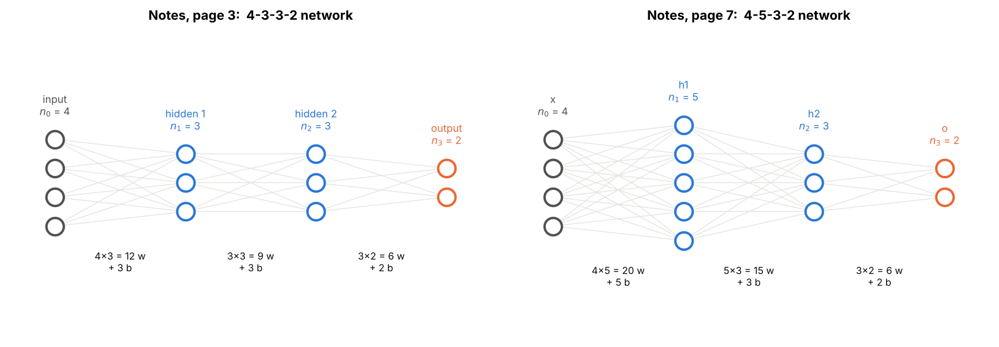

# 01 · Architecture and Parameter Counting

> **Module:** [02 - Feed-Forward Networks and Backpropagation](../) · **Notebook:** [`01_architecture_and_parameter_counting.ipynb`](01_architecture_and_parameter_counting.ipynb)
> **Course notes:** the 4-3-3-2 network, "35 params" (page 3) and the 4-5-3-2 network, "51 F.P." (page 7) · **Further reading:** Section 1 of [FFNN_Backpropagation_Guide Simplified.pdf](../FFNN_Backpropagation_Guide%20Simplified.pdf)

---

## 📌 The core idea in one sentence

In a fully connected layer **every neuron has one weight per incoming wire plus one bias**, so a layer with $n_{l-1}$ inputs and $n_l$ neurons has $n_l(n_{l-1}+1)$ parameters, and the whole network's size, memory and compute follow directly from its list of layer sizes.

---

## 1. The variables you need first

| Symbol | Meaning | Example (4-5-3-2) |
|---|---|---|
| $L$ | number of layers that have weights (hidden + output) | $3$ |
| $n_l$ | neurons in layer $l$; $n_0$ = number of inputs | $n_0=4,\ n_1=5,\ n_2=3,\ n_3=2$ |
| $w_{ji}$ | weight on the wire **from** neuron $i$ **to** neuron $j$ | – |
| $W^{[l]}$ | all weights of layer $l$, shape $n_l\times n_{l-1}$; **row $j$** = neuron $j$'s incoming weights | $W^{h1}$ is $5\times4$ |
| $b^{[l]}$ | biases of layer $l$, shape $n_l\times1$ | $b^{h1}$ is $5\times1$ |

These match the notes, which write $W^{h1}_{5\times4},\ W^{h2}_{3\times5},\ W^{o}_{2\times3}$.

---

## 2. What "feed-forward" and "fully connected" mean

- **Layers:** input → hidden layer(s) → output.
- **Feed-forward:** signals only flow forward. No loops (those come with RNNs).
- **Fully connected (dense):** every neuron of layer $l$ is wired to **every** neuron of layer $l-1$, each wire with its own weight.
- **Bias:** every non-input neuron also has a bias $b_j$ (the weight of a constant input 1).



---

## 3. The counting formula

$$\boxed{\text{params}_l=\underbrace{n_{l-1}\ n_l}_{\text{weights}}+\underbrace{n_l}_{\text{biases}}=n_l\ (n_{l-1}+1)}\qquad\qquad\text{params}=\sum_{l=1}^{L}n_l\ (n_{l-1}+1)$$

**Intuition:** each neuron owns $n_{l-1}+1$ numbers: one per incoming wire, plus its bias.

### Worked examples from the notes

| 4-3-3-2 (page 3) | weights | biases | total |
|---|---|---|---|
| 4 → 3 | 12 | 3 | 15 |
| 3 → 3 | 9 | 3 | 12 |
| 3 → 2 | 6 | 2 | 8 |
| **sum** | 27 | 8 | **35** |

| 4-5-3-2 (page 7) | weights | biases | total |
|---|---|---|---|
| 4 → 5 | 20 | 5 | 25 |
| 5 → 3 | 15 | 3 | 18 |
| 3 → 2 | 6 | 2 | 8 |
| **sum** | 41 | 10 | **51** |

The notebook prints the same tables and then **allocates the real arrays** to prove the formula:

```text
network [4, 3, 3, 2]
layer  W shape         weights  biases     total
1      (3, 4)               12       3        15
2      (3, 3)                9       3        12
3      (2, 3)                6       2         8
TOTAL                       27       8        35

network [4, 5, 3, 2]
layer  W shape         weights  biases     total
1      (5, 4)               20       5        25
2      (3, 5)               15       3        18
3      (2, 3)                6       2         8
TOTAL                       41      10        51
```

---

## 4. A realistic network: MNIST `[784, 128, 64, 10]`

```text
network [784, 128, 64, 10]
layer  W shape         weights  biases     total
1      (128, 784)      100,352     128   100,480
2      (64, 128)         8,192      64     8,256
3      (10, 64)            640      10       650
TOTAL                  109,184     202   109,386

layer 1 holds  91.9% of all parameters
layer 2 holds   7.5% of all parameters
layer 3 holds   0.6% of all parameters
```


**Intuition:** layer 1 joins 784 inputs to 128 neurons, so it needs about 100k weights; the later layers are small on both sides. With raw high-dimensional inputs the **first layer dominates**, which is one reason convolutional layers (weight sharing) were invented for images.

### Width vs depth

| Network | Params | float32 size |
|---|---|---|
| 784-32-10 | 25,450 | 0.10 MB |
| 784-128-64-10 | 109,386 | 0.44 MB |
| 784-128×4-10 (deep) | 151,306 | 0.61 MB |
| 784-256-32-256-10 | 220,202 | 0.88 MB |
| 784-512-10 (wide) | 407,050 | 1.63 MB |

The deep network has 4 hidden layers but fewer parameters than the wide one: after the first layer, a $128\to128$ layer costs only 16,512. **Depth is cheap; width on a big input is expensive.**

---

## 5. Compute and activations

For one example, neuron $j$ computes $net_j=\sum_i w_{ji}o_i+b_j$: $n_{l-1}$ multiply-adds. A whole layer needs $n_{l-1}n_l$ of them, the same as its weight count.

$$\text{FLOPs per example}\approx2\sum_l n_{l-1}n_l,\qquad\text{activations kept for backprop}=\sum_{l\ge1}n_l\ \text{per example}$$

For `[784,128,64,10]`: 218,368 FLOPs and 202 stored activations per example (×256 for a batch of 256). Notebook 06 turns these counts into GPU memory.

**Sizing to a budget:** a `[784, H, H, 10]` network fits in 100k parameters with $H=110$ and in 1M with $H=678$.

---

## 6. Code, step by step

| Step | Code | Maths |
|---|---|---|
| 1. Loop over layers $l=1..L$ | `for l in range(1, len(sizes))` | – |
| 2. Inputs and outputs of the layer | `n_in, n_out = sizes[l-1], sizes[l]` | $n_{l-1},\ n_l$ |
| 3. Weights | `w = n_out * n_in` | $n_ln_{l-1}$ entries of $W^{[l]}$ |
| 4. Biases | `b = n_out` | $n_l$ entries of $b^{[l]}$ |
| 5. Allocate to check | `rng.normal(0, 0.1, (sizes[l], sizes[l-1]))` | $W^{[l]}\in\mathbb R^{n_l\times n_{l-1}}$ |
| 6. Count entries | `W.size + b.size` | must equal the formula |

### Full code

<details>
<summary><b>Click to expand: parameter counter and initialiser</b></summary>

```python
import numpy as np

def count_params(sizes):
    """sizes = [n_0 (inputs), n_1, ..., n_L (outputs)]  ->  (list of per-layer dicts, total)."""
    rows, total = [], 0
    for l in range(1, len(sizes)):
        n_in, n_out = sizes[l - 1], sizes[l]
        w = n_out * n_in                  # W^[l] has shape (n_l, n_{l-1})
        b = n_out                         # b^[l] has shape (n_l, 1)
        rows.append(dict(layer=l, W_shape=(n_out, n_in), weights=w, biases=b, total=w + b))
        total += w + b
    return rows, total

def show(sizes):
    """Pretty-print the parameter table of a network."""
    rows, total = count_params(sizes)
    print(f"network {sizes}")
    print(f"{'layer':<7}{'W shape':<13}{'weights':>10}{'biases':>8}{'total':>10}")
    for r in rows:
        print(f"{r['layer']:<7}{str(r['W_shape']):<13}{r['weights']:>10,}{r['biases']:>8,}{r['total']:>10,}")
    print(f"{'TOTAL':<20}{sum(r['weights'] for r in rows):>10,}{sum(r['biases'] for r in rows):>8,}{total:>10,}\n")
    return rows, total

def init_params(sizes, rng):
    """Create W^[l] (n_l × n_{l-1}) and b^[l] (n_l × 1) for every layer, small random weights."""
    return [(rng.normal(0, 0.1, (sizes[l], sizes[l - 1])), np.zeros((sizes[l], 1)))
            for l in range(1, len(sizes))]


rows, total = show([4, 5, 3, 2])     # 51, as in the notes
params = init_params([4, 5, 3, 2], np.random.default_rng(0))
assert sum(W.size + b.size for W, b in params) == total
```
</details>

---

## 7. What is in the notebook

| Section | Content |
|---|---|
| 2 | `draw_network` diagrams of both networks from the notes |
| 3 | formula, hand counts, `count_params` / `show`, array-allocation check |
| 4 | MNIST table, per-layer share bar chart |
| 5 | width vs depth comparison |
| 6 | FLOPs and activation counts for several batch sizes |
| 7 | largest hidden width for a parameter budget, with plot |

```bash
jupyter notebook 01_architecture_and_parameter_counting.ipynb
```

## ✍️ Exercises
1. Count `[3072, 512, 256, 100]` by hand, then check with `show`.
2. Remove all biases. What fraction of the MNIST network disappears? *(202 of 109,386: 0.18%.)*
3. The word2vec model in the notes has $V_{d\times n}$ and $U_{n\times d}$ and no biases. Show it has $2dn$ parameters; evaluate for $d=300,\ n=10^5$.
4. Add batch norm (2 parameters per hidden neuron) to `[784,128,64,10]`. How many extra parameters?

**Next:** [02 - Matrix-Form Forward Pass](../02%20-%20Matrix-Form%20Forward%20Pass/)
