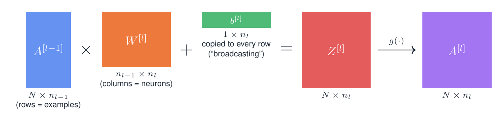
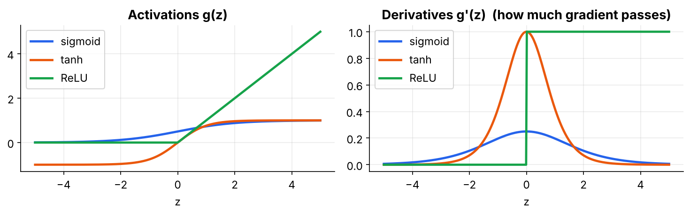
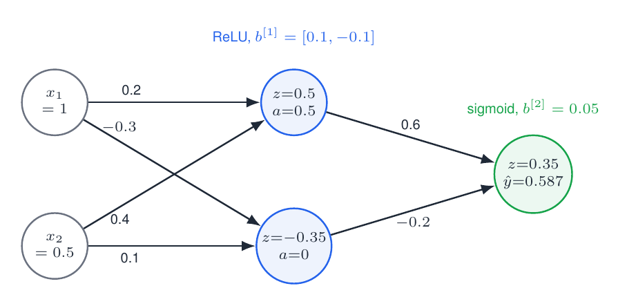

# 02 · Matrix-Form Forward Pass

Turn "a neuron computes a weighted sum" into **one matrix expression** that handles a whole batch at once.

> 📘 For more explanation, the softmax derivation and a hand-checked example, read **Section 2** of **[FFNN_Backpropagation_Guide Simplified.pdf](../FFNN_Backpropagation_Guide%20Simplified.pdf)**.

---

## 1. One neuron = one dot product

$$z=\vec w\cdot\vec x+b,\qquad a=g(z)$$

Example from the notebook: $\vec x=[1,0.5,-1]$, $\vec w=[0.2,-0.4,0.1]$, $b=0.3$ gives $z=0.2-0.2-0.1+0.3=\mathbf{0.2}$. The Python loop and `x @ w + b` agree.

## 2. A whole layer and a whole batch = one matrix multiply

Put each neuron's weights in a **column** of $W$ and each example in a **row** of $A$. Entry $(n,j)$ of $AW$ is then "example $n$ dotted with neuron $j$", which is that neuron's $z$ for that example.



$$Z^{[l]}=A^{[l-1]}W^{[l]}+b^{[l]},\qquad A^{[l]}=g\big(Z^{[l]}\big),\qquad A^{[0]}=X$$

**Shape rule:** the inner sizes must match ($n_{l-1}$), and the outer sizes give the result ($N\times n_l$). $N$ never appears in $W$ or $b$, because the same weights are reused for every example.

**Why bother?** Three nested Python loops (examples × neurons × inputs) become one optimised call. In the notebook, a 32×256 by 256×64 layer took ~201 ms with loops and ~0.145 ms as a matrix product, **over 1000× faster**, and the same code runs on GPUs.

## 3. Activations

Without $g$, layers collapse into one (see module 01). Common choices:



| | $g(z)$ | $g'(z)$ | Notes |
|---|---|---|---|
| Sigmoid | $1/(1+e^{-z})$ | $a(1-a)\le0.25$ | output in (0,1); gradients shrink |
| tanh | $\tanh z$ | $1-a^2$ | zero-centred |
| ReLU | $\max(0,z)$ | 1 if $z>0$ else 0 | cheap; keeps gradients alive; can "die" |

## 4. Softmax: logits → probabilities

$$p_k=\frac{e^{z_k}}{\sum_j e^{z_j}}$$

- **Example:** $z=[2,1,0.1]\Rightarrow e^z=[7.389,2.718,1.105]$, sum $=11.212$, so $p=[0.659,0.242,0.099]$.
- **Stability trick:** with $z=[1000,1001,1002]$, `exp` overflows and the result is `NaN`. Subtracting the row maximum doesn't change the answer, because it cancels top and bottom. The stable result is $[0.090,0.245,0.665]$.

## 5. A forward pass you can check by hand (2–2–1)



$$z^{[1]}=[1(0.2)+0.5(0.4)+0.1,\;1(-0.3)+0.5(0.1)-0.1]=[0.5,\,-0.35]\Rightarrow a^{[1]}=[0.5,\,0]$$
$$z^{[2]}=0.5(0.6)+0(-0.2)+0.05=0.35\Rightarrow\hat y=\sigma(0.35)=0.5866$$

The same network is used for a full backprop step in [folder 04](../04%20-%20Backprop%20for%20Hidden%20Layers/).

## 6. Code: the forward pass with a cache

```python
def softmax(z):
    z = z - z.max(axis=1, keepdims=True)       # stability trick
    e = np.exp(z)
    return e / e.sum(axis=1, keepdims=True)    # each row sums to 1

def forward(X, params):
    A, L = X, len(params)
    cache = [(None, X)]                        # cache[l] = (Z[l], A[l])
    for l, (W, b) in enumerate(params, start=1):
        Z = A @ W + b                          # (N, n_in) @ (n_in, n_out) + (n_out,)
        A = softmax(Z) if l == L else relu(Z)
        cache.append((Z, A))                   # backprop needs these later
    return A, cache
```

## Contents

| File | Description |
|---|---|
| `02_matrix_form_forward_pass.ipynb` | neuron as dot product, activations + derivatives, loop-vs-matrix timing, full forward pass with cache and shape trace, softmax stability, hand-checkable 2-2-1 example |

## Run

```bash
jupyter notebook 02_matrix_form_forward_pass.ipynb
```

## Exercises
1. Redo the 2-2-1 example with `tanh` by hand and in code.
2. Which dimension of every tensor depends on the batch size? Which never does?
3. Time `dense_loops` with only the outer sample loop replaced by `X[n] @ W + b`.

**Previous:** [01](../01%20-%20Architecture%20and%20Parameter%20Counting/) · **Next:** [03 - Backprop for the Output Layer](../03%20-%20Backprop%20for%20the%20Output%20Layer/)
