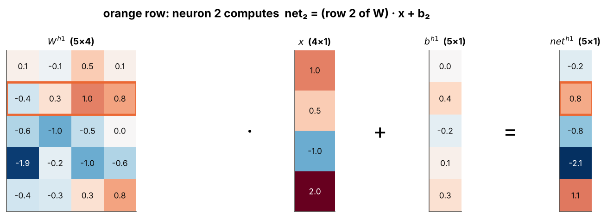
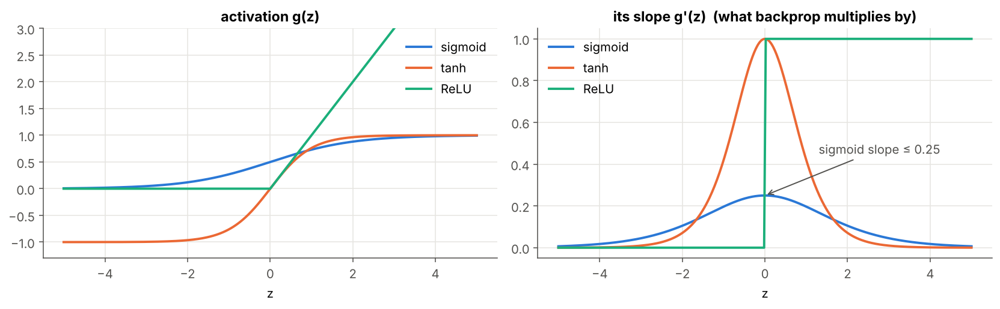
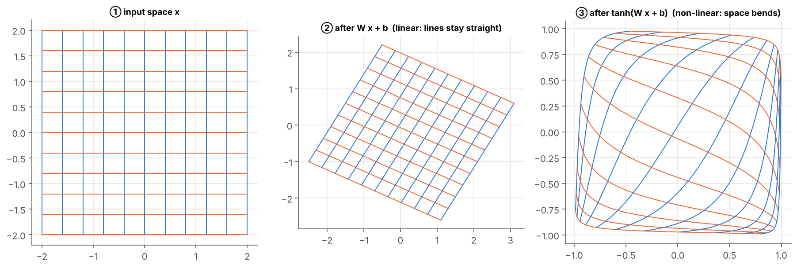

# 02 · Matrix-Form Forward Pass

> **Module:** [02 - Feed-Forward Networks and Backpropagation](../) · **Notebook:** [`02_matrix_form_forward_pass.ipynb`](02_matrix_form_forward_pass.ipynb)
> **Course notes:** page 8, $o^{h1}=\sigma(W^{h1}x+b^{h1}),\;o^{h2}=\sigma(W^{h2}o^{h1}+b^{h2}),\;o^{o}=\sigma(W^{o}o^{h2}+b^{o})$ · **Further reading:** Section 2 of [FFNN_Backpropagation_Guide Simplified.pdf](../FFNN_Backpropagation_Guide%20Simplified.pdf)

---

## 📌 The core idea in one sentence

A neuron is a dot product; a **layer** is a matrix-vector product $net^{[l]}=W^{[l]}o^{[l-1]}+b^{[l]}$ followed by an activation; a **batch** is a matrix-matrix product. Chaining these from input to output is the **forward pass**, and we keep every intermediate result because backpropagation will need it.

---

## 1. The variables you need first

| Symbol | Shape | Meaning |
|---|---|---|
| $n_l$ | – | number of neurons in layer $l$ ($n_0$ = inputs) |
| $o^{[l-1]}$ | $n_{l-1}\times1$ | outputs of the previous layer ($o^{[0]}=x$) |
| $w_{ji}$ | – | weight from neuron $i$ to neuron $j$ |
| $W^{[l]}$ | $n_l\times n_{l-1}$ | weights of layer $l$; row $j$ = neuron $j$'s incoming weights |
| $b^{[l]}$ | $n_l\times1$ | biases of layer $l$ |
| $net^{[l]}$ | $n_l\times1$ | net inputs of layer $l$ |
| $g$ | – | activation function (sigmoid in the notes) |
| $o^{[l]}=g(net^{[l]})$ | $n_l\times1$ | outputs of layer $l$ |
| $N$ | – | batch size; $X$ and $O^{[l]}$ have **one example per column** |
| $z_k,\;p_k,\;K$ | – | output score, softmax probability, number of classes |

---

## 2. One neuron = one dot product

$$net_j=\sum_{i=1}^{n_{l-1}}w_{ji}\,o_i+b_j,\qquad o_j=g(net_j)$$

`w_j @ o_prev + b_j` gives the same number as the explicit loop.

## 3. One layer = one matrix-vector product

Stack the weight rows of all neurons into $W^{[l]}$:

$$\boxed{net^{[l]}=W^{[l]}\,o^{[l-1]}+b^{[l]},\qquad o^{[l]}=g\big(net^{[l]}\big)}$$

**Shape rule:** $(n_l\times n_{l-1})(n_{l-1}\times1)=(n_l\times1)$. Inner sizes must match; outer sizes give the result.



*Row 2 of $W^{h1}$ dotted with $x$, plus $b_2$, gives $net_2$.*

### Shapes through the notes' 4-5-3-2 network

| Layer | Computation | Shapes |
|---|---|---|
| h1 | $o^{h1}=\sigma(W^{h1}x+b^{h1})$ | $(5\times4)(4\times1)+(5\times1)\to5\times1$ |
| h2 | $o^{h2}=\sigma(W^{h2}o^{h1}+b^{h2})$ | $(3\times5)(5\times1)+(3\times1)\to3\times1$ |
| o | $o^{o}=\sigma(W^{o}o^{h2}+b^{o})$ | $(2\times3)(3\times1)+(2\times1)\to2\times1$ |

The output size of each layer is the input size of the next.

---

## 4. Activation functions

| Name | $g(z)$ | $g'(z)$ | Range |
|---|---|---|---|
| sigmoid (notes) | $1/(1+e^{-z})$ | $g(1-g)$, at most 0.25 | $(0,1)$ |
| tanh | $(e^z-e^{-z})/(e^z+e^{-z})$ | $1-g^2$, at most 1 | $(-1,1)$ |
| ReLU | $\max(0,z)$ | 1 if $z>0$, else 0 | $[0,\infty)$ |



The slope $g'$ is what backpropagation multiplies by, so a small slope means a weak learning signal.

---

## 5. A whole batch at once

Put $N$ examples side by side as columns, $X\in\mathbb R^{n_0\times N}$:

$$\boxed{NET^{[l]}=W^{[l]}O^{[l-1]}+b^{[l]}}\qquad(n_l\times n_{l-1})(n_{l-1}\times N)=(n_l\times N)$$

Column $n$ is exactly the single-example result for example $n$. The bias is **broadcast** to every column. $N$ never appears in $W$ or $b$: the same weights serve every example.

**Why bother?** Three nested Python loops (examples × neurons × inputs) become one call to optimised BLAS code. Measured in the notebook:

```text
W 32×64, batch  16:  loops      5.04 ms | matrix  0.0033 ms | ≈ 1,540× faster
W 64×256, batch  32:  loops     82.16 ms | matrix  0.0183 ms | ≈ 4,487× faster
W 128×512, batch  64:  loops   1120.20 ms | matrix  0.1703 ms | ≈ 6,578× faster
```

(Exact times depend on your machine; the speed-up is always in the thousands.)

---

## 6. Softmax: scores → probabilities

For $K$ classes, with output scores $z_1,\dots,z_K$:

$$p_k=\frac{e^{z_k}}{\sum_{m=1}^{K}e^{z_m}}$$

$e^{z}$ makes every score positive, the division makes them sum to 1, and a bigger score always gets a bigger probability. **Example:** $z=(2,1,0.1,-1)\to p=(0.64,0.23,0.10,0.03)$.

**Stability trick:** $e^{1000}$ overflows to `inf`, giving `nan`. Softmax is unchanged when the same constant is subtracted from every $z_k$, so subtract the maximum first.

---

## 7. Full forward pass with a cache

```text
Notes' network 4-5-3-2, one example:
layer 1: W(5, 4) @ o(4, 1) + b(5, 1) → net(5, 1) --sigmoid--> o(5, 1)
layer 2: W(3, 5) @ o(5, 1) + b(3, 1) → net(3, 1) --sigmoid--> o(3, 1)
layer 3: W(2, 3) @ o(3, 1) + b(2, 1) → net(2, 1) --sigmoid--> o(2, 1)
output o^o = [0.2772 0.5892]

MNIST-style network 784-128-64-10, batch of 32, sigmoid hidden + softmax output:
layer 1: W(128, 784) @ o(784, 32) + b(128, 1) → net(128, 32) --sigmoid--> o(128, 32)
layer 2: W(64, 128) @ o(128, 32) + b(64, 1) → net(64, 32) --sigmoid--> o(64, 32)
layer 3: W(10, 64) @ o(64, 32) + b(10, 1) → net(10, 32) --softmax--> o(10, 32)
every column sums to 1: True | cache holds 4 entries (layers 0..3)
```

The `cache` stores every $(net^{[l]},o^{[l]})$. Backprop needs $o^{[l-1]}$ (for weight gradients) and $net^{[l]}$ or $o^{[l]}$ (for $g'$).

---

## 8. Worked 2-2-1 example (pen and paper)

$x=\begin{bmatrix}1\\0.5\end{bmatrix}$, $W^{[1]}=\begin{bmatrix}0.2&0.4\\-0.3&0.1\end{bmatrix}$, $b^{[1]}=\begin{bmatrix}0.1\\-0.1\end{bmatrix}$, $W^{[2]}=\begin{bmatrix}0.6&-0.2\end{bmatrix}$, $b^{[2]}=0.05$, sigmoid everywhere.

| Step | Computation | Value |
|---|---|---|
| $net^{[1]}_1$ | $0.2\cdot1+0.4\cdot0.5+0.1$ | $0.5$ |
| $net^{[1]}_2$ | $-0.3\cdot1+0.1\cdot0.5-0.1$ | $-0.35$ |
| $o^{[1]}$ | $\sigma(0.5),\;\sigma(-0.35)$ | $0.6225,\;0.4134$ |
| $net^{[2]}$ | $0.6\cdot0.6225-0.2\cdot0.4134+0.05$ | $0.3408$ |
| $o^{[2]}$ | $\sigma(0.3408)$ | $\mathbf{0.5844}$ |

```text
net1 = [ 0.5  -0.35]   o1 = [0.6225 0.4134]
net2 = [0.3408]   o2 = [0.5844]
forward() gives the same: [0.5844]
```

The same network is used for the backprop step in folder 04.

---

## 9. What a layer does geometrically



$W x+b$ rotates, stretches and shears the space (lines stay straight). The activation then **bends** it. Stacking layers lets the network fold the input until the classes can be split by a straight line at the end.

---

## 10. Code, step by step

| Step | Code | Maths |
|---|---|---|
| 1. Start from the input | `O = X; cache = [(None, X)]` | $o^{[0]}=X$ |
| 2. Net input of layer $l$ | `NET = W @ O + b` | $net^{[l]}=W^{[l]}o^{[l-1]}+b^{[l]}$ |
| 3. Activation | `O_new = g(NET)` | $o^{[l]}=g(net^{[l]})$ |
| 4. Remember for backprop | `cache.append((NET, O))` | store $net^{[l]},o^{[l]}$ |
| 5. Softmax (per column) | `E = np.exp(Z - Z.max(axis=0)); E / E.sum(axis=0)` | $p_k=e^{z_k}/\sum_me^{z_m}$ |
| 6. Initial weights | `rng.normal(0, 1/np.sqrt(n_in), (n_out, n_in))` | $w\sim\mathcal N(0,1/n_{l-1})$ keeps $net$ moderate |

### Full code

<details>
<summary><b>Click to expand: forward pass with cache</b></summary>

```python
import numpy as np

def sigmoid(z): return 1.0 / (1.0 + np.exp(-z))
def tanh(z):    return np.tanh(z)
def relu(z):    return np.maximum(0.0, z)

def softmax(Z):
    Z = Z - Z.max(axis=0, keepdims=True)
    E = np.exp(Z)
    return E / E.sum(axis=0, keepdims=True)

ACTIVATIONS = {"sigmoid": sigmoid, "tanh": tanh, "relu": relu, "softmax": softmax,
               "identity": lambda z: z}


def init_params(sizes, rng, scale=None):
    """W^[l]: (n_l × n_{l-1}) Gaussian, std = 1/sqrt(n_{l-1}) unless given; b^[l]: zeros (n_l × 1)."""
    return [(rng.normal(0, scale or 1 / np.sqrt(sizes[l - 1]), (sizes[l], sizes[l - 1])),
             np.zeros((sizes[l], 1))) for l in range(1, len(sizes))]


def forward(X, params, hidden="sigmoid", output="sigmoid", verbose=False):
    """X: (n_0 × N), one example per column. Returns final output and cache[l] = (net^[l], o^[l])."""
    O = X
    cache = [(None, X)]                                       # layer 0: no net, o^[0] = X
    L = len(params)
    for l, (W, b) in enumerate(params, start=1):
        NET = W @ O + b                                       # net^[l] = W^[l] o^[l-1] + b^[l]
        g = ACTIVATIONS[output if l == L else hidden]
        O_new = g(NET)                                        # o^[l] = g(net^[l])
        if verbose:
            print(f"layer {l}: W{W.shape} @ o{O.shape} + b{b.shape} → net{NET.shape} "
                  f"--{output if l == L else hidden}--> o{O_new.shape}")
        O = O_new
        cache.append((NET, O))
    return O, cache


rng = np.random.default_rng(0)
P, cache = forward(rng.normal(size=(784, 32)), init_params([784, 128, 64, 10], rng),
                   hidden="sigmoid", output="softmax", verbose=True)
```
</details>

---

## 11. What is in the notebook

| Section | Content |
|---|---|
| 2–3 | neuron as dot product; annotated heat-map of $W^{h1}x+b^{h1}$ |
| 4 | sigmoid / tanh / ReLU and their slopes |
| 5 | batch form, loop vs matrix check and timing chart |
| 6 | softmax, overflow demo, scores vs probabilities chart |
| 7 | commented `forward` with cache on the notes' network and on MNIST shapes |
| 8 | the 2-2-1 example by hand and in code |
| 9 | a grid pushed through a layer: linear part vs tanh |

```bash
jupyter notebook 02_matrix_form_forward_pass.ipynb
```

## ✍️ Exercises
1. Redo the 2-2-1 example with tanh hidden units.
2. Push 1000 examples through `forward`. Which dimensions change and which never do?
3. Replace the two inner loops of `dense_loops` with one `W @ O_prev[:, n] + b[:, 0]`. Where does most of the speed-up come from?
4. Show `softmax(z + 100) == softmax(z)`. Why does this justify the max-subtraction trick?

**Previous:** [01 - Architecture and Parameter Counting](../01%20-%20Architecture%20and%20Parameter%20Counting/) · **Next:** [03 - Backprop for the Output Layer](../03%20-%20Backprop%20for%20the%20Output%20Layer/)
