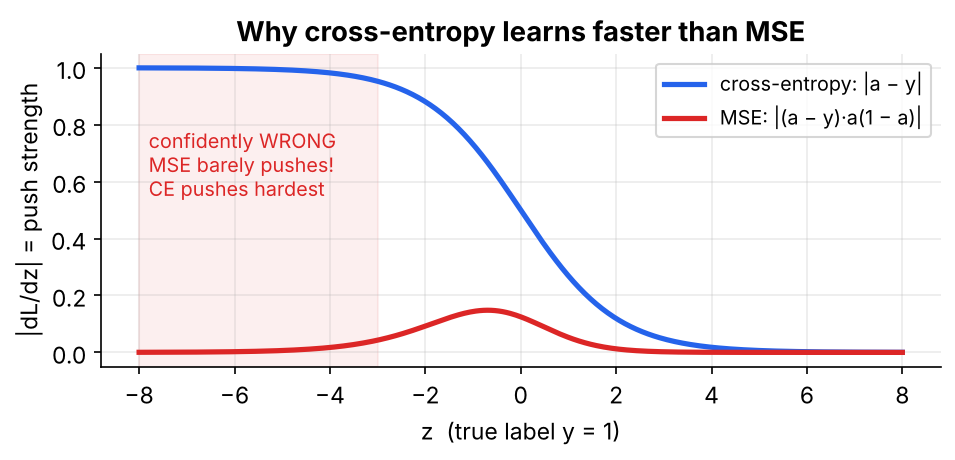

# 03 · Backprop for the Output Layer

Derive and implement the gradient of the loss with respect to the last layer, then **prove it is correct** with a numerical gradient check.

> 📘 For the chain-rule intuition and the softmax derivation step by step, read **Sections 3–4** of **[FFNN_Backpropagation_Guide Simplified.pdf](../FFNN_Backpropagation_Guide%20Simplified.pdf)**.

---

## 1. The question backprop answers

For **every** weight: *"If I nudge this weight up a little, does the loss go up or down, and by how much?"* That is $\partial L/\partial w$. The tool is the chain rule: if $L$ depends on $z$ and $z$ depends on $w$, then

$$\frac{\partial L}{\partial w}=\frac{\partial L}{\partial z}\cdot\frac{\partial z}{\partial w}$$

Everyday version: petrol costs Rs. 8 per km and you drive 60 km per hour, so it costs $8\times60=$ Rs. 480 per hour. Rates multiply along a chain.

## 2. The error signal $\delta$

$$\delta=\frac{\partial L}{\partial Z}\quad\text{(the "blame" at each output neuron)}$$

For a single weight $w_{ij}$ (input $i$ → neuron $j$), since $z_j=\sum_i a_iw_{ij}+b_j$:

$$\frac{\partial L}{\partial w_{ij}}=\delta_j\cdot a_i$$

**Gradient of a weight = (what came in on that wire) × (blame at the neuron it feeds).**

## 3. All weights, all examples: let the shapes guide you

| We want | Must have the shape of | Only way to build it | Code |
|---|---|---|---|
| $dW$ | $W$: $(n_{in},n_{out})$ | $A_{prev}^{\top}\,\delta$ | `A_prev.T @ delta` |
| $db$ | $b$: $(n_{out},)$ | sum $\delta$ over rows | `delta.sum(axis=0)` |
| $dA_{prev}$ | $A_{prev}$: $(N,n_{in})$ | $\delta\,W^{\top}$ | `delta @ W.T` |

**Tip:** a gradient always has the same shape as the thing it's the gradient of.

## 4. Softmax + cross-entropy gives $\delta=P-Y$

Cross-entropy $L=-\sum_k y_k\log p_k$ is "minus the log of the probability given to the right answer". Using the softmax derivative $\partial p_k/\partial z_j=p_k(\mathbb 1[k=j]-p_j)$:

$$\frac{\partial L}{\partial z_j}=\sum_k\Big(-\frac{y_k}{p_k}\Big)p_k(\mathbb 1[k=j]-p_j)=-y_j+p_j\sum_k y_k=p_j-y_j$$

Averaged over the batch: $\boxed{\delta^{[L]}=(P-Y)/N}$.

**Example:** the true class is #2 and $p=[0.7,0.2,0.1]$, so $\delta=[+0.7,\,-0.8,\,+0.1]$. Positive means "too high, push down"; negative means "too low, push up". A perfect prediction gives $\delta=0$.

## 5. Gradient checking

Measure the slope the slow way by wiggling each weight by $\varepsilon$:

$$\frac{\partial L}{\partial\theta}\approx\frac{L(\theta+\varepsilon)-L(\theta-\varepsilon)}{2\varepsilon},\qquad \text{rel. error}=\frac{\lVert a-b\rVert}{\lVert a\rVert+\lVert b\rVert}$$

The notebook gets `dW 1.96e-10 · db 7.97e-10 · dA_prev 6.00e-10`. A relative error below $10^{-6}$ means correct; above $10^{-3}$ means there's a bug.

## 6. Why cross-entropy rather than MSE for classification?

| Task | Output | Loss | $\delta^{[L]}$ |
|---|---|---|---|
| multi-class | softmax | cross-entropy | $(P-Y)/N$ |
| binary | sigmoid | binary CE | $(A-Y)/N$ |
| regression | identity | ½ MSE | $(A-Y)/N$ |
| binary | sigmoid | MSE | $(A-Y)A(1-A)/N$ ← **slow** |



With MSE, the sigmoid's slope $a(1-a)$ appears in the gradient. When the neuron is **confidently wrong** that slope is ≈ 0, so learning stalls exactly when it should be fastest. Cross-entropy cancels it.

## 7. Code

```python
Z = A_prev @ W + b;  P = softmax(Z)           # forward
delta   = (P - Y) / N                          # dL/dZ          (N, K)
dW      = A_prev.T @ delta                     # (d, N) @ (N, K) -> (d, K)
db      = delta.sum(axis=0)                    # (K,)
dA_prev = delta @ W.T                          # blame for the layer below (N, d)
```

## Contents

| File | Description |
|---|---|
| `03_backprop_output_layer.ipynb` | Jacobian derivation check, output-layer forward/backward, `numerical_grad`, BCE vs MSE comparison, saturation plot |

## Run

```bash
jupyter notebook 03_backprop_output_layer.ipynb
```

## Exercises
1. Add L2 regularisation $\frac\lambda2\lVert W\rVert^2$. *(Answer: `dW += lambda * W`.)* Verify it with `numerical_grad`.
2. Implement label smoothing and derive its $\delta$.
3. Remove the `/ N` on purpose and watch the gradient check fail.

**Previous:** [02](../02%20-%20Matrix-Form%20Forward%20Pass/) · **Next:** [04 - Backprop for Hidden Layers](../04%20-%20Backprop%20for%20Hidden%20Layers/)
