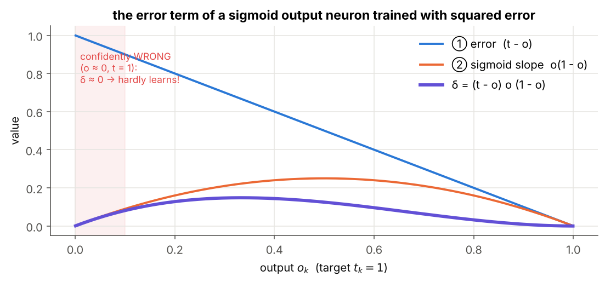

# 03 · Backprop for the Output Layer

> **Module:** [02 - Feed-Forward Networks and Backpropagation](../) · **Notebook:** [`03_backprop_output_layer.ipynb`](03_backprop_output_layer.ipynb)
> **Course notes:** page 4 (chain rule, $\delta_j=-\partial E/\partial net_j$, $\Delta w_{ji}=\eta\,\delta_j\,x_{ji}$), page 8 ($\partial E/\partial W^o=\delta^o(o^{h2})^\top$), pages 11–12 (softmax and $E=-\log y_o$) · **Further reading:** Sections 3–4 of [FFNN_Backpropagation_Guide Simplified.pdf](../FFNN_Backpropagation_Guide%20Simplified.pdf), Mitchell §4.5.3

---

## 📌 The core idea in one sentence

For an output weight $w_{kj}$, the chain rule splits $\partial E/\partial w_{kj}$ into *(how wrong the output is) × (how sensitive the neuron is) × (what came in on the wire)*; the first two factors form the **error term** $\delta_k$, and the update is simply $\Delta w_{kj}=\eta\,\delta_k\,x_{kj}$.


---

## 1. The variables you need first

| Symbol | Meaning |
|---|---|
| $j$ | a neuron in the **last hidden layer** |
| $k$ | a neuron in the **output layer** |
| $o_j$ | output of hidden neuron $j$; it is also the input $x_{kj}$ arriving at output neuron $k$ |
| $w_{kj}$ | weight from hidden neuron $j$ to output neuron $k$ |
| $net_k=\sum_jw_{kj}o_j+b_k$ | net input of output neuron $k$ |
| $o_k=\sigma(net_k)$ | output of neuron $k$ |
| $t_k$ | target for neuron $k$ |
| $E=\tfrac12\sum_k(t_k-o_k)^2$ | squared error of one example (the notes also sum over $d\in D$) |
| $\delta_k=-\partial E/\partial net_k$ | **error term** ("blame") of output neuron $k$, notes' sign convention |
| $\eta$ | learning rate |
| $\odot$ | elementwise product |

---

## 2. The chain rule: rates multiply

If $E$ depends on $o$, $o$ on $net$, and $net$ on $w$:

$$\frac{\partial E}{\partial w}=\frac{\partial E}{\partial o}\cdot\frac{\partial o}{\partial net}\cdot\frac{\partial net}{\partial w}$$

**Everyday version:** petrol costs ₹8 per km and you drive 60 km per hour, so driving costs $8\times60=$ ₹480 per hour.

---

## 3. Derivation for one output weight

$$\frac{\partial E}{\partial w_{kj}}=\underbrace{\frac{\partial E}{\partial o_k}}_{①}\cdot\underbrace{\frac{\partial o_k}{\partial net_k}}_{②}\cdot\underbrace{\frac{\partial net_k}{\partial w_{kj}}}_{③}$$

| Factor | Why | Value | Meaning |
|---|---|---|---|
| ① | only term $k$ of $\tfrac12\sum_k(t_k-o_k)^2$ contains $o_k$ | $-(t_k-o_k)$ | how wrong the output is |
| ② | sigmoid derivative | $o_k(1-o_k)$ | how sensitive the neuron is |
| ③ | $net_k=\sum_jw_{kj}o_j+b_k$ | $o_j=x_{kj}$ | the signal on that wire |

$$\boxed{\delta_k=(t_k-o_k)\,o_k(1-o_k)}\qquad\boxed{\Delta w_{kj}=-\eta\frac{\partial E}{\partial w_{kj}}=\eta\,\delta_k\,x_{kj}}\qquad\Delta b_k=\eta\,\delta_k$$

**Read it as:** weight change = learning rate × blame at the neuron × signal on the wire. Everything is **local** (notes: *"for back prop you need only local information"*). Changing the activation function only changes factor ② (notes: *"activation function changes, only this partial derivative changes"*).



When the neuron is **confidently wrong** ($o_k\approx0$, $t_k=1$), factor ② is ≈ 0 and the neuron hardly learns. Section 7 fixes this.

---

## 4. Worked example: one update of the 2-2-1 network

Same weights as in folder 02, target $t=1$, $\eta=0.5$:

```text
hidden outputs o_j = [0.6225 0.4134]   output o_k = 0.5844   E = 0.0864
① dE/do = -0.4156   ② do/dnet = 0.2429   δ_k = 0.1009
ΔW2 = [0.0314 0.0209]   Δb2 = 0.05047
after the update: output 0.5844 → 0.6034,  E 0.08637 → 0.07866  ✅ error went down
```

By hand: $\delta_k=(1-0.5844)(0.5844)(0.4156)=0.1009$, so $\Delta w_{k1}=0.5\times0.1009\times0.6225=0.0314$ and $\Delta w_{k2}=0.5\times0.1009\times0.4134=0.0209$. The output was too low and both inputs were positive, so both weights grow.

---

## 5. Gradient checking

Compute every slope the slow way and compare:

$$\frac{\partial E}{\partial\theta}\approx\frac{E(\theta+\varepsilon)-E(\theta-\varepsilon)}{2\varepsilon},\qquad\text{rel. error}=\frac{\lVert a-b\rVert}{\lVert a\rVert+\lVert b\rVert}$$

Below $10^{-6}$ means correct; above $10^{-3}$ means a bug.

```text
analytic ∂E/∂W2 : [-0.0628 -0.0417]
numerical ∂E/∂W2: [-0.0628 -0.0417]
relative error   : 1.48e-10
```

---

## 6. Matrix form: all output neurons, all examples

With $K$ outputs, $n_h$ hidden neurons and $N$ examples (one per column):

| Quantity | Formula | Shape |
|---|---|---|
| error terms | $\delta^o=(T-O^o)\odot O^o\odot(1-O^o)$ | $K\times N$ |
| weight gradient | $\dfrac{\partial E}{\partial W^o}=-\,\delta^o\,(O^h)^\top$ | $K\times n_h$ (same as $W^o$) |
| bias gradient | $\dfrac{\partial E}{\partial b^o}=-\sum_{\text{cols}}\delta^o$ | $K\times1$ |
| blame for the hidden layer | $\dfrac{\partial E}{\partial O^h}=-(W^o)^\top\delta^o$ | $n_h\times N$ |

Entry $(k,j)$ of $\delta^o(O^h)^\top$ is $\sum_n\delta_{kn}o_{jn}$: "blame × input", summed over examples. This is the notes' $\partial E/\partial W^o=\delta^o(o^{h2})^\top$ (written there without the minus).

> 💡 **Shape trick:** a gradient always has the same shape as the thing it differentiates. $\delta^o$ is $K\times N$, $O^h$ is $n_h\times N$, and the only product giving $K\times n_h$ is $\delta^o(O^h)^\top$.

Gradient check of every piece on a random batch:

```text
shapes:  delta (3, 8) | dW (3, 5) | db (3, 1) | dO_prev (5, 8)
dW       relative error = 3.32e-10
db       relative error = 1.88e-10
dO_prev  relative error = 4.56e-10
```

---

## 7. Softmax + cross-entropy

| Symbol | Meaning |
|---|---|
| $z_k$ | score (net input) of output neuron $k$ |
| $p_k=e^{z_k}/\sum_me^{z_m}$ | softmax probability |
| $t_k$ | one-hot target |
| $E=-\sum_kt_k\log p_k$ | cross-entropy, i.e. $-\log$(probability of the true class): the notes' $E=-\log(y_o)$ |

Using the softmax slope $\partial p_m/\partial z_k=p_m(\mathbb 1[m=k]-p_k)$:

$$\frac{\partial E}{\partial z_k}=\sum_m\Big(-\frac{t_m}{p_m}\Big)p_m(\mathbb 1[m=k]-p_k)=-t_k+p_k\sum_mt_m=p_k-t_k\qquad\Longrightarrow\qquad\boxed{\delta_k=t_k-p_k}$$

**Target minus prediction**, no slope factor at all. For a batch with mean loss: $\delta=(T-P)/N$.

```text
chain rule  ∂E/∂z : [ 0.1517  0.5144 -0.7125  0.0464]
shortcut    p - t : [ 0.1517  0.5144 -0.7125  0.0464]
numerical check rel. error: 7.83e-11
```

**Example:** true class 2, $p=(0.7,0.2,0.1)$ gives $\delta=(-0.7,+0.8,-0.1)$: push the true class up, the others down. A perfect prediction gives $\delta=0$.

---

## 8. Why cross-entropy trains faster

| Task | Output | Loss | $\delta^o$ |
|---|---|---|---|
| multi-class | softmax | cross-entropy | $T-P$ |
| binary | sigmoid | binary CE | $T-O$ |
| regression | identity | ½ squared error | $T-O$ |
| binary | sigmoid | ½ squared error (notes) | $(T-O)\odot O\odot(1-O)$ ← slow when saturated |


With squared error the factor $o(1-o)$ kills the signal when the neuron is confidently wrong. Cross-entropy cancels it, so the learning signal is largest exactly when the mistake is worst. Starting from $o\approx0.02$, cross-entropy passes 0.9 after about 15 steps; squared error is still below 0.2 after 60.

---

## 9. Code, step by step

| Step | Code | Maths |
|---|---|---|
| 1. Error terms | `delta = (T - O) * O * (1 - O)` | $\delta^o=(T-O)\odot O\odot(1-O)$ |
| 2. Weight gradient | `dW = -delta @ O_prev.T` | $-\delta^o(O^h)^\top$ |
| 3. Bias gradient | `db = -delta.sum(axis=1, keepdims=True)` | $-\sum_n\delta_{kn}$ |
| 4. Blame for the layer below | `dO_prev = -W.T @ delta` | $-(W^o)^\top\delta^o$ |
| 5. Update | `W -= eta * dW` (same as `W += eta * delta @ O_prev.T`) | $\Delta W=\eta\,\delta^o(O^h)^\top$ |
| 6. Check | `numerical_grad(f, W)` then `rel_err` | central differences |

`numerical_grad` nudges each entry by $\pm\varepsilon$, re-evaluates the loss, and **restores** the entry. Forgetting to restore is a classic bug.

### Full code

<details>
<summary><b>Click to expand: output-layer backprop + gradient check</b></summary>

```python
import numpy as np

def sigmoid(z): return 1.0 / (1.0 + np.exp(-z))

def numerical_grad(f, theta, eps=1e-6):
    """Brute-force gradient of the scalar function f() w.r.t. the array theta (changed in place, then restored)."""
    g = np.zeros_like(theta)
    for idx in np.ndindex(theta.shape):
        old = theta[idx]
        theta[idx] = old + eps; f_plus = f()
        theta[idx] = old - eps; f_minus = f()
        theta[idx] = old                                  # restore!
        g[idx] = (f_plus - f_minus) / (2 * eps)           # central difference
    return g


def rel_err(a, b):
    return np.linalg.norm(a - b) / (np.linalg.norm(a) + np.linalg.norm(b) + 1e-12)

def output_layer_backward(O_prev, O, T, W):
    """Sigmoid output layer with E = 1/2 Σ (t - o)^2.
    O_prev: (n_h × N) inputs to the layer, O: (K × N) outputs, T: (K × N) targets, W: (K × n_h).
    Returns delta (K × N), dE/dW (K × n_h), dE/db (K × 1), dE/dO_prev (n_h × N)."""
    delta = (T - O) * O * (1 - O)            # δ_k = (t_k - o_k) o_k (1 - o_k)     (notes: δ = -∂E/∂net)
    dW = -delta @ O_prev.T                   # ∂E/∂w_kj = -Σ_n δ_kn o_jn
    db = -delta.sum(axis=1, keepdims=True)   # ∂E/∂b_k  = -Σ_n δ_kn
    dO_prev = -W.T @ delta                   # blame for the layer below
    return delta, dW, db, dO_prev


rng = np.random.default_rng(1)
O_h = sigmoid(rng.normal(size=(5, 8)))          # 5 hidden neurons, 8 examples
T = rng.uniform(0, 1, size=(3, 8))              # 3 output neurons
W, b = rng.normal(0, 0.5, (3, 5)), np.zeros((3, 1))
O = sigmoid(W @ O_h + b)
delta, dW, db, dO_h = output_layer_backward(O_h, O, T, W)
f = lambda: 0.5 * np.sum((T - sigmoid(W @ O_h + b)) ** 2)
print(rel_err(dW, numerical_grad(f, W)))        # ~1e-10
```
</details>

---

## 10. What is in the notebook

| Section | Content |
|---|---|
| 2 | forward/backward chain diagram |
| 3 | derivation; plot of the three factors of $\delta$ |
| 4 | one full update of the 2-2-1 network, factor by factor |
| 5 | `numerical_grad`, `rel_err`, check on the example |
| 6 | matrix form, `output_layer_backward`, check on a batch |
| 7 | softmax + cross-entropy derivation and Jacobian check; $p$, $t$, $\delta$ bar charts |
| 8 | CE vs squared error: signal size and a training race |

```bash
jupyter notebook 03_backprop_output_layer.ipynb
```

## ✍️ Exercises
1. Add L2 regularisation $\frac\lambda2\lVert W\rVert^2$. *(Answer: $\partial E/\partial W$ gains $+\lambda W$.)* Verify with `numerical_grad`.
2. Drop `O * (1 - O)` on purpose and watch the gradient check fail.
3. Show that sigmoid + binary cross-entropy gives $\delta=t-o$.
4. How many updates does the 2-2-1 example need for $o>0.9$ with $\eta=0.5$?

**Previous:** [02 - Matrix-Form Forward Pass](../02%20-%20Matrix-Form%20Forward%20Pass/) · **Next:** [04 - Backprop for Hidden Layers](../04%20-%20Backprop%20for%20Hidden%20Layers/)
