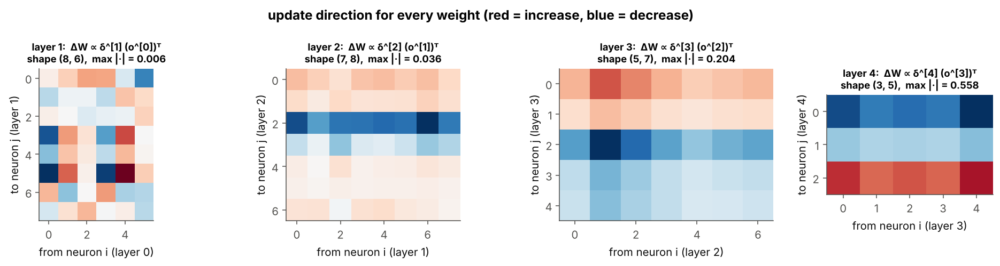

# 04 · Backprop for Hidden Layers

> **Module:** [02 - Feed-Forward Networks and Backpropagation](../) · **Notebook:** [`04_backprop_hidden_layers.ipynb`](04_backprop_hidden_layers.ipynb)
> **Course notes:** page 5, "For deeper layers", $\Delta w_{ji}=\eta\ x_i\ o_j(1-o_j)\sum_{s\in Down(j)}\delta_sw_{sj}$, and "only need info about next layer and previous layer" · **Further reading:** Section 5 of [FFNN_Backpropagation_Guide Simplified.pdf](../FFNN_Backpropagation_Guide%20Simplified.pdf), Mitchell §4.5.3 and Table 4.2

---

## 📌 The core idea in one sentence

A hidden neuron has no target, so its error term is **borrowed from the neurons it feeds**: each downstream blame $\delta_s$ is sent back along the same wire, weighted by $w_{sj}$, summed, and scaled by the neuron's own slope, $\delta_j=o_j(1-o_j)\sum_s\delta_sw_{sj}$. After that, the update is the same as everywhere else: $\Delta w_{ji}=\eta\ \delta_j\ x_{ji}$.


---

## 1. The variables you need first

| Symbol | Meaning |
|---|---|
| $j$ | a **hidden** neuron |
| $i$ | a neuron in the layer **before** $j$; $x_{ji}=o_i$ is the signal on wire $i\to j$ |
| $s$ | a neuron in the layer **after** $j$ |
| $Down(j)$ | all neurons that receive $j$'s output (in a dense net: the whole next layer) |
| $w_{ji}$, $w_{sj}$ | weight into $j$ from $i$; weight out of $j$ into $s$ |
| $net_j,\ o_j$ | net input and output of $j$; $o_j=\sigma(net_j)$ |
| $\delta_j=-\partial E/\partial net_j$ | error term of $j$ (notes' sign) |
| $\delta_s$ | error term of downstream neuron $s$: **already known**, because we work backwards |
| $\eta$ | learning rate |
| $\delta^{[l]}$ | all error terms of layer $l$ stacked, shape $n_l\times N$ |

---

## 2. Derivation, step by step (as in the notes)

**Step 1.** $w_{ji}$ affects $E$ only through $net_j$:

$$\frac{\partial E}{\partial w_{ji}}=\frac{\partial E}{\partial net_j}\cdot\frac{\partial net_j}{\partial w_{ji}}=\frac{\partial E}{\partial net_j}\cdot x_{ji}$$

**Step 2.** $net_j$ affects $E$ through **every** downstream $net_s$, so we add up all paths (multivariate chain rule):

$$\frac{\partial E}{\partial net_j}=\sum_{s\in Down(j)}\frac{\partial E}{\partial net_s}\cdot\frac{\partial net_s}{\partial net_j}=\sum_{s\in Down(j)}(-\delta_s)\cdot\frac{\partial net_s}{\partial net_j}$$

**Step 3.** Go through $o_j$. Since $net_s=\sum_jw_{sj}o_j+b_s$ and $o_j=\sigma(net_j)$:

$$\frac{\partial net_s}{\partial net_j}=\frac{\partial net_s}{\partial o_j}\cdot\frac{\partial o_j}{\partial net_j}=w_{sj}\cdot o_j(1-o_j)$$

**Step 4.** Combine, using $\delta_j=-\partial E/\partial net_j$:

$$\boxed{\delta_j=o_j(1-o_j)\sum_{s\in Down(j)}\delta_s\ w_{sj}}\qquad\boxed{\Delta w_{ji}=\eta\ \delta_j\ x_{ji}=\eta\ x_{ji}\ o_j(1-o_j)\sum_{s\in Down(j)}\delta_s\ w_{sj}}$$

The second box is the boxed formula in the notes.

| | Output neuron $k$ | Hidden neuron $j$ |
|---|---|---|
| error term | $o_k(1-o_k)\ (t_k-o_k)$ (uses the **target**) | $o_j(1-o_j)\sum_s\delta_sw_{sj}$ (uses **downstream blame**) |
| update | $\eta\ \delta_k\ x_{kj}$ | $\eta\ \delta_j\ x_{ji}$ |

**Intuition: passing the blame backwards.** If $j$ feeds $s$ through a strong wire, it shares much of $s$'s blame; through a weak wire, little. A negative weight flips the sign: if being more active *lowers* a too-low output, $j$ should become *less* active.

---

## 3. Worked example: one full backprop step on the 2-2-1 network

$x=(1,0.5)$, target $t=1$, $\eta=0.5$, same weights as folders 02–03:

```text
forward : o_hidden = [0.6225 0.4134],  o_out = 0.5844,  E = 0.08637
δ_out   = [0.1009]
blame Σ δ_s w_sj = [ 0.0606 -0.0202]   (= δ_out × [0.6, -0.2])
o_j(1-o_j)       = [0.235  0.2425]
δ_hidden         = [ 0.0142 -0.0049]
ΔW2 = [[0.03142, 0.02086]]   ΔW1 = [[0.00712, 0.00356], [-0.00245, -0.00122]]
after one step: o_out 0.5844 → 0.6040,  E 0.08637 → 0.07842 ✅
```

**Read the hidden deltas.** Hidden neuron 1 feeds the output through $+0.6$, so raising it would raise the too-low output: $\delta_1>0$, its weights grow. Hidden neuron 2 feeds through $-0.2$, so raising it would lower the output: $\delta_2<0$, its weights shrink, and by less because the wire is weaker.

Every gradient checked against brute force:

```text
W1: relative error = 8.90e-10
b1: relative error = 5.08e-10
W2: relative error = 1.48e-10
b2: relative error = 1.10e-10
```

---

## 4. Matrix form: one line per layer

The sums $\sum_s\delta_sw_{sj}$ for all $j$ at once are the product $(W^{[l+1]})^\top\delta^{[l+1]}$: **the same weights, transposed, carry blame back along the same wires.**

$$\delta^{[L]}=(T-O^{[L]})\odot g'(net^{[L]})\qquad\boxed{\delta^{[l]}=g'\big(net^{[l]}\big)\odot\big((W^{[l+1]})^\top\delta^{[l+1]}\big)}\qquad\boxed{\Delta W^{[l]}=\eta\ \delta^{[l]}(O^{[l-1]})^\top}$$

| Term | Shape | Meaning |
|---|---|---|
| $\delta^{[l+1]}$ | $n_{l+1}\times N$ | blame of the layer above |
| $(W^{[l+1]})^\top\delta^{[l+1]}$ | $n_l\times N$ | blame sent back along the wires |
| $g'(net^{[l]})$ | $n_l\times N$ | sensitivity of each neuron (sigmoid: $o(1-o)$, tanh: $1-o^2$, ReLU: 0 or 1) |
| $\delta^{[l]}(O^{[l-1]})^\top$ | $n_l\times n_{l-1}$ | same shape as $W^{[l]}$ |

*Take the blame from the layer above, send it back through the weights, gate it by this layer's slope.*


**The algorithm** (Mitchell Table 4.2): ① forward pass, storing every $net$ and $o$; ② $\delta$ for the output layer; ③ $\delta$ for each hidden layer from the top down; ④ update every weight with $\Delta w=\eta\ \delta\ x$.

---

## 5. Gradient check on a deeper network

A 6-8-7-5-3 network (3 hidden layers), with two settings:

```text
--- sigmoid hidden, sigmoid_mse output ---
  layer 1: W(8, 6)  dW rel.err = 2.0e-08   db rel.err = 5.7e-08
  layer 2: W(7, 8)  dW rel.err = 1.3e-08   db rel.err = 9.6e-09
  layer 3: W(5, 7)  dW rel.err = 2.6e-09   db rel.err = 7.9e-10
  layer 4: W(3, 5)  dW rel.err = 5.9e-10   db rel.err = 6.0e-10
--- tanh hidden, softmax_ce output ---
  layer 1: W(8, 6)  dW rel.err = 8.4e-10   db rel.err = 1.4e-09
  layer 2: W(7, 8)  dW rel.err = 7.9e-10   db rel.err = 9.9e-10
  layer 3: W(5, 7)  dW rel.err = 9.0e-10   db rel.err = 4.6e-10
  layer 4: W(3, 5)  dW rel.err = 7.9e-10   db rel.err = 8.4e-11
```



Each gradient has the shape of its $W^{[l]}$, and the values get smaller towards the input.

---

## 6. Locality and cost

Each backward step uses only the $\delta$ of the **next** layer, the weights between the two layers, and the stored $net$/$o$ of the **current and previous** layers (notes: *"only need info about next layer and previous layer"*). That locality is also what makes pipeline parallelism possible (folder 06).

In arithmetic, backward ≈ 2 matrix products per layer vs 1 for forward, so a training step costs about 3 forward passes **for all gradients at once**. Brute force needs 2 forward passes **per parameter**:

```text
forward    1.38 ms
backward   1.20 ms   (≈ 0.9× forward on this machine)
numerical gradient would need 2 × 235,146 forward passes ≈ 0.2 hours
```

---

## 7. The vanishing gradient problem

Every step back multiplies by $g'$. Sigmoid has $g'\le0.25$, so the blame shrinks exponentially with depth.


In a 10-hidden-layer network, the first layer's gradient with sigmoid + Xavier init is about $10^{-7}$ of the last layer's: the early layers are practically frozen. tanh + Xavier and ReLU + He keep all layers within about one order of magnitude. This is why modern networks use ReLU-like activations and careful initialisation, and why RNNs need LSTM/GRU gates.

---

## 8. Code, step by step

| Step | Code | Maths |
|---|---|---|
| 1. Forward, store all | `cache.append((NET, O))` | keep $net^{[l]},o^{[l]}$ |
| 2. Output delta | `delta = (T - O_L) * O_L * (1 - O_L)` | $\delta^{[L]}$ |
| 3. Walk backwards | `for l in range(L, 0, -1):` | $l=L,\dots,1$ |
| 4. Gradient of $W^{[l]}$ | `-delta @ O_prev.T` | $-\delta^{[l]}(o^{[l-1]})^\top$ |
| 5. Gradient of $b^{[l]}$ | `-delta.sum(axis=1, keepdims=True)` | $-\sum_{\text{cols}}\delta^{[l]}$ |
| 6. Blame back | `W.T @ delta` | $\sum_sw_{sj}\delta_s$ for every $j$ |
| 7. Gate by slope | `gprime(NET_prev, O_prev) * (...)` | $\delta^{[l-1]}=g'\odot(\cdot)$ |

`ACT` stores each activation with its derivative written in terms of the stored values, e.g. sigmoid's slope uses only `o`: `o * (1 - o)`.

### Full code

<details>
<summary><b>Click to expand: general L-layer forward + backward with gradient check</b></summary>

```python
import numpy as np

def sigmoid(z): return 1.0 / (1.0 + np.exp(-z))

def softmax(Z):
    Z = Z - Z.max(axis=0, keepdims=True)
    E = np.exp(Z)
    return E / E.sum(axis=0, keepdims=True)

def numerical_grad(f, theta, eps=1e-6):
    """Central-difference gradient of scalar f() w.r.t. array theta (modified in place, then restored)."""
    g = np.zeros_like(theta)
    for idx in np.ndindex(theta.shape):
        old = theta[idx]
        theta[idx] = old + eps; fp = f()
        theta[idx] = old - eps; fm = f()
        theta[idx] = old
        g[idx] = (fp - fm) / (2 * eps)
    return g


def rel_err(a, b):
    return np.linalg.norm(a - b) / (np.linalg.norm(a) + np.linalg.norm(b) + 1e-12)

# activation g and its slope g' written using the stored values (net, o)
ACT = {
    "sigmoid": (sigmoid,                         lambda net, o: o * (1 - o)),
    "tanh":    (np.tanh,                         lambda net, o: 1 - o ** 2),
    "relu":    (lambda z: np.maximum(0.0, z),    lambda net, o: (net > 0).astype(float)),
}

def init_params(sizes, rng, scheme="xavier"):
    """W^[l] ~ N(0, s^2) with s = sqrt(1/n_in) ('xavier') or sqrt(2/n_in) ('he', for ReLU)."""
    params = []
    for l in range(1, len(sizes)):
        s = np.sqrt((2.0 if scheme == "he" else 1.0) / sizes[l - 1])
        params.append((rng.normal(0, s, (sizes[l], sizes[l - 1])), np.zeros((sizes[l], 1))))
    return params

def forward(X, params, hidden="sigmoid", output="sigmoid_mse"):
    """X: (n_0 × N). Returns cache[l] = (net^[l], o^[l]) for l = 0..L."""
    g = ACT[hidden][0]
    cache, O = [(None, X)], X
    for l, (W, b) in enumerate(params, start=1):
        NET = W @ O + b                                            # net^[l] = W^[l] o^[l-1] + b^[l]
        if l < len(params):
            O = g(NET)                                             # hidden layer
        else:
            O = sigmoid(NET) if output == "sigmoid_mse" else softmax(NET)
        cache.append((NET, O))
    return cache


def loss(T, O, output="sigmoid_mse"):
    if output == "sigmoid_mse":
        return 0.5 * np.sum((T - O) ** 2)                          # E = 1/2 ΣΣ (t - o)^2   (notes)
    return -np.sum(T * np.log(O + 1e-12)) / T.shape[1]             # mean cross-entropy

def backward(T, params, cache, hidden="sigmoid", output="sigmoid_mse"):
    """Returns deltas δ^[l] (notes' sign: δ = -∂E/∂net) and gradients (∂E/∂W^[l], ∂E/∂b^[l])."""
    gprime = ACT[hidden][1]
    L = len(params)
    deltas, grads = [None] * (L + 1), [None] * L
    NET_L, O_L = cache[L]
    if output == "sigmoid_mse":
        delta = (T - O_L) * O_L * (1 - O_L)                        # δ_k = (t_k - o_k) o_k (1 - o_k)
    else:
        delta = (T - O_L) / T.shape[1]                             # δ_k = (t_k - p_k) / N
    for l in range(L, 0, -1):                                      # l = L, L-1, ..., 1
        deltas[l] = delta
        O_prev = cache[l - 1][1]
        grads[l - 1] = (-delta @ O_prev.T,                         # ∂E/∂W^[l] = -δ^[l] (o^[l-1])^T
                        -delta.sum(axis=1, keepdims=True))         # ∂E/∂b^[l] = -Σ_cols δ^[l]
        if l > 1:
            W = params[l - 1][0]
            NET_prev, O_prev = cache[l - 1]
            delta = gprime(NET_prev, O_prev) * (W.T @ delta)       # δ^[l-1] = g'(net) ⊙ (W^[l])^T δ^[l]
    return deltas, grads


rng = np.random.default_rng(2)
params = init_params([6, 8, 7, 5, 3], rng)
X, T = rng.normal(size=(6, 9)), rng.uniform(0, 1, (3, 9))
cache = forward(X, params)
deltas, grads = backward(T, params, cache)
E_fn = lambda: loss(T, forward(X, params)[-1][1])
print([rel_err(dW, numerical_grad(E_fn, W)) for (W, _), (dW, _) in zip(params, grads)])
```
</details>

---

## 9. What is in the notebook

| Section | Content |
|---|---|
| 2–3 | blame picture, 4-step derivation |
| 4 | full backprop step on 2-2-1 with every number printed, gradient check |
| 5 | matrix recursion and shape table |
| 6 | commented `forward` / `backward` / `loss`, gradient check of every layer, gradient heat-maps |
| 7 | cost of backward vs forward vs numerical gradient |
| 8 | vanishing gradients: sigmoid vs tanh vs ReLU over 10 layers |

```bash
jupyter notebook 04_backprop_hidden_layers.ipynb
```

## ✍️ Exercises
1. Add `leaky_relu` to `ACT` and gradient-check it.
2. Plot $\lVert\delta^{[l]}\rVert$ per layer for the sigmoid network. Same decay rate as $\lVert\partial E/\partial W\rVert$?
3. Use `depth=30`. Does ReLU + He stay flat?
4. In the 2-2-1 example set $w_{s2}=0$. What is $\delta_2$, and why?

**Previous:** [03 - Backprop for the Output Layer](../03%20-%20Backprop%20for%20the%20Output%20Layer/) · **Next:** [05 - Training a Small Network](../05%20-%20Training%20a%20Small%20Network/)
