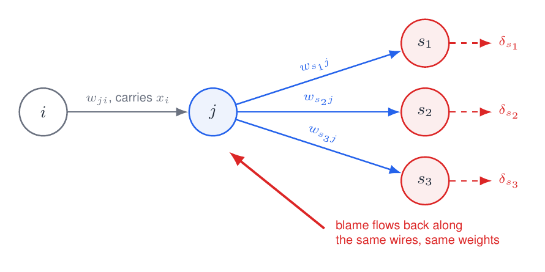
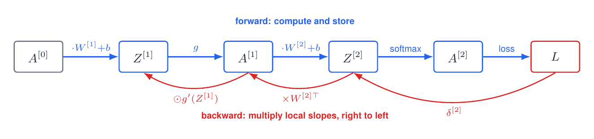
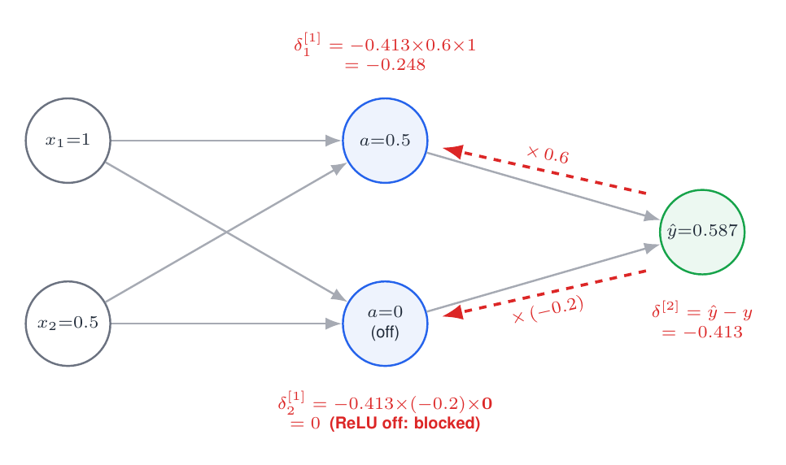
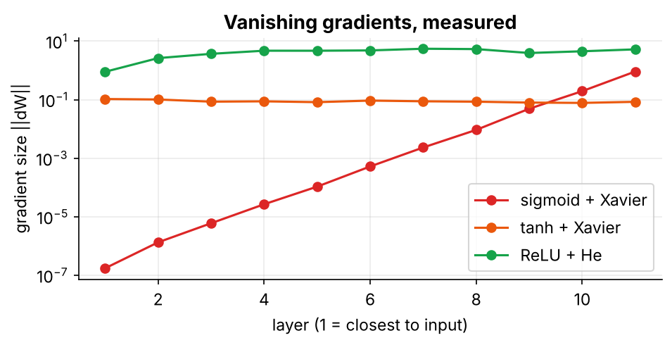

# 04 · Backprop for Hidden Layers

Send the error signal backwards through **any number of layers**. This is the heart of backpropagation.

> 📘 For the full derivation and the complete hand-worked example, read **Section 5** of **[FFNN_Backpropagation_Guide Simplified.pdf](../FFNN_Backpropagation_Guide%20Simplified.pdf)**.

---

## 1. How a hidden neuron gets its blame

A hidden neuron $j$ doesn't touch the loss directly. It affects the loss only **through** the neurons $s$ it feeds into. So its blame is their blame, sent back along the same wires and scaled by how sensitive neuron $j$ itself is:



$$\delta_j=\underbrace{g'(z_j)}_{\text{my sensitivity}}\sum_{s\in\text{downstream}(j)}\underbrace{\delta_s}_{\text{their blame}}\,\underbrace{w_{sj}}_{\text{how much I mattered}},\qquad \Delta w_{ji}=-\eta\,\delta_j\,x_i$$

This is the boxed formula in the handwritten notes, $\Delta w_{ji}=\eta\,x_i\,o_j(1-o_j)\sum_s\delta_sw_{sj}$. For a sigmoid $g'=o(1-o)$, and the notes use the opposite sign convention for $\delta$.

## 2. Matrix form: two lines per layer

$$\delta^{[l]}=\Big(\delta^{[l+1]}\,W^{[l+1]\top}\Big)\odot g'\big(Z^{[l]}\big),\qquad \frac{\partial L}{\partial W^{[l]}}=A^{[l-1]\top}\delta^{[l]},\qquad \frac{\partial L}{\partial b^{[l]}}=\sum_{\text{rows}}\delta^{[l]}$$

Read it as: *take the blame from the layer above, send it back through the weights, then gate it by this layer's slope.*



## 3. Worked example: one full step by hand (2–2–1, target $y=1$)



| Step | Computation | Result |
|---|---|---|
| Output blame | $\delta^{[2]}=\hat y-y=0.5866-1$ | −0.4134 |
| Output grads | $dW^{[2]}=a^{[1]}\delta^{[2]}$ | [−0.2067, 0] |
| Send back | $\delta^{[2]}W^{[2]\top}=-0.4134\times[0.6,-0.2]$ | [−0.2480, +0.0827] |
| Gate by ReLU | $g'([0.5,-0.35])=[1,0]$ | $\delta^{[1]}=[-0.2480,\,0]$ |
| Hidden grads | $dW^{[1]}=x^\top\delta^{[1]}$ | [[−0.2480, 0], [−0.1240, 0]] |
| SGD step, $\eta=0.5$ | $\theta\leftarrow\theta-\eta\,d\theta$ | $\hat y$: 0.5866 → **0.6910**; loss: 0.5334 → **0.3697** |

The second hidden neuron was "off" ($z<0$, ReLU slope 0), so **none of its weights changed**. That's the *dying ReLU* effect in miniature. One step cut the loss by 31%.

## 4. Code: the whole algorithm

```python
def backward(Y, params, cache, act="relu"):
    _, gprime = ACT[act]
    N, L = Y.shape[0], len(params)
    grads = [None] * L
    delta = (cache[-1][1] - Y) / N                   # output layer: (P - Y) / N
    for l in range(L, 0, -1):                        # backwards: L, L-1, ..., 1
        A_prev = cache[l - 1][1]
        W, _ = params[l - 1]
        grads[l - 1] = (A_prev.T @ delta, delta.sum(axis=0))   # dW, db
        if l > 1:
            delta = (delta @ W.T) * gprime(cache[l - 1][0])    # send back, gate by g'(Z)
    return grads
```

A gradient check on a 3-hidden-layer tanh network gives a relative error of ~$10^{-9}$ on every `dW` and `db`. Backward costs about **2× the forward pass** (two matrix products per layer), and it needs every stored $Z$ and $A$.

## 5. Vanishing gradients, measured

Each backward step multiplies by $g'$. For a sigmoid $g'\le0.25$, and $0.25^{10}\approx10^{-6}$.



| 10 hidden layers | $\lVert dW\rVert$ at layer 1 |
|---|---|
| sigmoid + Xavier | $1.7\times10^{-7}$ |
| tanh + Xavier | 0.105 |
| ReLU + He | 0.90 |

ReLU's slope is exactly 1 on the active side, and **He initialisation** ($\text{Var}(W)=2/n_{in}$) keeps the signal at a stable size.

## Contents

| File | Description |
|---|---|
| `04_backprop_hidden_layers.ipynb` | general L-layer forward/backward, shape trace, full gradient check on a 4-layer net, vanishing-gradient experiment (sigmoid vs tanh vs ReLU) |

## Run

```bash
jupyter notebook 04_backprop_hidden_layers.ipynb
```

## Exercises
1. Add `leaky_relu` to `ACT` and gradient-check it.
2. Plot $\lVert\delta\rVert$ per layer for the sigmoid network. Does it decay at the same rate as $\lVert dW\rVert$?
3. Increase the depth to 30. When does ReLU + He start to explode?

**Previous:** [03](../03%20-%20Backprop%20for%20the%20Output%20Layer/) · **Next:** [05 - Training a Small Network](../05%20-%20Training%20a%20Small%20Network/)
