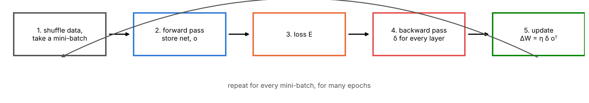
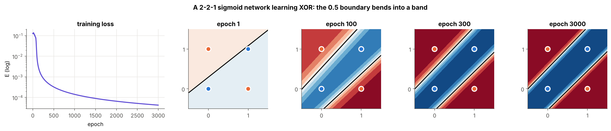
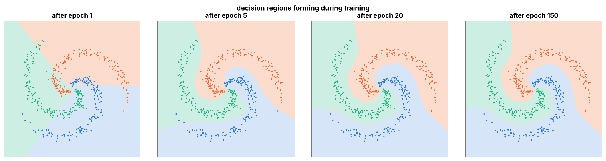
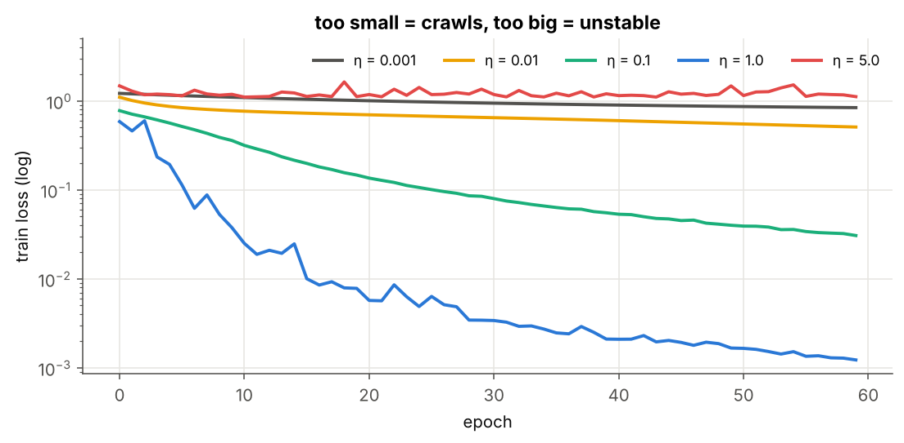
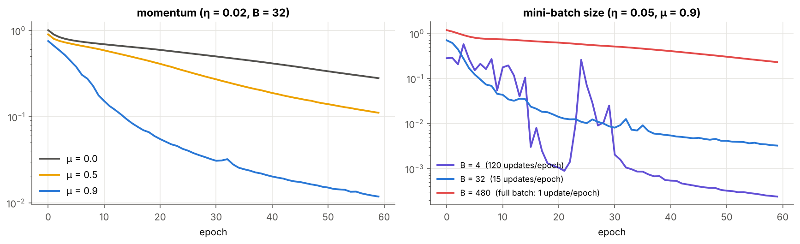

# 05 · Training a Small Network

> **Module:** [02 - Feed-Forward Networks and Backpropagation](../) · **Notebook:** [`05_training_a_small_network.ipynb`](05_training_a_small_network.ipynb)
> **Course notes:** pages 3–5 (sigmoid units, $w_{ji}\leftarrow w_{ji}+\Delta w_{ji}$, backprop for output and hidden layers) · **Further reading:** Section 6 of [FFNN_Backpropagation_Guide Simplified.pdf](../FFNN_Backpropagation_Guide%20Simplified.pdf), Mitchell Table 4.2

---

## 📌 The core idea in one sentence

Training is a five-step loop (**shuffle → forward → loss → backward → update**) repeated over mini-batches and epochs; with backprop supplying every gradient, the same loop teaches a 2-2-1 sigmoid network XOR and a 2-64-64-3 network a tangled spiral.



---

## 1. The variables you need first

| Symbol | Meaning |
|---|---|
| epoch | one full pass over the training set |
| $B$ | mini-batch size: examples used for one update ($B=1$: the notes' stochastic/incremental GD; $B=N$: batch GD) |
| $\theta$ | any parameter ($W^{[l]}$ or $b^{[l]}$) |
| $g=\partial E/\partial\theta$ | gradient of the mini-batch loss, from backprop |
| $\eta$ | learning rate |
| $\mu$ | momentum coefficient (e.g. 0.9) |
| $v$ | velocity: running memory of past updates, same shape as $\theta$ |
| $\delta^{[l]}$, $o^{[l]}$, $net^{[l]}$ | as in folders 02–04 (notes' notation, columns = examples) |

---

## 2. The update rules

**Plain mini-batch SGD:**

$$\theta\leftarrow\theta-\eta\ g\qquad\Longleftrightarrow\qquad\Delta W^{[l]}=\eta\ \delta^{[l]}(o^{[l-1]})^\top$$

**With momentum:**

$$v\leftarrow\mu\ v-\eta\ g,\qquad\theta\leftarrow\theta+v$$

**Intuition: a ball rolling downhill.** Gradients that keep pointing the same way add up and speed the ball along a valley; gradients that flip sign (the zig-zag across a narrow valley seen in module 01) cancel. With $\mu=0$ this is plain SGD.

**Losses are averaged over the batch** (divide by $N$), so the same $\eta$ works for any batch size.

---

## 3. XOR with a 2-2-1 sigmoid network

Exactly the notes' setting: sigmoid hidden and output units, squared error, online updates ($B=1$), $\eta=0.5$, $\mu=0.9$:

```text
outputs after training: [0.009 0.989 0.991 0.008]   targets: [0. 1. 1. 0.]
loss: 0.1262 → 0.00004
```



The 0.5-boundary starts as one straight line and bends into a **band**, the same shape as the hand-built XOR network from module 01, but this time **learned**.

> ⚠️ **Local minima.** With only 2 hidden units some random starts get stuck (a hidden unit saturates in a flat region). Try other seeds; wider hidden layers make this much rarer.

---

## 4. A 3-armed spiral with a 2-64-64-3 network

200 points per class (480 train, 120 test), ReLU hidden layers, softmax + cross-entropy output, $B=32$, $\eta=0.05$, $\mu=0.9$, 150 epochs:

```text
final train acc = 1.000 | test acc = 1.000 | train loss = 0.0010
```



After epoch 1 the regions are nearly straight wedges; by epoch 150 they follow each arm. Every bit of that shape came from the same five-step loop.

---

## 5. Learning rate, momentum, batch size

```text
η = 0.001  final train loss =   0.8385   test acc = 0.558
η = 0.01   final train loss =   0.5073   test acc = 0.808
η = 0.1    final train loss =   0.0306   test acc = 0.992
η = 1.0    final train loss =   0.0012   test acc = 1.000
η = 5.0    final train loss =   1.1139   test acc = 0.325
```



**Too small crawls, too big diverges.** The learning rate matters more than anything else.



- **Momentum** reaches the same loss in far fewer epochs at the same $\eta$.
- **Small batches** give many cheap, noisy updates per epoch (fast per epoch, but spiky: see $B=4$). **Full batch** gives one exact update per epoch (slowest here). On GPUs larger batches are cheaper per example, so 32–512 is a common compromise.

---

## 6. Code, step by step

| Step | Code in `MLP.fit` | Maths |
|---|---|---|
| 1. Shuffle each epoch | `idx = r.permutation(N)` | new random order |
| 1. Mini-batch | `cols = idx[s:s + batch]` | $B$ columns of $X$ |
| 2. Forward | `self.forward(X[:, cols])` | $o^{[l]}=g(W^{[l]}o^{[l-1]}+b^{[l]})$, stored |
| 3. Output delta | `(T - O) / N` or `(T - O) * O * (1 - O) / N` | $\delta^{[L]}$ for softmax-CE / sigmoid-MSE |
| 4. Hidden deltas | `gprime(net, o) * (W.T @ delta)` | $\delta^{[l]}=g'\odot(W^{[l+1]})^\top\delta^{[l+1]}$ |
| 4. Gradients | `-delta @ self.o[l].T` | $\partial E/\partial W^{[l]}=-\delta^{[l]}(o^{[l-1]})^\top$ |
| 5. Momentum update | `v = momentum * v - lr * g;  W += v` | $v\leftarrow\mu v-\eta g,\ \theta\leftarrow\theta+v$ |

Initial weights: $\mathcal N(0,2/n_{l-1})$ for ReLU (He), $\mathcal N(0,1/n_{l-1})$ otherwise (Xavier), so signals neither explode nor vanish at the start.

### Full code

<details>
<summary><b>Click to expand: the complete MLP class (forward, backward, SGD + momentum)</b></summary>

```python
import numpy as np

def sigmoid(z): return 1.0 / (1.0 + np.exp(-z))

def softmax(Z):
    Z = Z - Z.max(axis=0, keepdims=True)
    E = np.exp(Z)
    return E / E.sum(axis=0, keepdims=True)

class MLP:
    """Fully-connected network trained with backprop + mini-batch SGD (+ momentum).
    hidden: 'sigmoid' | 'tanh' | 'relu'      output: 'sigmoid_mse' (notes) | 'softmax_ce' (classification)"""

    ACT = {"sigmoid": (sigmoid,                       lambda net, o: o * (1 - o)),
           "tanh":    (np.tanh,                       lambda net, o: 1 - o ** 2),
           "relu":    (lambda z: np.maximum(0, z),    lambda net, o: (net > 0).astype(float))}

    def __init__(self, sizes, hidden="relu", output="softmax_ce", seed=0, init_scale=None):
        r = np.random.default_rng(seed)
        gain = 2.0 if hidden == "relu" else 1.0                      # He for ReLU, Xavier otherwise
        self.W = [r.normal(0, init_scale or np.sqrt(gain / sizes[l - 1]), (sizes[l], sizes[l - 1]))
                  for l in range(1, len(sizes))]                     # W^[l]: (n_l × n_{l-1})
        self.b = [np.zeros((n, 1)) for n in sizes[1:]]               # b^[l]: (n_l × 1)
        self.vW = [np.zeros_like(W) for W in self.W]                 # momentum velocities
        self.vb = [np.zeros_like(b) for b in self.b]
        self.hidden, self.output = hidden, output

def forward(self, X):
    """X: (n_0 × N). Stores net^[l] and o^[l] for backprop."""
    g = self.ACT[self.hidden][0]
    self.net, self.o = [None], [X]
    L = len(self.W)
    for l in range(L):
        NET = self.W[l] @ self.o[-1] + self.b[l]                 # net = W o_prev + b
        self.net.append(NET)
        if l < L - 1:
            self.o.append(g(NET))
        else:
            self.o.append(sigmoid(NET) if self.output == "sigmoid_mse" else softmax(NET))
    return self.o[-1]

MLP.forward = forward

def loss(self, O, T):
    if self.output == "sigmoid_mse":
        return 0.5 * np.sum((T - O) ** 2) / T.shape[1]           # ½ squared error, averaged per example
    return -np.sum(T * np.log(O + 1e-12)) / T.shape[1]           # mean cross-entropy

MLP.loss = loss

def backward(self, T):
    """Returns gradients ∂E/∂W, ∂E/∂b for the batch (mean over examples)."""
    gprime = self.ACT[self.hidden][1]
    N, L = T.shape[1], len(self.W)
    O = self.o[-1]
    delta = (T - O) * O * (1 - O) / N if self.output == "sigmoid_mse" else (T - O) / N   # δ^[L]
    gW, gb = [None] * L, [None] * L
    for l in reversed(range(L)):
        gW[l] = -delta @ self.o[l].T                             # ∂E/∂W^[l] = -δ o_prevᵀ
        gb[l] = -delta.sum(axis=1, keepdims=True)
        if l > 0:
            delta = gprime(self.net[l], self.o[l]) * (self.W[l].T @ delta)   # δ^[l-1]
    return gW, gb

MLP.backward = backward

def step(self, gW, gb, lr, momentum=0.0):
    for l in range(len(self.W)):
        self.vW[l] = momentum * self.vW[l] - lr * gW[l]          # v ← μ v − η g
        self.vb[l] = momentum * self.vb[l] - lr * gb[l]
        self.W[l] += self.vW[l]                                  # θ ← θ + v
        self.b[l] += self.vb[l]

MLP.step = step

def train_epoch(self, X, T, batch, lr, momentum, r):
    idx = r.permutation(X.shape[1])                              # 1. shuffle every epoch
    for s in range(0, X.shape[1], batch):
        cols = idx[s:s + batch]                                  #    take a mini-batch
        self.forward(X[:, cols])                                 # 2. forward
        gW, gb = self.backward(T[:, cols])                       # 3-4. loss gradient by backprop
        self.step(gW, gb, lr, momentum)                          # 5. update

MLP.train_epoch = train_epoch

def predict(self, X):
    return self.forward(X).argmax(axis=0)


def evaluate(self, X, T):
    O = self.forward(X)
    acc = np.mean(O.argmax(0) == T.argmax(0)) if T.shape[0] > 1 else np.mean((O > 0.5) == T)
    return self.loss(O, T), acc

MLP.predict, MLP.evaluate = predict, evaluate

def fit(self, X, T, X_test=None, T_test=None, epochs=100, batch=32, lr=0.1, momentum=0.0,
        seed=0, snapshot_epochs=(), snapshot_fn=None):
    r = np.random.default_rng(seed)
    hist = {k: [] for k in ("loss", "test_loss", "acc", "test_acc")}
    self.snapshots = {}
    for ep in range(1, epochs + 1):
        self.train_epoch(X, T, batch, lr, momentum, r)
        loss_tr, acc_tr = self.evaluate(X, T)                    # bookkeeping on the full sets
        hist["loss"].append(loss_tr); hist["acc"].append(acc_tr)
        if X_test is not None:
            loss_te, acc_te = self.evaluate(X_test, T_test)
            hist["test_loss"].append(loss_te); hist["test_acc"].append(acc_te)
        if ep in snapshot_epochs and snapshot_fn is not None:
            self.snapshots[ep] = snapshot_fn(self)
    return hist

MLP.fit = fit


# ---- usage: XOR exactly as in the notes ----
X = np.array([[0, 0, 1, 1], [0, 1, 0, 1]], dtype=float)
T = np.array([[0, 1, 1, 0]], dtype=float)
net = MLP([2, 2, 1], hidden="sigmoid", output="sigmoid_mse", seed=3, init_scale=1.0)
net.fit(X, T, epochs=3000, batch=1, lr=0.5, momentum=0.9)
print(net.forward(X).round(3))        # ≈ [[0.009 0.989 0.991 0.008]]
```
</details>

---

## 7. What is in the notebook

| Section | Content |
|---|---|
| 2 | training-loop diagram, mini-batch SGD and momentum explained |
| 3 | commented `MLP` class |
| 4 | XOR: loss curve and the output surface at epochs 1, 100, 300, 3000 |
| 5 | spiral data, 2-64-64-3 training curves, decision regions at 4 epochs |
| 6 | learning-rate sweep |
| 7 | momentum and batch-size comparisons |

```bash
jupyter notebook 05_training_a_small_network.ipynb
```

## ✍️ Exercises
1. Train XOR with seeds 0–9. How many get stuck? Repeat with `[2, 4, 1]`.
2. Use `hidden="sigmoid"` for the spiral. What changes, and how does it relate to the vanishing-gradient plot in folder 04?
3. Add L2 weight decay (`g + λθ`) to `step` and watch the test loss.
4. Train on `sklearn.datasets.load_digits` with `sizes=[64, 64, 10]`.

**Previous:** [04 - Backprop for Hidden Layers](../04%20-%20Backprop%20for%20Hidden%20Layers/) · **Next:** [06 - Memory Footprint and Multi-GPU Training](../06%20-%20Memory%20Footprint%20and%20Multi-GPU%20Training/)
