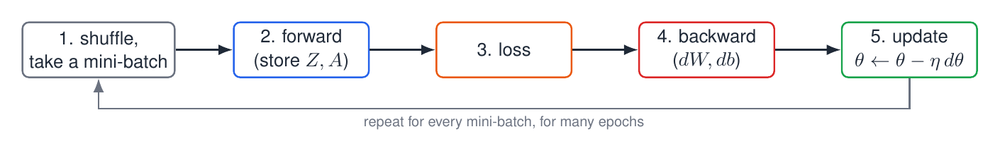
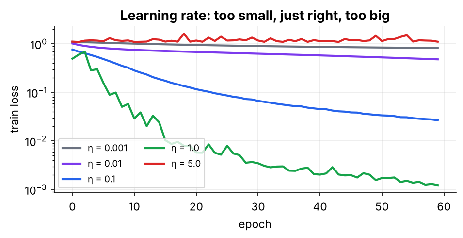

# 05 · Training a Small Network

Combine forward + backward + an optimiser and train a real classifier **from scratch in NumPy**.

> 📘 For more on momentum, the results and choosing a learning rate, read **Section 6** of **[FFNN_Backpropagation_Guide Simplified.pdf](../FFNN_Backpropagation_Guide%20Simplified.pdf)**.

---

## 1. The training loop



**Mini-batch SGD** is the middle ground: not one example at a time (too noisy), and not the whole dataset (too slow), but e.g. 32 at a time. Shuffling every epoch stops the network memorising the order.

$$\theta\leftarrow\theta-\eta\,\nabla_\theta L$$

## 2. Momentum: a heavy ball instead of a nervous walker

$$v\leftarrow\mu\,v-\eta\,g,\qquad \theta\leftarrow\theta+v\qquad(\mu\approx0.9)$$

$v$ is a running "velocity" that remembers recent directions. Like a heavy ball rolling down a valley, it ignores small side-to-side jiggles and speeds up along directions that stay consistent. This fixes the slow narrow-valley crawl seen with the Delta rule in module 01.

## 3. Code: the `MLP` class

```python
def step(self, gW, gb, lr, momentum=0.0):
    for l in range(len(self.W)):
        self.vW[l] = momentum * self.vW[l] - lr * gW[l]     # update velocity
        self.vb[l] = momentum * self.vb[l] - lr * gb[l]
        self.W[l] += self.vW[l]                             # move by velocity
        self.b[l] += self.vb[l]

def fit(self, X, Y, Xte, Yte, epochs=100, batch=32, lr=0.1, momentum=0.0, seed=0):
    r = np.random.default_rng(seed)
    for ep in range(epochs):
        idx = r.permutation(len(X))                         # 1. shuffle
        for s in range(0, len(X), batch):
            j = idx[s:s + batch]                            #    mini-batch
            self.forward(X[j])                              # 2. forward
            gW, gb = self.backward(Y[j])                    # 3. backward
            self.step(gW, gb, lr, momentum)                 # 4. update
```

With `momentum=0`, this reduces to plain SGD. Inside `backward`, the ReLU slope is written as `(self.Z[l] > 0)`.

## 4. Results

- **XOR** (impossible for one neuron): a `2-8-2` network predicts `[0 1 1 0]` with a final loss of $1.8\times10^{-4}$.
- **3-arm spiral** (very curved boundary): a `2-64-64-3` ReLU net with $\eta=0.05$, momentum 0.9 and 150 epochs reaches **100% train and 100% test accuracy**.


## 5. The learning rate matters most



| $\eta$ (plain SGD, 60 epochs) | Final train loss | Test acc. | Verdict |
|---|---|---|---|
| 0.001 | 0.82 | 52% | far too slow |
| 0.01 | 0.48 | 85% | slow |
| 0.1 | 0.027 | 99% | good |
| 1.0 | 0.001 | 100% | good |
| 5.0 | 1.11 | 33% | overshoots (chance level) |

**Recipe:** try $\eta$ on a log scale, watch the loss curve, and keep the largest value that still decreases smoothly. Then add momentum, weight decay and a decay schedule.

## Contents

| File | Description |
|---|---|
| `05_training_a_small_network.ipynb` | `MLP` class (forward/backward/SGD + momentum/fit), XOR warm-up, spiral dataset, loss/accuracy curves, decision regions, learning-rate sweep |

## Run

```bash
jupyter notebook 05_training_a_small_network.ipynb
```

## Exercises
1. Compare `momentum=0` and `momentum=0.9` at the same learning rate.
2. Add weight decay to `step` (`gW[l] + wd * W[l]`) and watch the test loss.
3. Swap ReLU for tanh in both `forward` and `backward`.
4. Train on `sklearn.datasets.load_digits` with `sizes=[64, 64, 10]`.

**Previous:** [04](../04%20-%20Backprop%20for%20Hidden%20Layers/) · **Next:** [06 - Memory Footprint and Multi-GPU Training](../06%20-%20Memory%20Footprint%20and%20Multi-GPU%20Training/)
