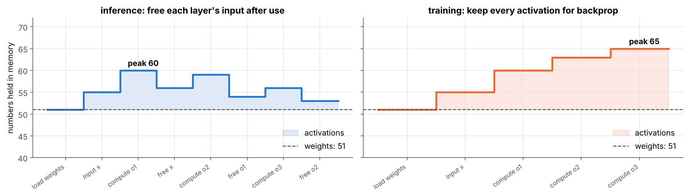
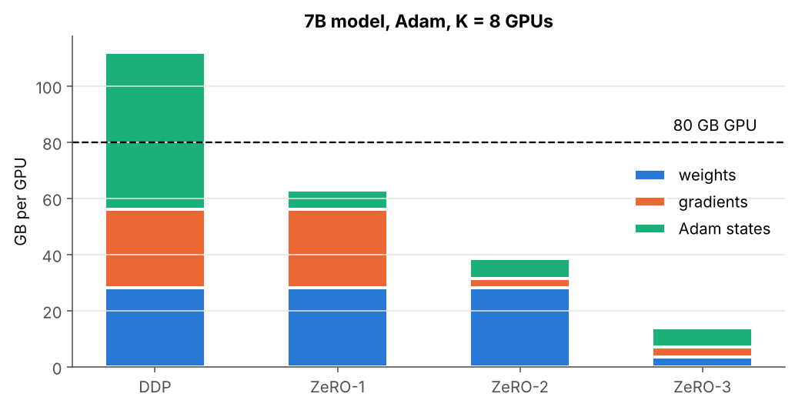
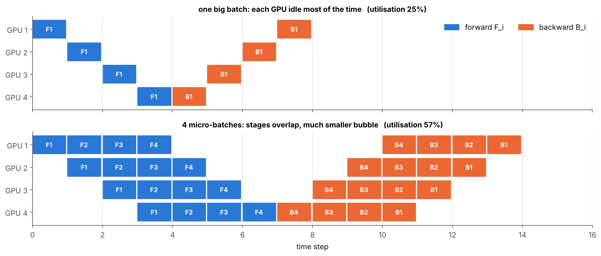

# 06 · Memory Footprint and Multi-GPU Training

> **Module:** [02 - Feed-Forward Networks and Backpropagation](../) · **Notebook:** [`06_memory_footprint_and_multi_gpu.ipynb`](06_memory_footprint_and_multi_gpu.ipynb)
> **Course notes:** page 7 "Memory footprint of FFNN" (4-5-3-2, 51 F.P.), page 5 "Model size: 1 GPU / multiple … collect all updates together", "$F_i$ has to come before $B_i$", page 6 "Divide by layers … pipelined", "split weight matrices" · **Further reading:** Sections 7–8 of [FFNN_Backpropagation_Guide Simplified.pdf](../FFNN_Backpropagation_Guide%20Simplified.pdf)

---

## 📌 The core idea in one sentence

Training must keep **every activation** for backprop plus a gradient and optimiser state for **every parameter** (16 bytes per parameter with Adam), so big models don't fit on one GPU, and the work is split by **data** (data parallel, ZeRO), by **layers** (pipeline) or **inside a matrix** (tensor parallel).

---

## 1. The variables you need first

| Symbol | Meaning | Example |
|---|---|---|
| $P$ | number of parameters | 51 |
| bytes per number | float32 = 4, float16 / bfloat16 = 2 | 4 |
| $N$ | batch size | 256 |
| $n_l$ | neurons (activations per example) in layer $l$ | 5 |
| $K$ | number of GPUs | 8 |
| $N_k$, $g_k$ | examples given to GPU $k$, and the gradient it computes on them | $N/K$ |
| $m,\ v$ | Adam's two running averages, one of each per parameter | – |
| $F_i,\ B_i$ | forward / backward pass of micro-batch $i$ | – |

---

## 2. Inference vs training: the notes' 4-5-3-2 example

$P=(20+5)+(15+3)+(6+2)=51$.

- **Inference:** layer $l$ only needs $o^{[l-1]}$, which can be freed afterwards. Peak at layer 1: $51+4+5=\mathbf{60}$ numbers.
- **Training:** backprop needs every $o^{[l]}$ again, so nothing is freed. Peak: $51+4+5+3+2=\mathbf{65}$ (notes: *"at peak we need all"*).

```text
parameters P = 51
inference peak = 60   (= 51 + 4 + 5)
training  peak = 65   (= 51 + 4 + 5 + 3 + 2)
```



---

## 3. The 16-bytes-per-parameter rule

| Item | Why it exists | float32 bytes / param |
|---|---|---|
| weight | the parameter | 4 |
| gradient | produced by backprop, used by the update | 4 |
| optimiser state | SGD: none · momentum: $v$ · **Adam: $m$ and $v$** | 0 / 4 / **8** |
| **total with Adam** | | **16** |

$$\text{memory}\approx16P\ +\ \underbrace{4N\Big(n_0+2\sum_{l\ge1}n_l\Big)}_{\text{activations: }x,\ net^{[l]},\ o^{[l]}}\ \text{bytes}$$

The parameter part is **fixed**; the activation part **grows with batch size**.

### Worked example: `[784, 4096, 4096, 10]`, batch 256

```text
network [784, 4096, 4096, 10]: 20,037,642 parameters, batch 256, Adam, float32
  weights          80.15 MB
  grads            80.15 MB
  optimizer       160.30 MB
  activations      17.60 MB
  TOTAL           338.20 MB
```

Checked against real float32 arrays (weights, gradients, Adam states and an actual forward cache):

```text
weights      estimate =     80.15 MB | measured =     80.15 MB | equal: True
grads        estimate =     80.15 MB | measured =     80.15 MB | equal: True
optimizer    estimate =    160.30 MB | measured =    160.30 MB | equal: True
activations  estimate =     17.60 MB | measured =     17.60 MB | equal: True
```

### At LLM scale

```text
125M (GPT-2 small)  →      2.0 GB of training state   ( 0.03 × an 80 GB GPU)
1B                  →     16.0 GB of training state   ( 0.20 × an 80 GB GPU)
7B                  →    112.0 GB of training state   ( 1.40 × an 80 GB GPU)
70B                 →  1,120.0 GB of training state   (14.00 × an 80 GB GPU)
```

A 7B model's training state alone (112 GB) is larger than any single GPU.

---

## 4. Data parallelism: copy the model, split the data

Notes: *"Each GPU collects local updates. Collect all updates together."* Every GPU holds the full model, processes $N_k$ examples, and the gradients are averaged. Because the loss is a **mean** over examples, this is exact:

$$g_{\text{full}}=\frac1N\sum_{n=1}^Ng_n=\sum_{k=1}^K\frac{N_k}{N}\ g_k$$

```text
4 workers × 16 examples each
max |single-GPU − data-parallel| = 5.551115123125783e-17
```

**Ring all-reduce.** Instead of sending everything to one server (which would receive $(K-1)\times$ the gradient), the gradient is split into $K$ chunks that circulate around a ring: first summed (reduce-scatter), then shared (all-gather). Each GPU sends only $\frac{2(K-1)}{K}$ gradient sizes, almost independent of $K$.

### ZeRO / FSDP: don't store identical copies

| Strategy | Weights | Grads | Adam states |
|---|---|---|---|
| plain DDP | full | full | full |
| ZeRO-1 | full | full | 1/K |
| ZeRO-2 | full | 1/K | 1/K |
| ZeRO-3 / FSDP | 1/K | 1/K | 1/K |

```text
DDP       112.0 GB per GPU   does NOT fit on an 80 GB GPU
ZeRO-1     63.0 GB per GPU   fits on an 80 GB GPU
ZeRO-2     38.5 GB per GPU   fits on an 80 GB GPU
ZeRO-3     14.0 GB per GPU   fits on an 80 GB GPU
```



---

## 5. Pipeline parallelism: divide by layers

Notes: *"Divide by layers … pipelined."* GPU 1 holds the first layers, GPU 2 the next, and so on. Activations flow forward between GPUs; error terms $\delta$ flow back. Backprop still works because each layer only needs local information from its neighbours (folder 04).

```text
GPU 0: layers [1, 2, 3] →  142.6 M params =  2.28 GB (fp32 + Adam)
        sends o^[3] (8192×64) = 2.1 MB forward, receives δ of the same size backward, per micro-batch
GPU 1: layers [4, 5] →   75.3 M params =  1.20 GB (fp32 + Adam)
```

**The bubble.** $F_i$ must finish on every stage before $B_i$ can start (notes: *"$F_i$ has to come before $B_i$"*). With one big batch, each GPU is idle most of the time. Splitting into **micro-batches** lets stages overlap:



With $S$ stages and $M$ micro-batches, utilisation is $\frac{M}{M+S-1}$: 25% for $M=1$, 57% for $M=4$ ($S=4$), approaching 100% as $M$ grows.

---

## 6. Tensor parallelism: split one weight matrix

Notes: *"Weight matrix too big … split weight matrices."* Each row of $W$ is one neuron, independent of the others:

- **Row split:** each GPU computes some neurons; **concatenate** the outputs.
- **Column split:** each GPU sees part of the inputs; **add** the partial sums (an all-reduce).

```text
row split    (concatenate) equals full: True
column split (sum)         equals full: True
```

---

## 7. Summary

| Technique | Splits | Communicates | Solves |
|---|---|---|---|
| data parallel | the batch | gradients (all-reduce) | throughput |
| ZeRO / FSDP | optimiser states, grads, weights | shards on demand | memory per GPU |
| pipeline parallel | layers | activations forward, $\delta$ backward | model too big for one GPU |
| tensor parallel | each matrix | partial results | one layer too big |

---

## 8. Code, step by step

| Step | Code | Meaning |
|---|---|---|
| 1. Count parameters | `n_params(sizes)` | $\sum_l n_l(n_{l-1}+1)$ |
| 2. Count activations | `batch * (sizes[0] + 2 * sum(sizes[1:]))` | $x$ plus $net^{[l]},o^{[l]}$ per layer |
| 3. Optimiser states | `OPT_STATES[optimizer] * P * 4` | Adam: 2 extra numbers per parameter |
| 4. Shard the batch | `np.array_split(np.arange(N), K)` | GPU $k$ gets $N_k$ columns |
| 5. Local gradients | `grads_for(params, X[:, s], T[:, s])` | independent forward + backward |
| 6. All-reduce | `sum(len(s) / N * g for s, g in ...)` | weighted average $\sum_k\frac{N_k}{N}g_k$ |

### Full code

<details>
<summary><b>Click to expand: memory estimator + simulated data parallelism</b></summary>

```python
import numpy as np

def softmax(Z):
    Z = Z - Z.max(axis=0, keepdims=True)
    E = np.exp(Z)
    return E / E.sum(axis=0, keepdims=True)

OPT_STATES = {"sgd": 0, "momentum": 1, "adam": 2}            # extra numbers stored per parameter


def n_params(sizes):
    return sum(sizes[l] * sizes[l - 1] + sizes[l] for l in range(1, len(sizes)))


def activation_numbers(sizes, batch):
    """Numbers stored for backprop: the input X plus net^[l] and o^[l] of every layer."""
    return batch * (sizes[0] + 2 * sum(sizes[1:]))


def training_memory(sizes, batch, optimizer="adam", bytes_per=4):
    P = n_params(sizes)
    return dict(weights=P * bytes_per,
                grads=P * bytes_per,
                optimizer=OPT_STATES[optimizer] * P * 4,      # optimiser states are kept in fp32
                activations=activation_numbers(sizes, batch) * bytes_per)

def init_params(sizes, rng):
    return [(rng.normal(0, np.sqrt(2 / sizes[l - 1]), (sizes[l], sizes[l - 1])), np.zeros((sizes[l], 1)))
            for l in range(1, len(sizes))]


def grads_for(params, X, T):
    """Mean-loss gradients ∂E/∂W, ∂E/∂b of a ReLU / softmax MLP on (X, T); columns = examples."""
    O, cache, L = X, [(None, X)], len(params)
    for l, (W, b) in enumerate(params, 1):                     # forward, storing net and o
        NET = W @ O + b
        O = softmax(NET) if l == L else np.maximum(0, NET)
        cache.append((NET, O))
    delta, out = (T - O) / X.shape[1], [None] * L                # δ^[L] = (T - P) / N
    for l in range(L, 0, -1):                                    # backward
        out[l - 1] = (-delta @ cache[l - 1][1].T, -delta.sum(1, keepdims=True))
        if l > 1:
            delta = (params[l - 1][0].T @ delta) * (cache[l - 1][0] > 0)
    return out


flat = lambda gr: np.concatenate([np.concatenate([dW.ravel(), db.ravel()]) for dW, db in gr])


print({k: v / 1e6 for k, v in training_memory([784, 4096, 4096, 10], batch=256).items()})   # MB

rng = np.random.default_rng(3)
params = init_params([20, 32, 16, 4], rng)
X, T = rng.normal(size=(20, 64)), np.eye(4)[:, rng.integers(0, 4, 64)]
shards = np.array_split(np.arange(64), 4)
g_avg = sum(len(s) / 64 * flat(grads_for(params, X[:, s], T[:, s])) for s in shards)
print(np.abs(flat(grads_for(params, X, T)) - g_avg).max())      # ~1e-17
```
</details>

---

## 9. What is in the notebook

| Section | Content |
|---|---|
| 2 | live-memory timeline of the notes' network: inference vs training |
| 3 | estimator, check against real arrays, memory vs batch size |
| 4 | LLM-scale table |
| 5 | data parallel simulation, ring all-reduce simulation and traffic plot, ZeRO bar chart |
| 6 | pipeline split of a large MLP, GPipe schedule chart |
| 7 | tensor parallel: row split and column split checked |

```bash
jupyter notebook 06_memory_footprint_and_multi_gpu.ipynb
```

## ✍️ Exercises
1. Add **gradient checkpointing** (store every $\sqrt L$-th layer's activations, recompute the rest). How much is saved for 16 layers?
2. Add bf16 mixed-precision accounting to `per_gpu_gb`.
3. Prove that **gradient accumulation** over 4 micro-batches of 16 equals one batch of 64.
4. Derive the pipeline utilisation $\frac{M}{M+S-1}$ from the schedule.

**Previous:** [05 - Training a Small Network](../05%20-%20Training%20a%20Small%20Network/) · **Back to module overview:** [README](../README.md)
