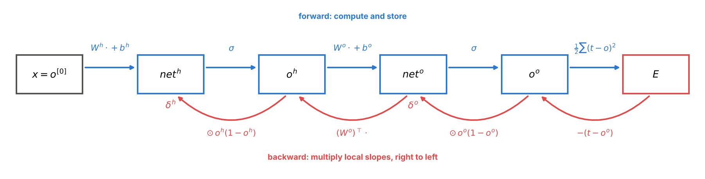
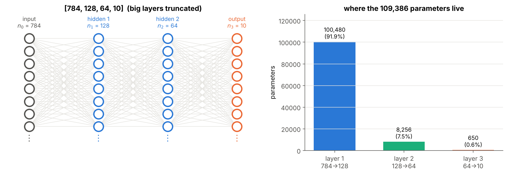
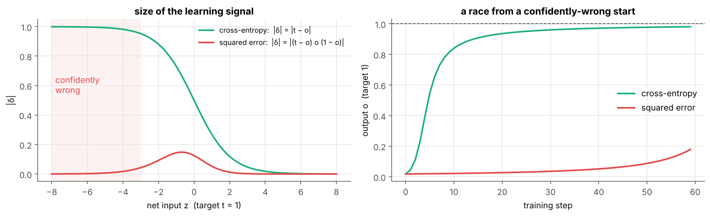
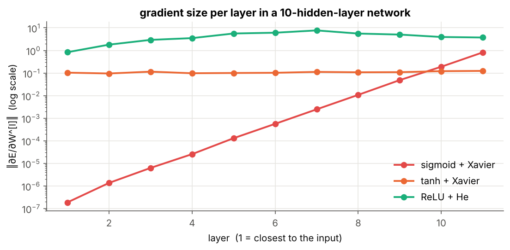

# 02 · Feed-Forward Networks and Backpropagation

**From "how many parameters?" to "will it fit on 8 GPUs?"** A hands-on, NumPy-only walk through feed-forward neural networks and the backpropagation algorithm. Every concept is derived step by step in the notation of the course notes, implemented from scratch, checked numerically, and visualised.

> 📘 **Full guide:** [FFNN_Backpropagation_Guide Simplified.pdf](FFNN_Backpropagation_Guide%20Simplified.pdf) (15 pages: plain-language explanations, a complete backprop step by hand, debugging checklist, cheat sheet).
> 📝 **Course notes:** pages 3–8 of the handwritten notes (4-3-3-2 network, backprop for output and hidden layers, multi-GPU, memory footprint, matrix form).
> 📗 **Book:** Tom Mitchell, *Machine Learning*, §4.5 and Table 4.2. New to neurons? Start with [module 01](../01%20-%20Perceptron%20and%20Gradient%20Descent/).


---

## Why this module?

Module 01 ended with a problem: one neuron draws one straight line, but a **layer** of sigmoid neurons can bend the boundary (XOR). We could only build that XOR network **by hand**. This module answers four questions, in order:

1. **How big** is a network? → parameter counting
2. **How does data flow** through it efficiently? → the matrix-form forward pass
3. **How do we train the hidden weights?** → backpropagation (output layer, then hidden layers)
4. **How do we train for real, and at scale?** → SGD + momentum, memory, multi-GPU

---

## 📖 Notation (identical to the course notes)

Read this once; every notebook and README in the module uses it.

| Symbol | Shape | Meaning |
|---|---|---|
| $L$ | – | number of layers with weights (the input is layer 0) |
| $n_l$ | – | neurons in layer $l$ ($n_0$ = number of inputs) |
| $x=o^{[0]}$ | $n_0\times1$ | one input example, a **column** vector |
| $w_{ji}$ | – | weight **from** neuron $i$ **to** neuron $j$ (first index = destination) |
| $W^{[l]}$ | $n_l\times n_{l-1}$ | weights of layer $l$; row $j$ = neuron $j$'s incoming weights (notes: $W^{h1}_{5\times4}$) |
| $b^{[l]}$ | $n_l\times1$ | biases (weight of a constant input 1) |
| $net^{[l]}=W^{[l]}o^{[l-1]}+b^{[l]}$ | $n_l\times1$ | net inputs; $net_j=\sum_iw_{ji}o_i+b_j$ |
| $o^{[l]}=g(net^{[l]})$ | $n_l\times1$ | outputs; $g$ = activation (sigmoid in the notes) |
| $x_{ji}$ | – | the input arriving at $j$ from $i$, i.e. $o_i$ |
| $t_k$ | – | target for output neuron $k$ |
| $E$ | – | error, e.g. $\tfrac12\sum_k(t_k-o_k)^2$ |
| $\delta_j=-\partial E/\partial net_j$ | – | **error term** ("blame") of neuron $j$ |
| $Down(j)$ | – | neurons that receive $j$'s output |
| $\eta$ | – | learning rate |
| $N$ | – | batch size; batches have **one example per column** |

The notes also name layers by role: $h1$, $h2$ (hidden) and $o$ (output), e.g. $o^{h1}=\sigma(W^{h1}x+b^{h1})$.

> ℹ️ The notebooks were rewritten to use exactly this convention (columns = examples, $\delta=-\partial E/\partial net$, $\Delta w_{ji}=+\eta\,\delta_j\,x_{ji}$), so the code reads like the notes.

---

## Backpropagation in one picture



The forward pass computes and **stores** every $net$ and $o$. The backward pass multiplies local slopes from right to left (the chain rule) and gets every gradient in **one sweep**:

$$\underbrace{\delta_k=o_k(1-o_k)(t_k-o_k)}_{\text{output neuron}}\qquad\underbrace{\delta_j=o_j(1-o_j)\sum_{s\in Down(j)}\delta_s\,w_{sj}}_{\text{hidden neuron}}\qquad\underbrace{\Delta w_{ji}=\eta\,\delta_j\,x_{ji}}_{\text{every weight}}$$

In matrix form: $\;\delta^{[l]}=g'(net^{[l]})\odot(W^{[l+1]})^\top\delta^{[l+1]}$, $\;\Delta W^{[l]}=\eta\,\delta^{[l]}(o^{[l-1]})^\top$.

**Intuition: passing the blame backwards.** The output layer is blamed first, using the targets. Each layer then passes blame to the layer before it, in proportion to the weights that connect them, gated by how sensitive each neuron was. Each layer only needs information from its neighbours (notes: *"only need info about next layer and previous layer"*).

---

## Learning path

| # | Topic | Core idea | Highlights |
|---|---|---|---|
| 01 | [Architecture and Parameter Counting](01%20-%20Architecture%20and%20Parameter%20Counting/) | params $=n_l(n_{l-1}+1)$ per layer | notes' 4-3-3-2 = 35, 4-5-3-2 = 51; MNIST net = 109,386 |
| 02 | [Matrix-Form Forward Pass](02%20-%20Matrix-Form%20Forward%20Pass/) | $net=Wo+b,\;o=g(net)$, batch as columns | annotated $Wx+b$ heat-map, ~1000× faster than loops, a layer bending space |
| 03 | [Backprop for the Output Layer](03%20-%20Backprop%20for%20the%20Output%20Layer/) | $\delta_k=(t_k-o_k)o_k(1-o_k)$; softmax + CE gives $t-p$ | full numeric example, gradient checking, CE vs MSE race |
| 04 | [Backprop for Hidden Layers](04%20-%20Backprop%20for%20Hidden%20Layers/) | $\delta_j=o_j(1-o_j)\sum_s\delta_sw_{sj}$ | complete backprop step by hand, every layer gradient-checked, vanishing gradients |
| 05 | [Training a Small Network](05%20-%20Training%20a%20Small%20Network/) | mini-batch SGD + momentum | XOR learned by a 2-2-1 sigmoid net, spiral decision regions forming |
| 06 | [Memory Footprint and Multi-GPU Training](06%20-%20Memory%20Footprint%20and%20Multi-GPU%20Training/) | 16 bytes/param, data / pipeline / tensor parallel | notes' 60 vs 65 numbers, ZeRO, GPipe bubble |

Work through them in order; each notebook reuses ideas from the previous one. Every notebook has a variable table before any formula, step-by-step derivations, fully commented code, plots for each idea, a summary and exercises.

---

## Key results you will reproduce

| Result | Figure |
|---|---|
| `[784, 128, 64, 10]` has **109,386** parameters; the first layer holds 92% |  |
| One backprop step on the 2-2-1 network: $\delta_{out}=0.1009$, $\delta_{hidden}=(0.0142,-0.0049)$, error drops from 0.0864 to 0.0784 |  |
| Cross-entropy escapes a confidently-wrong start in ~15 steps; squared error is still stuck after 60 |  |
| Sigmoid gradients at layer 1 of a 10-hidden-layer net are ~$10^{-7}$ of the last layer's; ReLU + He stays healthy |  |
| A 2-2-1 sigmoid network learns XOR by itself |  |
| A 2-64-64-3 MLP reaches **100%** train and test accuracy on the 3-arm spiral |  |
| Notes' 4-5-3-2: inference peak 60 numbers, training peak 65 |  |
| A 7B model needs 112 GB/GPU with plain DDP, 14 GB with ZeRO-3 on 8 GPUs |  |

Also checked in the notebooks:
- analytic gradients match brute-force numerical gradients to about $10^{-9}$–$10^{-10}$;
- data-parallel gradients equal single-GPU gradients to machine precision ($\sim10^{-17}$);
- the memory estimator matches real float32 arrays byte for byte.

---

## Quick start

```bash
pip install -r requirements.txt     # numpy, matplotlib, jupyter
jupyter notebook
```

All notebooks come with outputs pre-rendered, use only NumPy + Matplotlib, and run in a few seconds on a laptop CPU.

## Folder structure

```
02 - Feed-Forward Networks and Backpropagation/
├── README.md                                    ← you are here
├── FFNN_Backpropagation_Guide Simplified.pdf    ← full guide
├── requirements.txt
├── figures/                                     ← all images used in the READMEs (c2_* are generated by the notebooks)
├── 01 - Architecture and Parameter Counting/      README + notebook
├── 02 - Matrix-Form Forward Pass/                 README + notebook
├── 03 - Backprop for the Output Layer/            README + notebook
├── 04 - Backprop for Hidden Layers/               README + notebook
├── 05 - Training a Small Network/                 README + notebook
└── 06 - Memory Footprint and Multi-GPU Training/  README + notebook
```

## Topics
- [x] 01 - Architecture and Parameter Counting
- [x] 02 - Matrix-Form Forward Pass
- [x] 03 - Backprop for the Output Layer
- [x] 04 - Backprop for Hidden Layers
- [x] 05 - Training a Small Network
- [x] 06 - Memory Footprint and Multi-GPU Training

**Previous module:** [01 - Perceptron and Gradient Descent](../01%20-%20Perceptron%20and%20Gradient%20Descent/) · **Next module:** 03 - Text to Numbers and Word Embeddings (word2vec)
