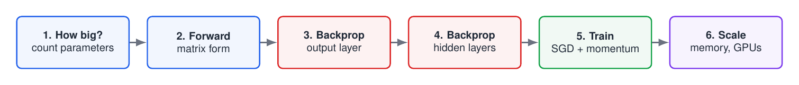
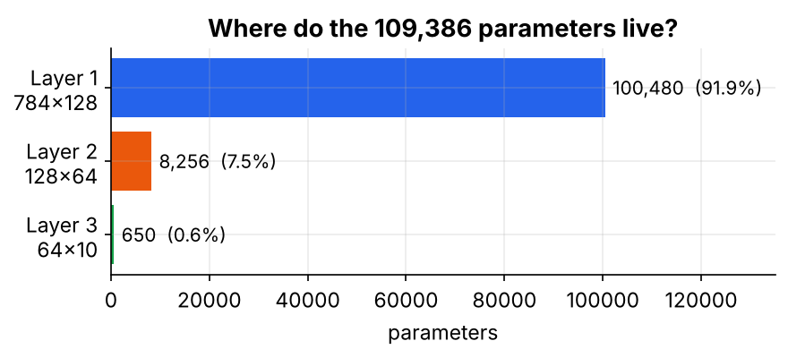
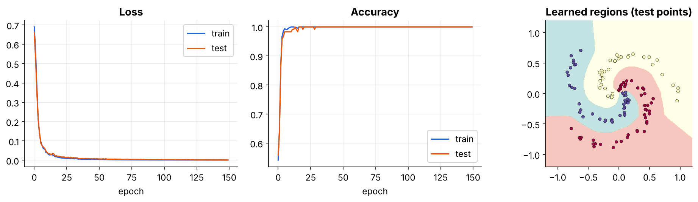
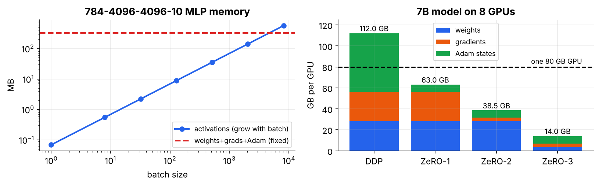

# 02 · Feed-Forward Networks and Backpropagation

**From "how many parameters?" to "will it fit on 8 GPUs?"** This is a hands-on, NumPy-only walk through feed-forward neural networks and the backpropagation algorithm. Every concept is implemented from scratch, checked numerically, and visualised.

> 📘 **Read the full guide for more detail:**
> **[FFNN_Backpropagation_Guide Simplified.pdf](FFNN_Backpropagation_Guide%20Simplified.pdf)** (15 pages). It explains everything in plain language, with step-by-step maths, a complete backprop step worked by hand, line-by-line code walk-throughs, figures, a debugging checklist and a cheat sheet.
> If you're new to neurons and gradient descent, start with **[Deep Learning Internals - Perceptron to Sigmoid Simplified.pdf](../01%20-%20Perceptron%20and%20Gradient%20Descent/Deep%20Learning%20Internals%20-%20Perceptron%20to%20Sigmoid%20Simplified.pdf)** from module 01.



---

## Why this module?

Module 01 ended with a problem: one neuron draws one straight line, but a **layer** of neurons can bend the boundary (for example, to solve XOR). That raises four questions, which this module answers in order:

1. **How big** is a network? *(parameter counting)*
2. **How does data flow** through it efficiently? *(matrix-form forward pass)*
3. **How do we train the hidden weights?** *(backpropagation: output layer, then hidden layers)*
4. **How do we train for real, and at scale?** *(SGD + momentum, memory, multi-GPU)*

## Backpropagation in one picture


The forward pass computes and **stores** every $Z$ and $A$. The backward pass multiplies local slopes from right to left (the chain rule) to get every gradient in **one sweep**:

$$\delta^{[L]}=\frac{P-Y}{N},\qquad \delta^{[l]}=\big(\delta^{[l+1]}W^{[l+1]\top}\big)\odot g'(Z^{[l]}),\qquad \frac{\partial L}{\partial W^{[l]}}=A^{[l-1]\top}\delta^{[l]}$$

**Intuition: passing the blame backwards.** The output layer is blamed first. Each layer then passes blame to the layer before it, *in proportion to the weights that connect them*. Each layer only needs information from its neighbours.

---

## Learning path

| # | Topic | Core idea | Notebook |
|---|---|---|---|
| 01 | [Architecture and Parameter Counting](01%20-%20Architecture%20and%20Parameter%20Counting/) | params $=n_{in}n_{out}+n_{out}$ per layer | `01_architecture_and_parameter_counting.ipynb` |
| 02 | [Matrix-Form Forward Pass](02%20-%20Matrix-Form%20Forward%20Pass/) | $Z=AW+b,\;A=g(Z)$ for a whole batch | `02_matrix_form_forward_pass.ipynb` |
| 03 | [Backprop for the Output Layer](03%20-%20Backprop%20for%20the%20Output%20Layer/) | softmax + CE gives $\delta=(P-Y)/N$ | `03_backprop_output_layer.ipynb` |
| 04 | [Backprop for Hidden Layers](04%20-%20Backprop%20for%20Hidden%20Layers/) | $\delta^{[l]}=(\delta^{[l+1]}W^{\top})\odot g'(Z^{[l]})$ | `04_backprop_hidden_layers.ipynb` |
| 05 | [Training a Small Network](05%20-%20Training%20a%20Small%20Network/) | mini-batch SGD + momentum on a spiral | `05_training_a_small_network.ipynb` |
| 06 | [Memory Footprint and Multi-GPU Training](06%20-%20Memory%20Footprint%20and%20Multi-GPU%20Training/) | 16 bytes/param, data parallel, ZeRO | `06_memory_footprint_and_multi_gpu.ipynb` |

Work through them in order. Each notebook reuses ideas (and some code) from the previous one.

## Notation used everywhere

| Symbol | Shape | Meaning |
|---|---|---|
| $N$ | number | batch size |
| $X=A^{[0]}$ | $(N,d)$ | input batch, **one row per example** |
| $W^{[l]}$ | $(n_{l-1},n_l)$ | weights of layer $l$; column $j$ = incoming weights of neuron $j$ |
| $b^{[l]}$ | $(n_l,)$ | biases, one per neuron |
| $Z^{[l]}=A^{[l-1]}W^{[l]}+b^{[l]}$ | $(N,n_l)$ | net input before activation |
| $A^{[l]}=g(Z^{[l]})$ | $(N,n_l)$ | layer output |
| $\delta^{[l]}=\partial L/\partial Z^{[l]}$ | $(N,n_l)$ | **error signal**: the blame at each neuron |

- The loss is the **mean** over the batch, so the $1/N$ lives inside $\delta$ at the output.
- Hidden activation is ReLU (with He init); the output is softmax + cross-entropy unless stated otherwise.
- The handwritten notes use column vectors ($o=\sigma(Wx+b)$) and the sign convention $\delta=-\partial E/\partial net$. The code uses rows and $\delta=+\partial L/\partial Z$. The maths is the same, just transposed, and the resulting update is identical.

## Key results you will reproduce

| Result | Figure |
|---|---|
| `[784, 128, 64, 10]` has **109,386** parameters; the first layer holds 92% |  |
| Sigmoid gradients shrink to $1.7\times10^{-7}$ by layer 1 of a 10-layer net; ReLU + He stays near 0.9 |  |
| A 2-64-64-3 MLP reaches **100%** train and test accuracy on the 3-arm spiral |  |
| A 7B model needs 112 GB/GPU with plain DDP but only 14 GB with ZeRO-3 on 8 GPUs |  |

Also covered:
- Matrix form runs about 1000× faster than Python loops.
- Analytic gradients match numerical ones to about $10^{-10}$.
- Data-parallel gradients equal single-GPU gradients to machine precision.

## Quick start

```bash
pip install numpy matplotlib jupyter
jupyter notebook
```

All notebooks come with outputs pre-rendered, use only NumPy + Matplotlib, and run in a few seconds on a laptop CPU.

## Folder structure

```
02 - Feed-Forward Networks and Backpropagation/
├── README.md                                    ← you are here
├── FFNN_Backpropagation_Guide Simplified.pdf    ← full guide
├── figures/                                     ← all images used in the READMEs
├── 01 - Architecture and Parameter Counting/      README + notebook
├── 02 - Matrix-Form Forward Pass/                 README + notebook
├── 03 - Backprop for the Output Layer/            README + notebook
├── 04 - Backprop for Hidden Layers/               README + notebook
├── 05 - Training a Small Network/                 README + notebook
└── 06 - Memory Footprint and Multi-GPU Training/  README + notebook
```

**Previous module:** [01 - Perceptron and Gradient Descent](../01%20-%20Perceptron%20and%20Gradient%20Descent/) · **Next module:** word embeddings (word2vec)
