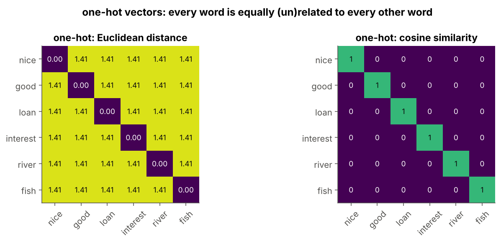
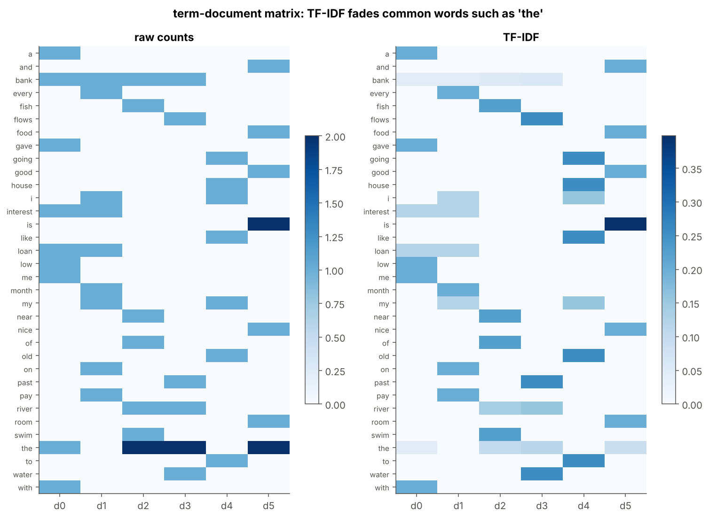
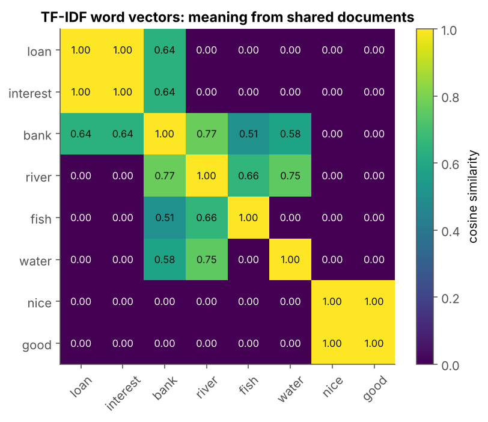
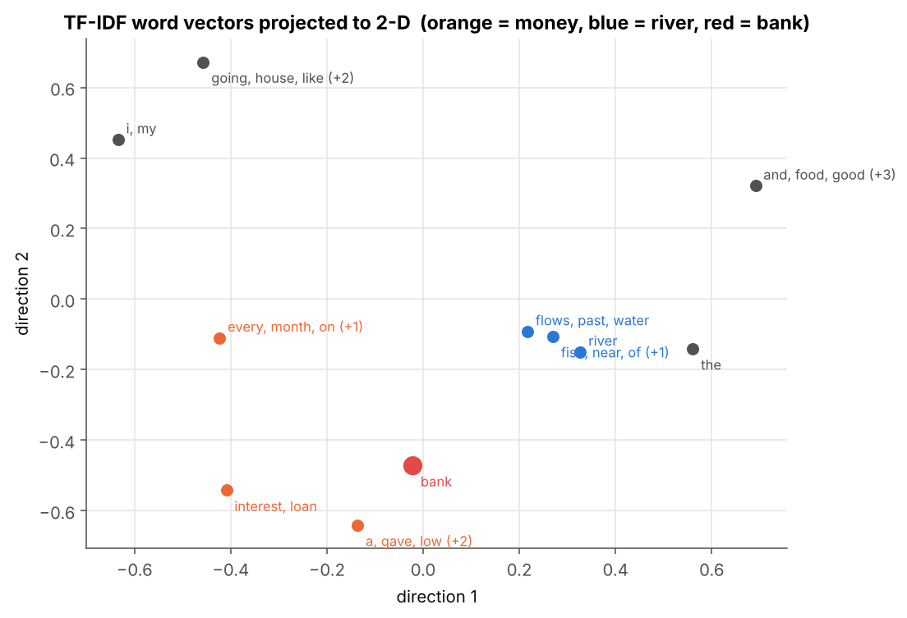

# 01 · One-Hot Encoding and TF-IDF

> **Module:** [03 - Text to Numbers and Word Embeddings](../) · **Notebook:** [`01_one_hot_and_tfidf.ipynb`](01_one_hot_and_tfidf.ipynb) · **Script:** [`01_one_hot_and_tfidf.py`](01_one_hot_and_tfidf.py)
> **Course notes:** pages 6–8: *"text → numbers"*, ASCII codes, one-hot encoding (*"all words are equidistant"*), TF, IDF (*"1 / #docs having w"*), TF × IDF

---

## 📌 The core idea in one sentence

A neural network only understands numbers, so every word must become a vector. The first attempts (character codes, one-hot vectors, TF-IDF) are easy to build, but they either measure **spelling** or treat every word as **equally unrelated** to every other word. That failure is what motivates word embeddings.



---

## 1. The variables you need first

| Symbol | Meaning |
|---|---|
| $w$ | a word, e.g. *bank* |
| $V$ (vocabulary) | the list of all distinct words; $n$ = its size |
| $i$ | position of a word in the vocabulary, $0..n-1$ |
| $x$ | the **one-hot vector** of a word: $n$ numbers, all 0 except a 1 at position $i$ |
| $d_j$ | document number $j$ (here: one sentence); $D$ = the collection of $m$ documents |
| $\text{count}(w,d)$ | how many times $w$ occurs in document $d$ |
| $\lvert d\rvert$ | length of document $d$ in words |
| $df(w)$ | **document frequency**: in how many documents $w$ occurs |
| $TF$, $IDF$ | term frequency, inverse document frequency (defined below) |

---

## 2. Attempt 1: character codes

Write every letter as its ASCII number: *like* → `[108, 105, 107, 101]`.

```text
i      → [105]   (1 numbers)
like   → [108, 105, 107, 101]   (4 numbers)
going  → [103, 111, 105, 110, 103]   (5 numbers)
to     → [116, 111]   (2 numbers)
my     → [109, 121]   (2 numbers)
old    → [111, 108, 100]   (3 numbers)
house  → [104, 111, 117, 115, 101]   (5 numbers)
```

Two problems:
* words have **different lengths**, but a network needs a fixed input size. Padding with zeros fixes the size, not the meaning;
* the numbers describe **spelling**. *nice* and *mice* differ by one letter and come out closest, while *nice* and *good* are far apart:

```text
distance(nice, mice) = 1.0   ← closest pair, but unrelated meanings
distance(nice, good) = 15.2
distance(nice, bad)  = 102.0
```

---

## 3. Attempt 2: one-hot vectors

Give every word its own position in a vector of length $n$:

$$x_k=\begin{cases}1 & k=i\cr 0 & k\neq i\end{cases}$$

For our 6-sentence corpus $n=34$:

```text
x(bank) = [0 0 1 0 0 0 0 0 0 0 0 0 0 0 0 0 0 0 0 0 0 0 0 0 0 0 0 0 0 0 0 0 0 0]
x(loan) = [0 0 0 0 0 0 0 0 0 0 0 0 0 0 0 1 0 0 0 0 0 0 0 0 0 0 0 0 0 0 0 0 0 0]
```

**Every word is equally far from every other word** (notes: *"all words are equidistant"*). For any two different words exactly two positions differ, so

$$\lVert x_a-x_b\rVert=\sqrt{1^2+1^2}=\sqrt2\approx1.414,\qquad\cos(x_a,x_b)=x_a\cdot x_b=0$$

```text
distance(nice, good) = 1.414   distance(nice, river) = 1.414
cosine  (nice, good) = 0.0      cosine  (nice, river) = 0.0
```

*nice* is as far from *good* as from *river*: the vectors carry **no similarity at all**. They are also huge ($n$ = 100,000 for a real vocabulary) and almost entirely zeros.

---

## 4. From words to documents: TF-IDF

Before word embeddings, the standard way to compare **documents** was to count their words.

**Term frequency:** how much of the document is this word?

$$TF(w,d)=\frac{\text{count}(w,d)}{\lvert d\rvert}$$

**Inverse document frequency:** how *rare* is the word across documents? A word in every document (*the*) tells us nothing about any of them.

$$IDF(w,D)=\log\frac{m}{df(w)}\qquad\text{(notes: } \frac{1}{df(w)}\text{, same idea, no log)}$$

**TF-IDF** combines them: a word is important for a document if it is frequent **there** and rare **elsewhere**.

$$TFIDF(w,d)=TF(w,d)\times IDF(w,D)$$

```text
the       df = 4   IDF_notes = 0.250   IDF = log(6/4) = 0.405
bank      df = 4   IDF_notes = 0.250   IDF = log(6/4) = 0.405
interest  df = 2   IDF_notes = 0.500   IDF = log(6/2) = 1.099
fish      df = 1   IDF_notes = 1.000   IDF = log(6/1) = 1.792
```

*the* and *bank* appear in 4 of 6 documents, so they get a low IDF; *fish* appears in only one, so it gets the highest.



---

## 5. Reading the matrix the other way: words as vectors

The TF-IDF matrix is $n\times m$ (words × documents). Each **row** is a vector for a word: its importance in each document. Words that share documents get similar rows:

```text
cos(loan, interest) = 1.00
cos(river, fish) = 0.66
cos(bank, loan) = 0.64
cos(bank, river) = 0.77
cos(loan, fish) = 0.00
```



This is the first representation where similarity **means** something, but it is crude: *loan* and *interest* look identical because they happen to occur in the same two sentences, and *bank* is a mix of the money and river sentences. The vectors are as long as the number of documents, and mostly zeros.



**What TF-IDF still cannot do:** it ignores word order.

```text
bag of words identical? True  → same vector, opposite meanings
```

---

## 6. Code, step by step

| Step | Code | Maths |
|---|---|---|
| 1. Vocabulary | `vocab = sorted({w for t in tokens for w in t})` | the $n$ distinct words |
| 2. One-hot | `x = np.zeros(n); x[index[w]] = 1` | $x_k=1$ if $k=i$ |
| 3. Counts | `Cm[index[w], j] = c` | $\text{count}(w,d_j)$ |
| 4. TF | `counts / doc_len` | $\text{count}/\lvert d\rvert$ |
| 5. IDF | `np.log(m / df)` | $\log(m/df)$ |
| 6. TF-IDF | `TF * IDF[:, None]` | $TF\times IDF$ |
| 7. Word similarity | cosine of rows of `TFIDF` | $\cos(a,b)=\frac{a\cdot b}{\lVert a\rVert\ \lVert b\rVert}$ |

<details>
<summary><b>Click to expand: the core code</b></summary>

```python
import numpy as np
from collections import Counter

docs = [
    "the bank gave me a loan with low interest",
    "i pay interest on my bank loan every month",
    "fish swim near the bank of the river",
    "the river water flows past the bank",
    "i like going to my old house",
    "the food is nice and the room is good",
]
print(len(docs), "documents")

tokens = [d.lower().split() for d in docs]              # list of token lists
vocab = sorted({w for t in tokens for w in t})           # distinct words, alphabetical
index = {w: i for i, w in enumerate(vocab)}              # word → position i
n = len(vocab)
print(f"n = {n} distinct words:\n{vocab}")

class OneHotEncoder:
    """Turns words into one-hot vectors of length n (the vocabulary size)."""

    def fit(self, token_lists):
        self.vocab = sorted({w for t in token_lists for w in t})
        self.index = {w: i for i, w in enumerate(self.vocab)}
        self.n = len(self.vocab)
        return self

def transform(self, word):
    x = np.zeros(self.n)
    x[self.index[word]] = 1.0          # the single 1
    return x

OneHotEncoder.transform = transform

enc = OneHotEncoder().fit(tokens)
print("x(bank) =", enc.transform("bank").astype(int))
print("x(loan) =", enc.transform("loan").astype(int))

def count_matrix(token_lists, index):
    """C[i, j] = how many times word i occurs in document j."""
    Cm = np.zeros((len(index), len(token_lists)))
    for j, toks in enumerate(token_lists):
        for w, c in Counter(toks).items():          # Counter counts each word in the document
            Cm[index[w], j] = c
    return Cm

counts = count_matrix(tokens, index)
print("term-document matrix:", counts.shape, "(words × documents)")
print("column for document 1 (non-zero entries):", {vocab[i]: int(c) for i, c in enumerate(counts[:, 1]) if c})

doc_len = counts.sum(axis=0)                 # |d_j| for every document
TF = counts / doc_len                        # TF(w, d) = count / length
print("document lengths:", doc_len.astype(int))
print("TF(interest, doc 1) =", TF[index["interest"], 1].round(3), "= 1 /", int(doc_len[1]))

m = len(docs)
df = (counts > 0).sum(axis=1)                # df(w): number of documents containing w
IDF_notes = 1.0 / df                         # notes' version
IDF = np.log(m / df)                         # standard version
for w in ["the", "bank", "interest", "fish"]:
    i = index[w]
    print(f"{w:<9} df = {df[i]}   IDF_notes = {IDF_notes[i]:.3f}   IDF = log({m}/{df[i]}) = {IDF[i]:.3f}")

TFIDF = TF * IDF[:, None]                    # TF-IDF(w, d) for every word and document
top = np.argsort(-TFIDF, axis=0)[:3]         # 3 highest-scoring words per document
for j in range(m):
    print(f"doc {j}: top words = {[vocab[i] for i in top[:, j]]}")
```
</details>

The complete runnable version, with all plots, is [`01_one_hot_and_tfidf.py`](01_one_hot_and_tfidf.py).

---

## 7. Summary

| Representation | Vector length | Captures meaning? | Main problem |
|---|---|---|---|
| characters (padded) | longest word | no, spelling only | *nice* ≈ *mice* |
| one-hot | $n$ | no, all distances are $\sqrt2$ | no similarity at all |
| TF-IDF (documents) | $n$ | – | ignores order |
| TF-IDF rows (words) | $m$ | partly, via shared documents | sparse, huge, one vector per word |

## 8. What is in the notebook

| Section | Content |
|---|---|
| 2 | characters → numbers, padding, *nice* vs *mice* |
| 3 | the corpus and vocabulary |
| 4 | `OneHotEncoder` (fit / transform), equidistance heat-maps |
| 5 | bag of words: the term-document count matrix |
| 6 | TF, IDF (notes' and log version), TF-IDF heat-map, top words per document |
| 7 | rows as word vectors, similarity matrix, 2-D map |
| 8 | what TF-IDF cannot do (*dog bites man*) |

```bash
jupyter notebook 01_one_hot_and_tfidf.ipynb     # or:  python 01_one_hot_and_tfidf.py
```

## ✍️ Exercises
1. Replace `IDF` by `IDF_notes`. Which words move up or down the rankings?
2. Add a document "the bank charged a fee". Does *bank* move closer to the money words?
3. Compute the cosine similarity between the six **document** vectors (columns of `TFIDF`). Which documents are most alike?

**Next:** [02 - Distributional Semantics and Co-occurrence](../02%20-%20Distributional%20Semantics%20and%20Co-occurrence/)
