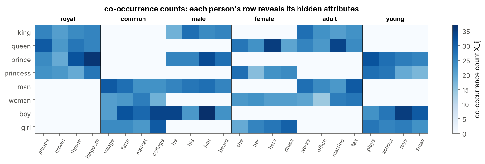
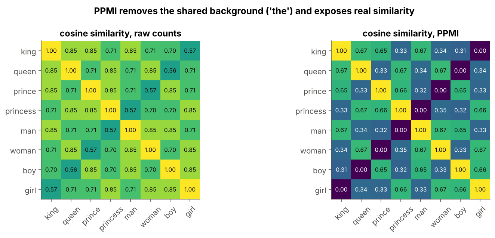
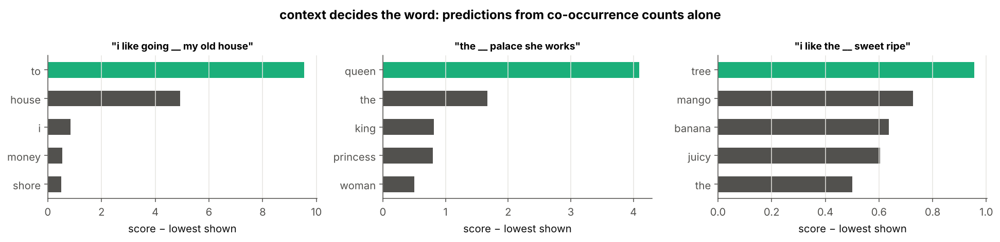
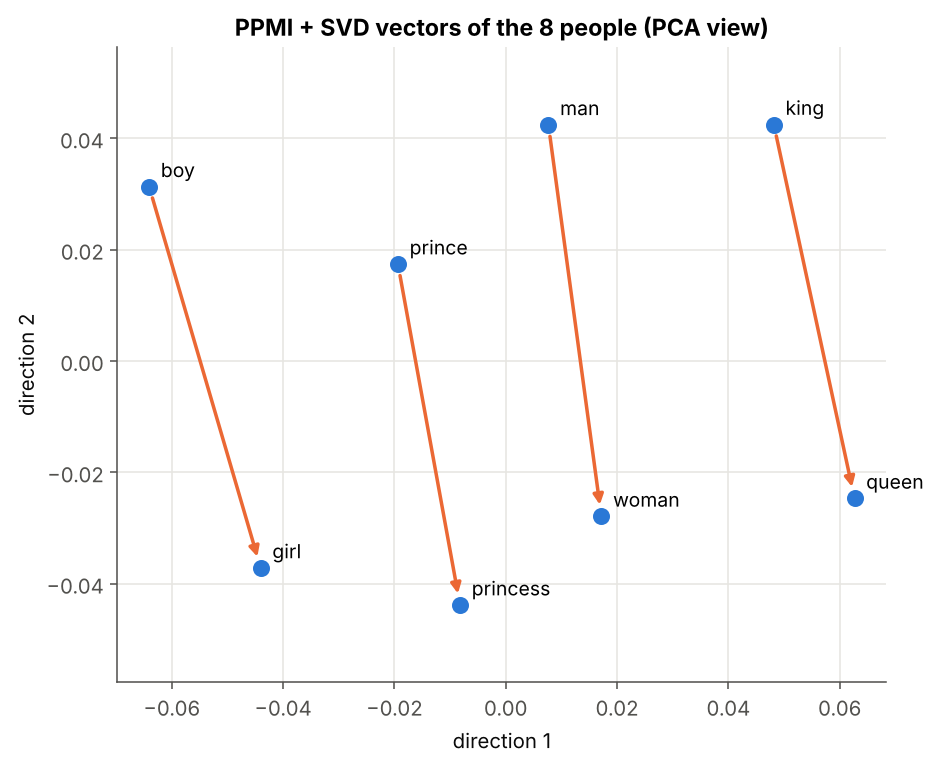

# 02 · Distributional Semantics and Co-occurrence

> **Module:** [03 - Text to Numbers and Word Embeddings](../) · **Notebook:** [`02_distributional_semantics.ipynb`](02_distributional_semantics.ipynb) · **Script:** [`02_distributional_semantics.py`](02_distributional_semantics.py)
> **Course notes:** pages 6 and 9: *"a word is known by the company it keeps"*, the missing-word game (*"I like going __ my old house"*), *king − man = queen − woman*, and the 2×2 table *distributed vs distributional*

---

## 📌 The core idea in one sentence

You can learn what a word means **without a dictionary**, just by looking at which words appear **around** it: words that keep the same company (*king*, *queen*, *prince*) end up with similar count vectors, and after compression those vectors even encode attributes like *royal* or *female* as **directions**.



---

## 1. The variables you need first

| Symbol | Meaning |
|---|---|
| $n$ | vocabulary size (75 words in our corpus) |
| $w_i$ | the word at position $i$ of the vocabulary |
| $m$ | window size: a word's **context** is the $m$ words to its left and right (here $m=3$) |
| $X$ | the $n\times n$ **co-occurrence matrix**; $X_{ij}$ = how often $w_j$ appears within $m$ words of $w_i$ |
| $X_i$ | row $i$ of $X$: the "context profile" of word $w_i$ |
| $P(i,j)$, $P(i)$, $P(j)$ | joint and marginal probabilities obtained by normalising $X$ |
| $PMI$, $PPMI$ | (positive) pointwise mutual information, defined below |
| $k$ | number of dimensions kept after compression (SVD) |

---

## 2. A corpus with hidden meanings

To check whether meaning is really recovered, we generate a toy corpus whose words have meanings **we know in advance**:

* 8 people, each with three hidden attributes: *king* = (royal, male, adult), *girl* = (common, female, young), …
* each attribute has its own context words: royal → *palace, crown, throne, kingdom*; female → *she, her, hers, dress*; …
* 4 kinds of things (fruit, drink, money, river), each with its own context words. *bank* is a context word for **both** money and river.

```text
1520 sentences, 8329 tokens, n = 75 words
   i like the money bank pay
   i like the banana tree ripe
   i like the interest cash rupees
   the boy farm toys beard
   the king he married kingdom
```

The model never sees the attributes, only the sentences.

---

## 3. Counting the company a word keeps

$$X_{ij}=\text{number of times } w_j \text{ appears within } m \text{ words of } w_i$$

```text
X shape: (75, 75)   symmetric: True   non-zero entries: 1086 of 5625
most frequent neighbours of 'king': [('the', 95), ('his', 28), ('works', 28), ('beard', 25), ('palace', 25), ('kingdom', 25), ('him', 24), ('throne', 24)]
```

Two words are similar if their **rows** are similar. We measure that with the cosine:

$$\cos(X_a,X_b)=\frac{X_a\cdot X_b}{\lVert X_a\rVert\ \lVert X_b\rVert}$$

```text
king   (raw counts) → [('man', 0.85), ('prince', 0.85), ('queen', 0.85), ('hers', 0.73), ('his', 0.73)]
girl   (raw counts) → [('boy', 0.85), ('princess', 0.85), ('woman', 0.85), ('him', 0.73), ('dress', 0.73)]
mango  (raw counts) → [('banana', 0.99), ('apple', 0.99), ('grape', 0.98), ('river', 0.79), ('boat', 0.78)]
water  (raw counts) → [('coffee', 0.99), ('milk', 0.99), ('tea', 0.99), ('river', 0.79), ('boat', 0.79)]
```

Already good, but polluted: *mango* looks similar to *river* simply because both appear after *i like the*. Frequent words (*the*, *i*, *like*) dominate the counts.

---

## 4. PPMI: count what is *surprising*

Normalise the counts into probabilities:

$$P(i,j)=\frac{X_{ij}}{\sum_{a,b}X_{ab}},\qquad P(i)=\sum_jP(i,j),\qquad P(j)=\sum_iP(i,j)$$

Pointwise mutual information compares how often two words **actually** meet with how often they would meet **by chance**:

$$PMI(i,j)=\log\frac{P(i,j)}{P(i)\ P(j)},\qquad PPMI(i,j)=\max(PMI(i,j),0)$$

* $PMI>0$: they meet more often than chance (*king*, *palace*);
* $PMI\approx0$: no relation, even if the raw count is large (*king*, *the*);
* negative values are unreliable for rare pairs, so PPMI clips them to 0.

```text
PPMI(king, palace) = 1.71
PPMI(king, dress) = 0.00
PPMI(king, the) = 0.30
PPMI(mango, sweet) = 2.39
```

```text
king   (PPMI) → [('queen', 0.67), ('man', 0.67), ('prince', 0.65), ('his', 0.49), ('she', 0.49)]
girl   (PPMI) → [('woman', 0.67), ('princess', 0.66), ('boy', 0.66), ('he', 0.5), ('cottage', 0.48)]
mango  (PPMI) → [('apple', 1.0), ('banana', 1.0), ('grape', 0.99), ('tree', 0.61), ('juicy', 0.61)]
water  (PPMI) → [('coffee', 1.0), ('milk', 1.0), ('tea', 0.99), ('pour', 0.62), ('glass', 0.62)]
bank   (PPMI) → [('rupees', 0.69), ('cash', 0.69), ('pay', 0.69), ('save', 0.68), ('wet', 0.6)]
he     (PPMI) → [('his', 0.97), ('him', 0.96), ('beard', 0.95), ('dress', 0.58), ('her', 0.58)]
```



---

## 5. The missing-word game (notes page 6)

Given the context, which word fits the gap? Use the counts as a naive-Bayes model: a good filler is common in general **and** often seen next to each context word $c$:

$$\text{score}(w)=\log P(w)+\sum_{c\in\text{context}}\log P(c\mid w),\qquad P(c\mid w)=\frac{X_{wc}+1}{\sum_{c'}(X_{wc'}+1)}$$

(the $+1$ is add-one smoothing, so unseen pairs do not give $\log0$).

```text
i like going __ my old house   → ['to', 'house', 'i', 'money', 'shore']
the __ palace she works        → ['queen', 'the', 'king', 'princess', 'woman']
i like the __ sweet ripe       → ['tree', 'mango', 'banana', 'juicy', 'the']
```



---

## 6. From long sparse rows to short dense vectors

Each PPMI row has $n$ numbers, mostly zero. The **singular value decomposition** writes $PPMI=A\ \Sigma\ B^\top$ with the most important directions first. Keeping the first $k$ columns of $A\Sigma$ gives every word $k$ dense numbers:

```text
each word: 75 sparse numbers → 10 dense numbers;  first 10 singular values: [22.5 17.2 15.8 15.8 15.8 13.3  8.8  8.3  8.2  7.5]
king   (SVD, k=10) → [('man', 1.0), ('queen', 1.0), ('prince', 1.0), ('woman', 1.0)]
mango  (SVD, k=10) → [('apple', 1.0), ('banana', 1.0), ('grape', 1.0), ('juicy', 0.87)]
bank   (SVD, k=10) → [('save', 0.8), ('pay', 0.8), ('cash', 0.8), ('rupees', 0.8)]
```

**Attributes become directions.** If the difference *man → woman* means "female", adding it to *king* should land on *queen* (notes: *king − man = queen − woman*):

```text
king − man + woman ≈ ['queen', 'princess', 'prince']
prince − boy + girl ≈ ['princess', 'woman', 'queen']
queen − woman + man ≈ ['king', 'prince', 'princess']
```



The *male → female* arrows are parallel for every pair: the gender attribute is one direction of the space.

---

## 7. Two different ideas: distributed vs distributional (notes page 9)

* **Distributional:** the *values* come from the contexts a word appears in.
* **Distributed:** the meaning is *spread* over many dense dimensions; no single dimension means "royal".

| | **distributed: yes** | **distributed: no** |
|---|---|---|
| **distributional: yes** | **word2vec** (and PPMI + SVD) | **TF-IDF word vectors** |
| **distributional: no** | **knowledge-graph embeddings** | **one-hot** |

Word2vec (notebooks 04–09) sits in the top-left cell: dense vectors **learned** from context, instead of counted and factorised.

---

## 8. Code, step by step

| Step | Code | Maths |
|---|---|---|
| 1. Count | `X[i, ids[ctx_pos]] += 1` for every pair within the window | $X_{ij}$ |
| 2. Cosine | `M_unit @ M_unit.T` | $\cos(X_a,X_b)$ for all pairs |
| 3. Probabilities | `X / X.sum()`, row and column sums | $P(i,j)$, $P(i)$, $P(j)$ |
| 4. PPMI | `np.maximum(np.log(P_joint / (P_word * P_ctx)), 0)` | $\max(PMI,0)$ |
| 5. Gap filler | `np.log(P_w) + sum(np.log(P_c_given_w[:, c]))` | naive-Bayes score |
| 6. Compress | `A_svd[:, :k] * sing[:k]` | first $k$ columns of $A\Sigma$ |
| 7. Analogy | nearest word to `En[a] - En[b] + En[c]` | $a-b+c$ |

<details>
<summary><b>Click to expand: the core code</b></summary>

```python
import numpy as np

def cooccurrence(sentences, index, window=3):
    """X[i, j] = number of times word j appears within `window` positions of word i."""
    X = np.zeros((len(index), len(index)))
    for s in sentences:
        ids = [index[w] for w in s]
        for pos, i in enumerate(ids):
            lo, hi = max(0, pos - window), min(len(ids), pos + window + 1)   # window boundaries
            for ctx_pos in range(lo, hi):
                if ctx_pos != pos:                                          # a word is not its own context
                    X[i, ids[ctx_pos]] += 1
    return X

def cosine_matrix(M):
    """Cosine similarity between all rows of M."""
    norms = np.linalg.norm(M, axis=1, keepdims=True)
    M_unit = M / np.where(norms == 0, 1, norms)
    return M_unit @ M_unit.T

P_joint = X / X.sum()                       # P(i, j)
P_word = P_joint.sum(axis=1, keepdims=True) # P(i): row sums, shape (n, 1)
P_ctx = P_joint.sum(axis=0, keepdims=True)  # P(j): column sums, shape (1, n)
print("total probability =", P_joint.sum().round(6))

with np.errstate(divide="ignore"):
    PMI = np.log(P_joint / (P_word * P_ctx))
PPMI = np.maximum(PMI, 0)                       # keep only the positive part (-inf → 0 too)
for a, b in [("king", "palace"), ("king", "dress"), ("king", "the"), ("mango", "sweet")]:
    print(f"PPMI({a}, {b}) = {PPMI[index[a], index[b]]:.2f}")

word_freq = np.array([sum(s.count(w) for s in sentences) for w in vocab])
P_w = word_freq / word_freq.sum()                               # P(w): how common each word is


def fill_gap(context, k=5):
    """Rank every vocabulary word as the filler for the given context words."""
    Xs = X + 1                                                  # add-one smoothing
    P_c_given_w = Xs / Xs.sum(axis=1, keepdims=True)           # row w holds P(c | w)
    scores = np.log(P_w) + sum(np.log(P_c_given_w[:, index[c]]) for c in context)
    for c in context:
        scores[index[c]] = -np.inf                              # do not predict a context word itself
    best = np.argsort(-scores)[:k]
    return [(vocab[j], float(scores[j])) for j in best]

A_svd, sing, Bt = np.linalg.svd(PPMI)
k = 10
dense = A_svd[:, :k] * sing[:k]                       # k-dimensional word vectors
print(f"each word: {n} sparse numbers → {k} dense numbers;  first 10 singular values:", sing[:10].round(1))
S_dense = cosine_matrix(dense)
for w in ["king", "mango", "bank"]:
    print(f"{w:<6} (SVD, k={k}) → {neighbours(S_dense, w, 4)}")

def analogy(E, a, b, c, k=3):
    """Words closest to  E[a] - E[b] + E[c]  (cosine), excluding a, b, c."""
    En = E / np.linalg.norm(E, axis=1, keepdims=True)
    q = En[index[a]] - En[index[b]] + En[index[c]]
    s = En @ q
    for w in (a, b, c):
        s[index[w]] = -np.inf
    return [vocab[j] for j in np.argsort(-s)[:k]]

for a, b, c in [("king", "man", "woman"), ("prince", "boy", "girl"), ("queen", "woman", "man")]:
    print(f"{a} − {b} + {c} ≈ {analogy(dense, a, b, c)}")
```
</details>

The complete runnable version, including the corpus generator and all plots, is [`02_distributional_semantics.py`](02_distributional_semantics.py).

---

## 9. What is in the notebook

| Section | Content |
|---|---|
| 2–3 | the missing-word game, the toy corpus with hidden attributes |
| 4 | co-occurrence counting, people × context heat-map |
| 5 | cosine similarity and nearest neighbours |
| 6 | PMI / PPMI, similarity heat-map |
| 7 | naive-Bayes gap filler on three sentences |
| 8 | SVD to 10 dense dimensions, analogies, parallel gender arrows |
| 9 | distributed vs distributional |

```bash
jupyter notebook 02_distributional_semantics.ipynb     # or:  python 02_distributional_semantics.py
```

## ✍️ Exercises
1. Use window $m=1$ and $m=5$. How do the nearest neighbours of *king* change?
2. Remove the PPMI step and run the SVD on raw counts. Do the analogies still work?
3. Find the words with the largest PPMI to *bank*. Which senses do they come from?

**Previous:** [01 - One-Hot and TF-IDF](../01%20-%20One-Hot%20and%20TF-IDF/) · **Next:** [03 - PageRank Analogy](../03%20-%20PageRank%20Analogy/)
