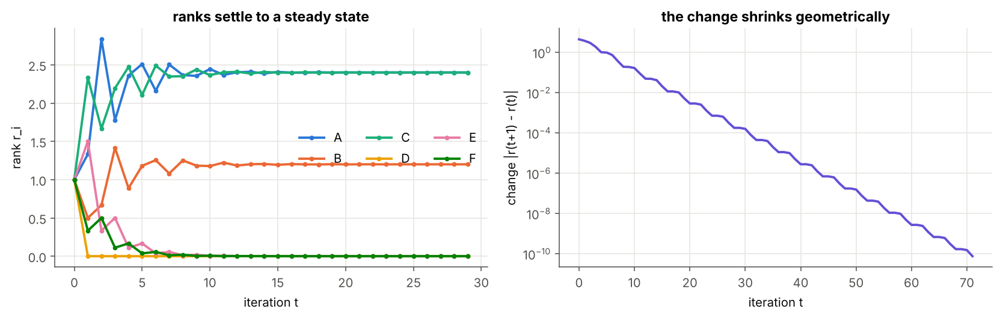
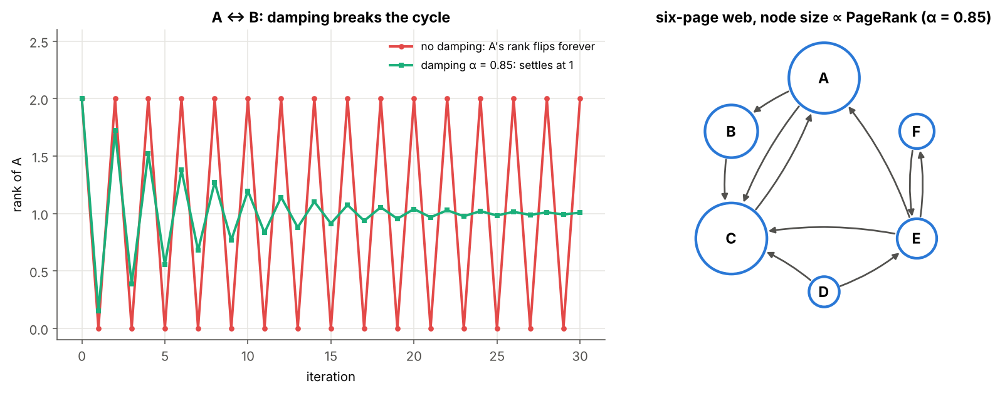

# 03 · The PageRank Analogy

> **Module:** [03 - Text to Numbers and Word Embeddings](../) · **Notebook:** [`03_pagerank_analogy.ipynb`](03_pagerank_analogy.ipynb) · **Script:** [`03_pagerank_analogy.py`](03_pagerank_analogy.py)
> **Course notes:** page 9: *"Recursive problem. PageRank: page is prestigious if other prestigious pages point at it. Assign influence = 1 ∀. Iteratively divide it equally across links. Under certain conditions you can always calculate prestige steady state. Same solution for this."*

---

## 📌 The core idea in one sentence

"A word's meaning is defined by the meanings of its neighbours" is a **recursive** definition, exactly like "a page is important if important pages link to it"; PageRank solves it by **starting with a guess and repeating the definition until nothing changes**, and the same trick spreads meaning through a word graph.



---

## 1. The variables you need first

| Symbol | Meaning |
|---|---|
| $N$ | number of pages (nodes) |
| $j\to i$ | page $j$ links to page $i$ |
| $\text{out}(j)$ | number of outgoing links of page $j$ |
| $r_i$ | the rank ("influence", "prestige") of page $i$; $r$ is the vector of all ranks |
| $M$ | the $N\times N$ **link matrix**: $M_{ij}=1/\text{out}(j)$ if $j\to i$, else 0 |
| $r^{(t)}$ | the ranks after $t$ iterations; $r^{(0)}$ = all ones (notes: *"assign influence = 1 ∀"*) |
| $\alpha$ | damping factor (0.85): probability of following a link rather than jumping to a random page |

---

## 2. The recursive definition

Every page shares its influence **equally** among the pages it links to (notes: *"divide it equally across links"*). The rank of page $i$ is what it receives:

$$r_i=\sum_{j\to i}\frac{r_j}{\text{out}(j)}$$

For all pages at once, with the link matrix $M$:

$$r=M\ r$$

Our six-page web (A–F, 10 links):

```text
[[0.   0.   1.   0.   0.33 0.  ]
 [0.5  0.   0.   0.   0.   0.  ]
 [0.5  1.   0.   0.5  0.33 0.  ]
 [0.   0.   0.   0.   0.   0.  ]
 [0.   0.   0.   0.5  0.   1.  ]
 [0.   0.   0.   0.   0.33 0.  ]]
column sums: [1. 1. 1. 1. 1. 1.]
```

Each **column** sums to 1: page $j$ gives away exactly all of its influence.

---

## 3. Solve it by iterating

Start with $r^{(0)}=(1,\dots,1)$ and apply the definition again and again:

$$r^{(t+1)}=M\ r^{(t)}$$

```text
converged after 72 iterations
steady-state ranks: {'A': 2.4, 'B': 1.2, 'C': 2.4, 'D': 0.0, 'E': 0.0, 'F': 0.0}
```

The steady state satisfies $r=Mr$: it is an **eigenvector** of $M$ with eigenvalue 1.

```text
eigenvalue: 1.0
eigenvector : [ 2.4  1.2  2.4 -0.  -0.  -0. ]
iteration   : [2.4 1.2 2.4 0.  0.  0. ]
```

**Intuition.** Pour one litre of water into every page and let each page pour its water equally into the pages it links to. After enough rounds the water levels stop changing; those levels are the ranks.

---

## 4. The "certain conditions" and the damping fix

Two things break the plain iteration:

| Problem | What happens |
|---|---|
| **dangling page** (no out-links) | its influence disappears: the total drains to 0 |
| **cycle** (A → B → A) | the influence sloshes back and forth forever |

```text
column sums: [1. 1. 1. 0.]   ← D's column is all zero
total influence after 0, 5, 20, 40 steps: [4.0, 1.0625, 0.0173, 0.0001]
ranks of A over time: [2. 0. 2. 0. 2. 0. 2. 0. 2. 0. 2. 0. 2.]
```

**The random surfer.** With probability $\alpha$ the surfer follows a link; otherwise they jump to a random page. Influence on a dangling page is spread evenly over all pages:

$$r^{(t+1)}=\alpha\left(M\ r^{(t)}+\frac{\text{lost}^{(t)}}{N}\right)+(1-\alpha)\ \frac{\sum_ir_i^{(t)}}{N}$$

Now the iteration always converges, to a unique answer:

```text
six-page web : {'A': 2.037, 'B': 1.016, 'C': 2.07, 'D': 0.15, 'E': 0.45, 'F': 0.277}  total 6.0
dangling web : total influence stays 4.0
A↔B cycle    : [1. 1.] after 1 iterations
```



---

## 5. The same idea on words

Replace pages by words and links by **co-occurrence**:

1. **Edges:** PPMI weights from notebook 02 (raw counts would let hubs like *the* connect everything to everything). Each row is normalised to sum to 1, giving a matrix $T$: row $i$ says how much each neighbour counts towards word $i$'s meaning.
2. **Seeds:** four words with a known topic: *mango* = fruit, *water* = drink, *loan* = money, *river* = river. Every other word starts as 25% of each topic.
3. **Iterate:** $F\leftarrow T\ F$ (each word's topic mix becomes the average of its neighbours'), then reset the seeds to their known topic.

```text
apple     fruit  61%  drink  13%  money  13%  river  13%   → fruit
banana    fruit  61%  drink  13%  money  13%  river  13%   → fruit
tea       fruit  14%  drink  61%  money  13%  river  13%   → drink
coffee    fruit  13%  drink  61%  money  13%  river  13%   → drink
interest  fruit  14%  drink  14%  money  49%  river  24%   → money
rupees    fruit  12%  drink  11%  money  56%  river  21%   → money
fish      fruit  14%  drink  14%  money  23%  river  49%   → river
boat      fruit  14%  drink  14%  money  24%  river  49%   → river
bank      fruit  11%  drink  11%  money  40%  river  37%   → money
sweet     fruit  67%  drink  11%  money  11%  river  11%   → fruit
swim      fruit  12%  drink  12%  money  21%  river  56%   → river
king      fruit  25%  drink  25%  money  25%  river  24%   → no clear topic
```


Words never labelled (*apple*, *coffee*, *rupees*, *boat*) inherit the right topic from their neighbours. *bank* sits between money and river, and *king* stays undecided because no seed is connected to the people.

**Connection to word2vec.** Word2vec solves the same recursive problem the same way: start with random vectors and repeat small updates until they stop moving.

---

## 6. Code, step by step

| Step | Code | Maths |
|---|---|---|
| 1. Link matrix | `M[pos[i_page], pos[j_page]] = 1.0 / len(targets)` | $M_{ij}=1/\text{out}(j)$ |
| 2. Iterate | `r_new = M @ r` until the change is below `tol` | $r^{(t+1)}=Mr^{(t)}$ |
| 3. Eigenvector check | `np.linalg.eig(M)` | $Mr=1\cdot r$ |
| 4. Damping | `alpha * (M @ r + lost / N) + (1 - alpha) * r.sum() / N` | random surfer |
| 5. Word graph | `T = PPMI / PPMI.sum(axis=1, keepdims=True)` | row-normalised PPMI |
| 6. Propagate | `F = T @ F; F[seed_rows] = seed_values` | $F\leftarrow TF$, keep seeds |

<details>
<summary><b>Click to expand: the core code</b></summary>

```python
import numpy as np

links = {
    "A": ["B", "C"],
    "B": ["C"],
    "C": ["A"],
    "D": ["C", "E"],
    "E": ["A", "C", "F"],
    "F": ["E"],
}
pages = sorted(links)
pos_of = {p: k for k, p in enumerate(pages)}
N = len(pages)
print(N, "pages;", sum(len(v) for v in links.values()), "links")

def link_matrix(links, pages):
    """M[i, j] = 1/out(j) if page j links to page i."""
    pos = {p: k for k, p in enumerate(pages)}
    M = np.zeros((len(pages), len(pages)))
    for j_page, targets in links.items():
        for i_page in targets:
            M[pos[i_page], pos[j_page]] = 1.0 / len(targets)
    return M

M = link_matrix(links, pages)
print(np.round(M, 2))
print("column sums:", M.sum(axis=0))

def power_iteration(M, r0, tol=1e-10, max_iter=200):
    """Apply r <- M r until the L1 change is below tol. Returns all iterates and the changes."""
    history, changes = [r0], []
    r = r0
    for _ in range(max_iter):
        r_new = M @ r
        changes.append(np.abs(r_new - r).sum())
        history.append(r_new)
        r = r_new
        if changes[-1] < tol:
            break
    return np.array(history), np.array(changes)

hist, changes = power_iteration(M, np.ones(N))
print(f"converged after {len(changes)} iterations")
print("steady-state ranks:", {p: round(float(hist[-1][pos_of[p]]), 3) for p in pages})

def pagerank(M, alpha=0.85, tol=1e-10, max_iter=500, r0=None):
    """Damped PageRank by power iteration. Dangling columns are spread evenly."""
    N = M.shape[0]
    dangling = M.sum(axis=0) == 0                          # pages with no out-links
    r = np.ones(N) if r0 is None else np.asarray(r0, float)
    history = [r]
    for _ in range(max_iter):
        lost = r[dangling].sum()                           # influence sitting on dangling pages
        r_new = alpha * (M @ r + lost / N) + (1 - alpha) * r.sum() / N
        history.append(r_new)
        if np.abs(r_new - r).sum() < tol:
            break
        r = r_new
    return np.array(history)

def propagate(T, F0, seed_rows, iters=300):
    F = F0.copy()
    seed_values = F0[seed_rows].copy()
    history = [F.copy()]
    for _ in range(iters):
        F = T @ F                                  # average of neighbours' meanings
        F[seed_rows] = seed_values                 # keep what we know
        history.append(F.copy())
    return np.array(history)

hist_words = propagate(T, F, seed_rows)
change = np.abs(np.diff(hist_words, axis=0)).sum(axis=(1, 2))
print("total change per iteration (first 6):", change[:6].round(3), " … last:", change[-1].round(8))
```
</details>

The complete runnable version (including the word graph and all plots) is [`03_pagerank_analogy.py`](03_pagerank_analogy.py).

---

## 7. What is in the notebook

| Section | Content |
|---|---|
| 2 | the recursive definition, the link matrix, graph drawing |
| 3 | power iteration, convergence plot, eigenvector check |
| 4 | dangling pages, cycles, damped PageRank |
| 5 | meaning propagation on the PPMI word graph from 4 seeds |

```bash
jupyter notebook 03_pagerank_analogy.ipynb     # or:  python 03_pagerank_analogy.py
```

## ✍️ Exercises
1. Add a link F → D. How do the ranks change?
2. Try $\alpha=0.5$ and $\alpha=0.99$. How many iterations are needed, and how do the ranks change?
3. Add *she* as a fifth seed with a new topic "female". Which words pick it up?

**Previous:** [02 - Distributional Semantics and Co-occurrence](../02%20-%20Distributional%20Semantics%20and%20Co-occurrence/) · **Next:** [04 - Word2Vec Model](../04%20-%20Word2Vec%20Model/)
