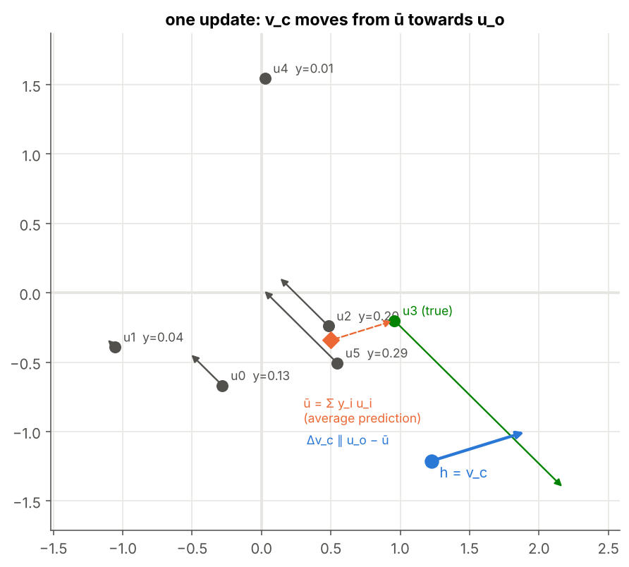
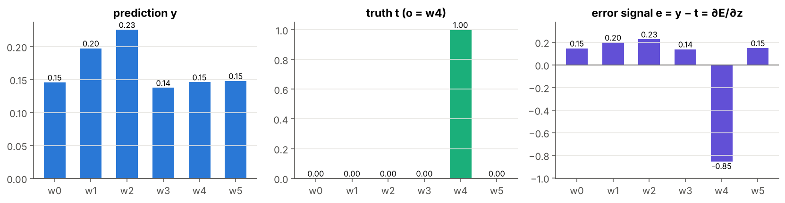
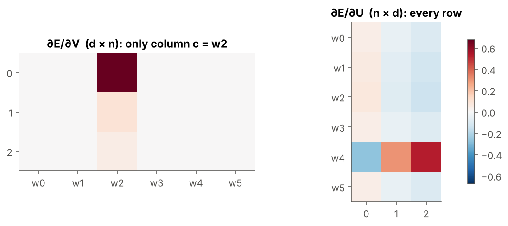

# 05 · Softmax and Cross-Entropy Gradients

> **Module:** [03 - Text to Numbers and Word Embeddings](../) · **Notebook:** [`05_softmax_cross_entropy_gradients.ipynb`](05_softmax_cross_entropy_gradients.ipynb) · **Script:** [`05_softmax_cross_entropy_gradients.py`](05_softmax_cross_entropy_gradients.py)
> **Course notes:** pages 11–14: $E=-\log y_o$, the quotient-rule derivation of the softmax, $\Delta u_k=\eta(\delta_{ok}-y_k)h^\top$, $\Delta v=\eta(u_o-\sum_iy_iu_i)$, *"k = input → I; k ≠ input → 0"*

---

## 📌 The core idea in one sentence

For softmax + cross-entropy the error signal at the scores is simply **prediction minus truth**, $y-t$; from it, every output vector $u_k$ is pushed towards or away from $h$, and the input word's vector moves from **what the model expected** ($\sum_iy_iu_i$) towards **what actually happened** ($u_o$).



---

## 1. The variables you need first

| Symbol | Shape | Meaning |
|---|---|---|
| $c$, $o$ | index | input word and true output word of one training pair |
| $h=v_c$ | $d$ | hidden vector = column $c$ of $V$ |
| $u_k$ | $d$ | row $k$ of $U$ (output vector of word $k$) |
| $z_k=u_k\cdot h$ | number | score of word $k$ |
| $y_k$ | number | softmax probability of word $k$ |
| $S=\sum_me^{z_m}$ | number | softmax denominator |
| $\delta_{ok}$ | number | Kronecker delta: 1 if $k=o$, else 0 |
| $t$ | $n$ | one-hot vector of the true word: $t_k=\delta_{ok}$ |
| $e=y-t$ | $n$ | the **error signal** |
| $\eta$ | number | learning rate |

---

## 2. The derivation, step by step (as in the notes)

**Step 1, the log.** $E=-\log y_o$, so

$$\frac{\partial E}{\partial y_o}=-\frac{1}{y_o}$$

**Step 2, the softmax (quotient rule).** Write $y_o=e^{z_o}\cdot\frac1S$ and differentiate with respect to $z_k$:

$$\frac{\partial y_o}{\partial z_k}=\frac{1}{S}e^{z_o}\delta_{ok}-\frac{e^{z_o}}{S^2}e^{z_k}=y_o\ \delta_{ok}-y_o\ y_k=y_o(\delta_{ok}-y_k)$$

**Step 3, combine.** The $y_o$ cancels:

$$\frac{\partial E}{\partial z_k}=-\frac{1}{y_o}\ y_o(\delta_{ok}-y_k)=\boxed{y_k-\delta_{ok}}\qquad\text{i.e.}\qquad\frac{\partial E}{\partial z}=y-t=e$$

**Step 4, rows of $U$.** $z_k=u_k\cdot h$ depends only on row $u_k$, and $\partial z_k/\partial u_k=h^\top$:

$$\frac{\partial E}{\partial u_k}=(y_k-\delta_{ok})\ h^\top\qquad\Rightarrow\qquad\boxed{\Delta u_k=\eta\ (\delta_{ok}-y_k)\ h^\top}$$

| case | update | meaning |
|---|---|---|
| $k=o$ (true word) | $\eta(1-y_o)h$ | pull $u_o$ **towards** $h$, more so the less sure we were |
| $k\neq o$ | $-\eta\ y_kh$ | push $u_k$ **away** from $h$, in proportion to how much we wrongly predicted it |

**Step 5, the input column of $V$.** $h$ enters every score, $\partial z_k/\partial h=u_k$:

$$\frac{\partial E}{\partial h}=\sum_{k=1}^{n}(y_k-\delta_{ok})\ u_k=U^\top(y-t)$$

Only column $c$ of $V$ produced $h$ (notes: *"k = input → I; k ≠ input → 0"*):

$$\boxed{\Delta v_c=\eta\Big(u_o-\sum_{i=1}^{n}y_i\ u_i\Big)},\qquad\Delta v_k=0\ \text{ for } k\neq c$$

**Intuition (notes).** $u_o$ is *"the word I should have predicted"*; $\sum_iy_iu_i$ is the **average prediction**, each word weighted by its probability. The word vector moves from the expected towards the actual.

---

## 3. Worked example

A tiny model, $n=6$ words, $d=3$, pair $(c,o)=(2,4)$:

```text
h = [ 0.32  -0.352 -0.623]
z = [-0.077  0.226  0.36  -0.136 -0.075 -0.062]
y = [0.146 0.197 0.226 0.137 0.146 0.148]  (sums to 1.0 )
E = -log y_o = -log 0.146 = 1.924
```

```text
y     = [0.146 0.197 0.226 0.137 0.146 0.148]
t     = [0. 0. 0. 0. 1. 0.]
e=y-t = [ 0.146  0.197  0.226  0.137 -0.854  0.148]   (sums to -0.0 )
```



Only the true word has a negative error: its score must go **up**. Every other word has an error equal to its probability: its score must go **down**. The entries sum to 0.

**Where the gradient lives:**

```text
non-zero columns of dV: [2]  (only the input word c = 2 )
non-zero rows of dU   : [0 1 2 3 4 5]  (every word)
```



**Gradient check** (central differences, as in module 02):

```text
dU relative error = 2.07e-10
dV relative error = 1.03e-10
```

**One SGD step** raises the true word's probability, and the change in $v_c$ equals the notes' formula exactly:

```text
y_o: 0.146 → 0.227      E: 1.924 → 1.482
Δv_c from the gradient : [-0.3373 -0.0473 -0.0254]
Δv_c from the notes    : [-0.3373 -0.0473 -0.0254]
```

---

## 4. The cost of one update

One pair changes **all $n$ rows of $U$** ($n\times d$ numbers) and **one column of $V$** ($d$ numbers):

```text
d =  10, n =      75:  U updates =          750   V updates =   10   per training pair
d = 300, n =  10,000:  U updates =    3,000,000   V updates =  300   per training pair
d = 300, n = 100,000:  U updates =   30,000,000   V updates =  300   per training pair
```

Notes: *"All d×n update ≈ 3×10⁷ … roughly 10⁷ updates"* per training pair. This is the problem that notebooks 07 and 08 solve.

---

## 5. Code, step by step

| Step | Code | Maths |
|---|---|---|
| 1. Forward | `h = V[:, c]; z = U @ h; y = softmax(z)` | $h,z,y$ |
| 2. Error signal | `e = y.copy(); e[o] -= 1.0` | $e=y-t$ |
| 3. Output gradient | `dU = np.outer(e, h)` | $\partial E/\partial u_k=e_kh^\top$ |
| 4. Input gradient | `dV[:, c] = U.T @ e` | $\partial E/\partial v_c=U^\top e$ |
| 5. Update | `V -= eta * dV; U -= eta * dU` | gradient descent |
| 6. Check | `expected_u = y @ U` | $\sum_iy_iu_i$ |

<details>
<summary><b>Click to expand: the core code</b></summary>

```python
import numpy as np

def softmax(z):
    e = np.exp(z - z.max())                 # subtract the max: same result, no overflow
    return e / e.sum()


def forward(V, U, c, o):
    """One skip-gram pair (c → o). Returns h, z, y and the error E."""
    h = V[:, c]                             # h = V x = column c
    z = U @ h                               # z_k = u_k · h
    y = softmax(z)
    return h, z, y, -np.log(y[o])

def error_signal(y, o):
    """dE/dz = y - t, where t is the one-hot vector of the true word o."""
    e = y.copy()
    e[o] -= 1.0
    return e

e = error_signal(y, o)
print("y     =", y.round(3))
print("t     =", np.eye(n_toy)[o])
print("e=y-t =", e.round(3), "  (sums to", e.sum().round(10), ")")

def gradients(V, U, c, o):
    """dE/dV and dE/dU for one skip-gram pair (c → o), full softmax."""
    h, z, y, E = forward(V, U, c, o)
    e = error_signal(y, o)                  # dE/dz
    dU = np.outer(e, h)                     # dE/du_k = e_k h^T   (every row)
    dV = np.zeros_like(V)
    dV[:, c] = U.T @ e                      # dE/dv_c = U^T e     (one column only)
    return dV, dU, E

dV, dU, E = gradients(V, U, c, o)
print("non-zero columns of dV:", np.flatnonzero(np.abs(dV).sum(axis=0)), " (only the input word c =", c, ")")
print("non-zero rows of dU   :", np.flatnonzero(np.abs(dU).sum(axis=1)), " (every word)")

def numerical_grad(f, theta, eps=1e-6):
    g = np.zeros_like(theta)
    for idx in np.ndindex(theta.shape):
        old = theta[idx]
        theta[idx] = old + eps; fp = f()
        theta[idx] = old - eps; fm = f()
        theta[idx] = old
        g[idx] = (fp - fm) / (2 * eps)
    return g


def rel_err(a, b):
    return np.linalg.norm(a - b) / (np.linalg.norm(a) + np.linalg.norm(b) + 1e-12)

E_fn = lambda: forward(V, U, c, o)[3]
print(f"dU relative error = {rel_err(dU, numerical_grad(E_fn, U)):.2e}")
print(f"dV relative error = {rel_err(dV, numerical_grad(E_fn, V)):.2e}")
```
</details>

The complete runnable version with all plots is [`05_softmax_cross_entropy_gradients.py`](05_softmax_cross_entropy_gradients.py).

---

## 6. Summary

| Quantity | Formula | Code |
|---|---|---|
| error signal | $\partial E/\partial z=y-t$ | `e = y.copy(); e[o] -= 1` |
| output vectors | $\Delta u_k=\eta(\delta_{ok}-y_k)h^\top$ | `U -= eta * np.outer(e, h)` |
| input vector | $\Delta v_c=\eta(u_o-\sum_iy_iu_i)$ | `V[:, c] -= eta * U.T @ e` |
| other input vectors | $\Delta v_k=0$ | – |
| cost per pair | $nd+d$ values | – |

## 7. What is in the notebook

| Section | Content |
|---|---|
| 2 | forward pass of one pair on a 6-word model |
| 3 | the 5-step derivation (quotient rule) with the notes' interpretation |
| 4 | `error_signal`, `gradients`, gradient check, sparsity heat-maps |
| 5 | one SGD step; the notes' $\Delta v_c$ checked; 2-D geometry of the update |
| 6 | number of values updated per pair |

```bash
jupyter notebook 05_softmax_cross_entropy_gradients.ipynb     # or:  python 05_softmax_cross_entropy_gradients.py
```

## ✍️ Exercises
1. Derive $\partial E/\partial z_k$ for CBOW, where $h$ is the average of the context columns. Which columns of $V$ change?
2. Show that if $y=t$ exactly, every gradient is 0.
3. Make one $y_k\approx0$ and confirm its row of $U$ barely moves (notes: *"no need to change anything"*).

**Previous:** [04 - Word2Vec Model](../04%20-%20Word2Vec%20Model/) · **Next:** [06 - Naive Training](../06%20-%20Naive%20Training/)
