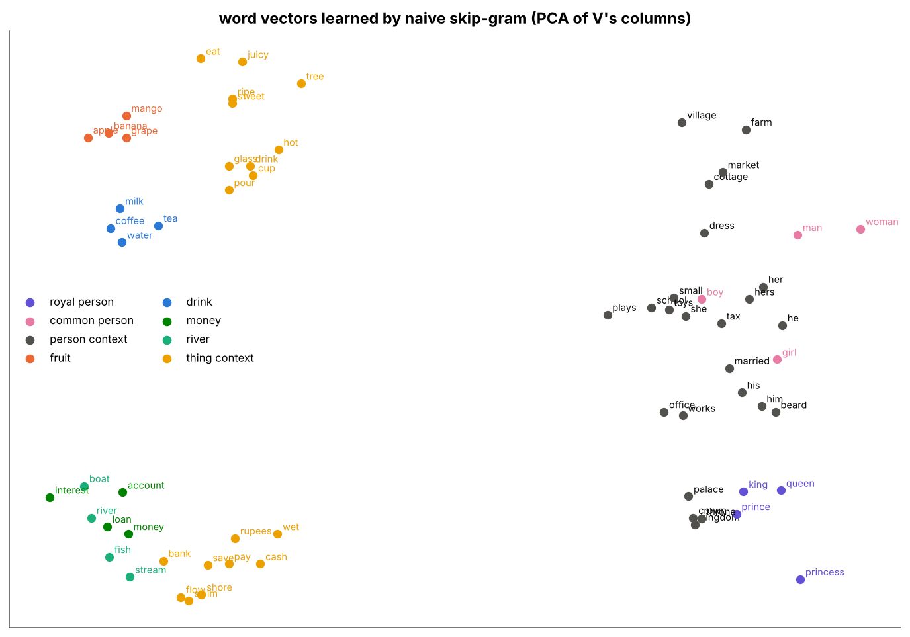
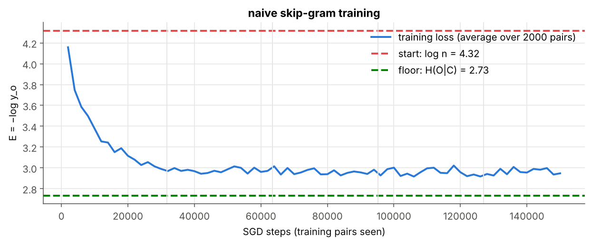
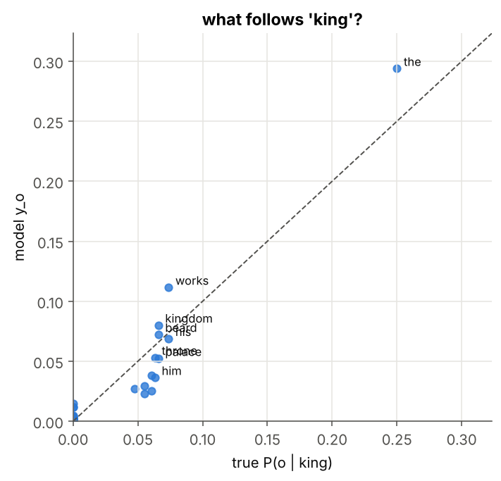
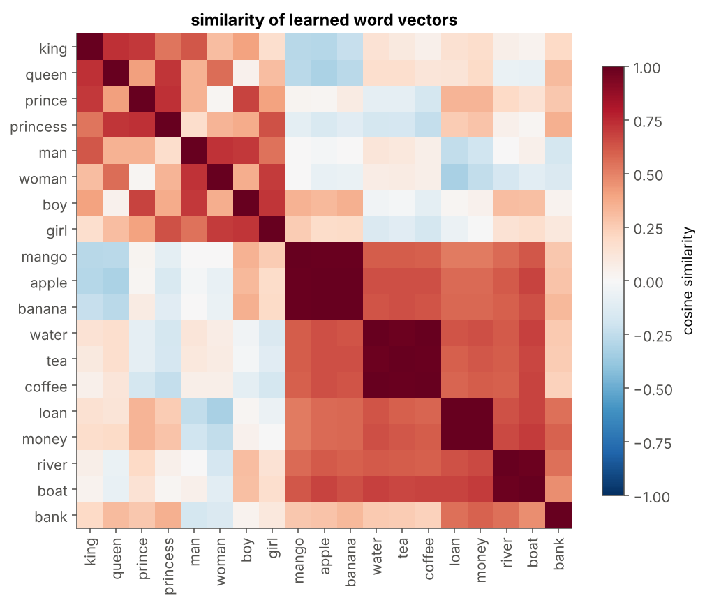
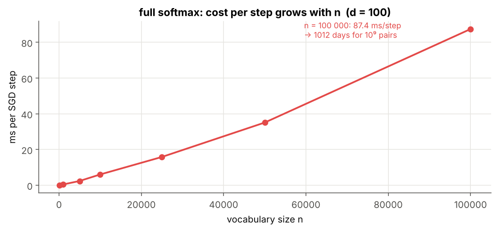

# 06 · Naive Training (Full Softmax)

> **Module:** [03 - Text to Numbers and Word Embeddings](../) · **Notebook:** [`06_naive_training.ipynb`](06_naive_training.ipynb) · **Script:** [`06_naive_training.py`](06_naive_training.py)
> **Course notes:** pages 13–14: $\Delta u_k=\eta(\delta_{ok}-y_k)h^\top$, $\Delta v=\eta(u_o-\sum_iy_iu_i)$, *"All d×n update ≈ 3×10⁷ … roughly 10⁷ updates – too expensive"*

---

## 📌 The core idea in one sentence

Apply the notebook-05 update to every (word, neighbour) pair of the corpus, many times over, and the columns of $V$ turn into real word vectors (*king − man + woman ≈ queen*), but every single step touches all $n\times d$ numbers of $U$, which is far too slow for a real vocabulary.



---

## 1. The variables you need first

| Symbol | Meaning |
|---|---|
| $n$, $d$ | vocabulary size (75) and embedding size (10) |
| $(c,o)$ | one skip-gram training pair: input word, true neighbour |
| $N$ | number of training pairs in the corpus (31,734 with window 3) |
| epoch | one pass over all $N$ pairs in random order |
| $\eta$ | learning rate (0.05) |
| $P(o\mid c)$ | true frequency of $o$ among the neighbours of $c$, counted from the data |
| $H(O\mid C)$ | conditional entropy: the lowest average error any model can reach |

---

## 2. How low can the error go?

A word has many different neighbours (*king* → *palace*, *he*, *works*, …), so even a perfect model cannot reach $E=0$. The best it can do is predict the true frequencies $P(o\mid c)$; its average error is the **conditional entropy**:

$$H(O\mid C)=-\frac{1}{N}\sum_{(c,o)}\log P(o\mid c)$$

So the loss curve has two reference lines: the start, $\log n$ (uniform guessing), and the floor $H(O\mid C)$.

```text
start:  log n      = 4.317
floor:  H(O | C)   = 2.734
```

---

## 3. The training loop

Stochastic gradient descent: for each pair, in random order, take one step downhill on $E=-\log y_o$.

| code | formula |
|---|---|
| `h, y = self.forward(c)` | $h=v_c$, $y=\text{softmax}(Uh)$ |
| `e = y.copy(); e[o] -= 1.0` | $e=y-t$ |
| `grad_h = self.U.T @ e` | $\partial E/\partial v_c=U^\top e$ (before $U$ changes) |
| `self.U -= eta * np.outer(e, h)` | $\Delta u_k=\eta(\delta_{ok}-y_k)h^\top$ for **all** $k$ |
| `self.V[:, c] -= eta * grad_h` | $\Delta v_c=\eta(u_o-\sum_iy_iu_i)$ |

Why shuffle? Without it the model would see all pairs of sentence 1, then sentence 2, … and keep forgetting earlier sentences.

```text
loss before training = 4.320   (log n = 4.317)
epoch 1:  mean loss (last 2000 pairs) = 2.990   time = 0.97 s
epoch 2:  mean loss (last 2000 pairs) = 2.961   time = 0.57 s
epoch 3:  mean loss (last 2000 pairs) = 2.957   time = 0.55 s
epoch 4:  mean loss (last 2000 pairs) = 2.958   time = 0.78 s
epoch 5:  mean loss (last 2000 pairs) = 2.948   time = 0.50 s

158,670 SGD steps, 120,589,200 parameter values updated in total
```



The loss drops from $\log n=4.32$ towards the floor and settles near 2.95. It cannot reach 2.73 exactly: 10 numbers per word is a compression, and SGD with a fixed $\eta$ keeps jittering.

---

## 4. What did the network learn to predict?

```text
  king  model: [('the', 0.294), ('works', 0.112), ('kingdom', 0.08), ('beard', 0.072), ('his', 0.069), ('throne', 0.053)]
        data : [('the', 0.25), ('his', 0.074), ('works', 0.074), ('beard', 0.066), ('palace', 0.066), ('kingdom', 0.066)]

  girl  model: [('the', 0.405), ('cottage', 0.102), ('farm', 0.084), ('market', 0.07), ('hers', 0.046), ('village', 0.038)]
        data : [('the', 0.25), ('cottage', 0.077), ('dress', 0.074), ('hers', 0.067), ('plays', 0.067), ('toys', 0.064)]

 mango  model: [('i', 0.184), ('eat', 0.162), ('like', 0.138), ('tree', 0.125), ('juicy', 0.112), ('sweet', 0.081)]
        data : [('i', 0.2), ('like', 0.2), ('the', 0.2), ('ripe', 0.113), ('sweet', 0.082), ('eat', 0.072)]

  bank  model: [('the', 0.141), ('like', 0.102), ('rupees', 0.073), ('pay', 0.072), ('loan', 0.068), ('money', 0.063)]
        data : [('the', 0.285), ('like', 0.146), ('loan', 0.052), ('cash', 0.047), ('rupees', 0.045), ('interest', 0.045)]
```



---

## 5. The word vectors: the columns of $V$

**Nearest neighbours** (cosine similarity between columns):

```text
  king → [('queen', 0.73), ('prince', 0.7), ('man', 0.62), ('she', 0.53), ('princess', 0.53)]
  girl → [('boy', 0.71), ('woman', 0.7), ('princess', 0.64), ('small', 0.59), ('him', 0.57)]
 mango → [('apple', 0.99), ('banana', 0.99), ('grape', 0.97), ('sweet', 0.77), ('juicy', 0.76)]
   tea → [('milk', 0.99), ('coffee', 0.99), ('water', 0.98), ('cup', 0.78), ('hot', 0.78)]
  loan → [('money', 0.99), ('interest', 0.98), ('account', 0.98), ('save', 0.81), ('rupees', 0.77)]
 river → [('fish', 0.99), ('stream', 0.98), ('boat', 0.98), ('shore', 0.81), ('swim', 0.8)]
  bank → [('flow', 0.74), ('save', 0.73), ('cash', 0.73), ('pay', 0.72), ('shore', 0.72)]
    he → [('him', 0.98), ('his', 0.98), ('beard', 0.97), ('dress', 0.62), ('her', 0.61)]
```



**Analogies.** *king − man + woman*: the difference *man → woman* encodes "female"; adding it to *king* should land on the female royal.

```text
king − man + woman = ['queen', 'princess', 'crown']   ✅ (expected queen)
prince − boy + girl = ['princess', 'queen', 'him']   ✅ (expected princess)
queen − woman + man = ['king', 'prince', 'she']   ✅ (expected king)
man − boy + princess = ['queen', 'king', 'woman']   ✅ (expected queen)
girl − woman + king = ['prince', 'princess', 'rupees']   ✅ (expected prince)
```

**Why does this work?** Words with similar contexts are pulled towards the **same** output vectors $u_o$ (notebook 05: $\Delta v_c\propto u_o-\bar u$), so their columns of $V$ move in the same directions.

*bank* lands between the money and the river words: one vector has to serve two meanings (see notebook 09).

---

## 6. The price

Each step changes $nd+d$ numbers:

```text
per step: n·d + d = 75 × 10 + 10 = 760 values
one epoch: 31,734 steps → 24,117,840 values,  0.67 s
per step : 3.0e+07 values
1 epoch  : 3.0e+16 values  (N = 1e+09 pairs)
```

Measured time per step grows **linearly** with the vocabulary:

```text
n =     100:    0.050 ms per step
n =   1,000:    0.446 ms per step
n =   5,000:    2.381 ms per step
n =  10,000:    6.032 ms per step
n =  25,000:   15.829 ms per step
n =  50,000:   35.099 ms per step
n = 100,000:   87.427 ms per step
```



Two places cost $O(n)$:
* the softmax denominator $\sum_{m=1}^{n}e^{z_m}$ needs all $n$ scores;
* the update touches all $n$ rows of $U$, because every word with $y_k>0$ is pushed away.

Negative sampling (07) and hierarchical softmax (08) remove both.

---

## 7. Code, step by step

<details>
<summary><b>Click to expand: the model and training loop</b></summary>

```python
import numpy as np, time

class SkipGramSoftmax:
    """Skip-gram word2vec with the full softmax (notes pages 10–14)."""

    def __init__(self, n, d, seed=0):
        rng = np.random.default_rng(seed)
        self.n, self.d = n, d
        self.V = rng.normal(0, 0.1, (d, n))     # input vectors  (columns = word vectors)
        self.U = rng.normal(0, 0.1, (n, d))     # output vectors (rows)
        self.steps = 0
        self.values_updated = 0

def forward(self, c):
    h = self.V[:, c]
    z = self.U @ h
    z = z - z.max()                             # numerical safety, softmax unchanged
    y = np.exp(z)
    return h, y / y.sum()

SkipGramSoftmax.forward = forward

def sgd_step(self, c, o, eta):
    h, y = self.forward(c)
    h = h.copy()
    E = -np.log(y[o])
    e = y.copy(); e[o] -= 1.0                   # dE/dz = y - t
    grad_h = self.U.T @ e                       # dE/dv_c
    self.U -= eta * np.outer(e, h)              # every row of U   → n·d values
    self.V[:, c] -= eta * grad_h                # one column of V  → d values
    self.steps += 1
    self.values_updated += self.n * self.d + self.d
    return E

SkipGramSoftmax.sgd_step = sgd_step

def train_epoch(self, pairs, eta, rng, log_every=2000):
    curve, running = [], []
    for c, o in pairs[rng.permutation(len(pairs))]:
        running.append(self.sgd_step(c, o, eta))
        if len(running) == log_every:
            curve.append(np.mean(running)); running = []
    return curve

SkipGramSoftmax.train_epoch = train_epoch

def predict_context(self, word, k=6):
    _, y = self.forward(index[word])
    top = np.argsort(-y)[:k]
    return [(vocab[i], round(float(y[i]), 3)) for i in top]


def vectors(self):
    return self.V / np.linalg.norm(self.V, axis=0, keepdims=True)

SkipGramSoftmax.predict_context = predict_context
SkipGramSoftmax.vectors = vectors

# ---- training ----
d, eta, epochs = 10, 0.05, 5
model = SkipGramSoftmax(n, d, seed=0)
E0 = np.mean([-np.log(model.forward(c)[1][o]) for c, o in pairs[:3000]])
print(f"loss before training = {E0:.3f}   (log n = {np.log(n):.3f})")

rng = np.random.default_rng(1)
curve, epoch_times = [], []
for ep in range(epochs):
    t0 = time.perf_counter()
    curve += model.train_epoch(pairs, eta, rng)
    epoch_times.append(time.perf_counter() - t0)
    print(f"epoch {ep + 1}:  mean loss (last 2000 pairs) = {curve[-1]:.3f}   time = {epoch_times[-1]:.2f} s")
print(f"\n{model.steps:,} SGD steps, {model.values_updated:,} parameter values updated in total")
```
</details>

The complete runnable version (corpus generator, analogies, all plots) is [`06_naive_training.py`](06_naive_training.py).

---

## 8. Summary

| | |
|---|---|
| training | SGD over all skip-gram pairs, update from notebook 05 |
| loss | from $\log n$ down towards the floor $H(O\mid C)$ |
| result | columns of $V$: similar words close, analogies work |
| cost per step | $nd+d$ values; $3\times10^7$ for $d=300$, $n=10^5$ |
| problem | time grows linearly with the vocabulary |

## 9. What is in the notebook

| Section | Content |
|---|---|
| 2–3 | corpus, pairs, the loss floor $H(O\mid C)$ |
| 4 | `SkipGramSoftmax`, one method per cell |
| 5 | training, loss curve |
| 6 | predicted vs true neighbour distributions |
| 7 | nearest neighbours, similarity heat-map, 2-D map, analogies |
| 8 | values per step, time per step vs $n$ |

```bash
jupyter notebook 06_naive_training.ipynb     # or:  python 06_naive_training.py
```

## ✍️ Exercises
1. Train with $d=2$ and plot $V$ directly. Which groups survive?
2. Increase $\eta$ to 0.5. What happens to the loss curve?
3. Use window $m=1$. Do the analogies still work?
4. Average $V$ and $U^\top$ and redo the analogies. Better or worse?

**Previous:** [05 - Softmax and Cross-Entropy Gradients](../05%20-%20Softmax%20and%20Cross-Entropy%20Gradients/) · **Next:** [07 - Negative Sampling](../07%20-%20Negative%20Sampling/)
