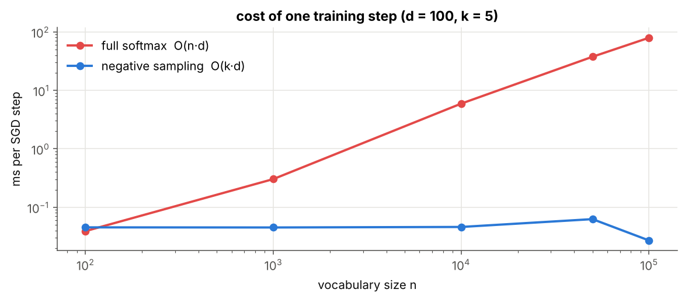
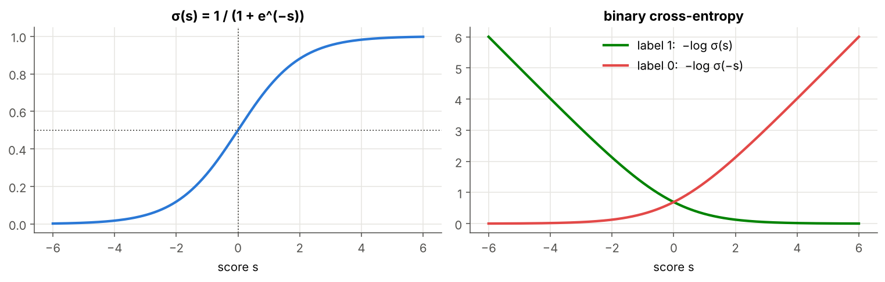
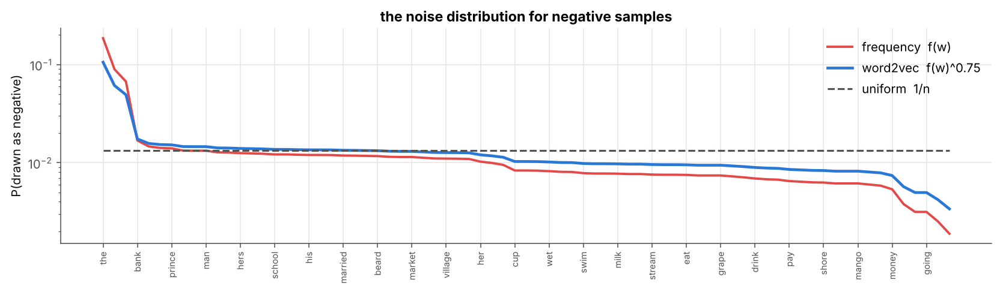
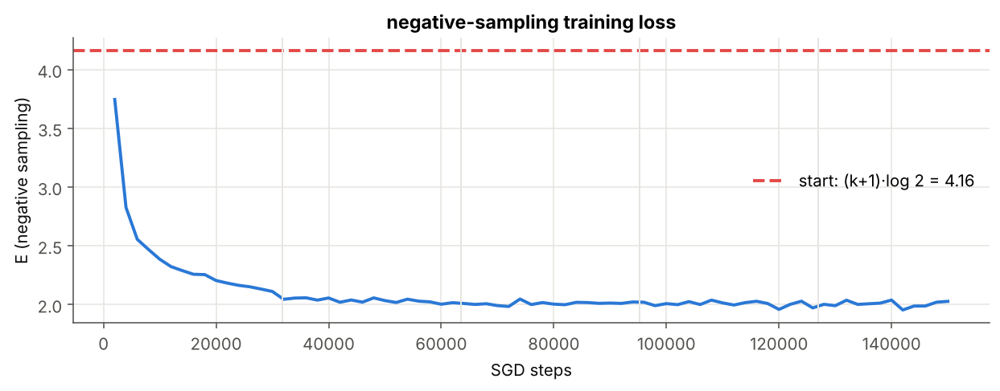
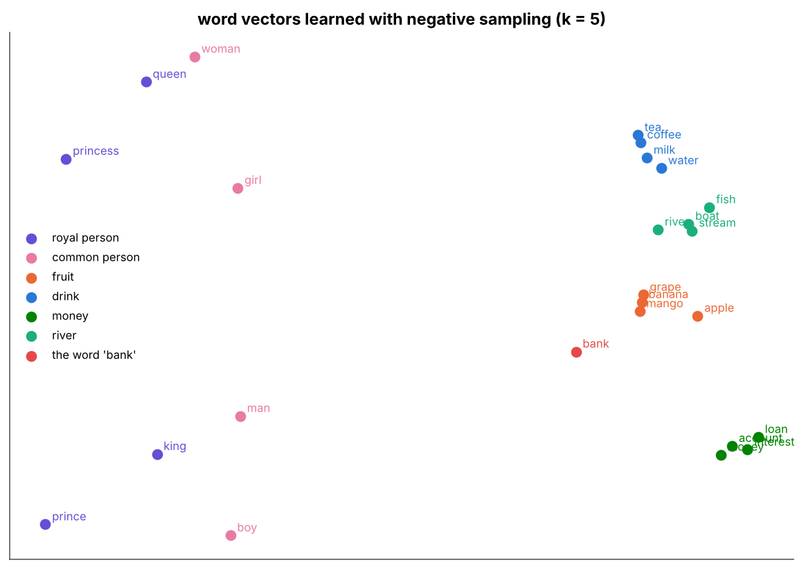
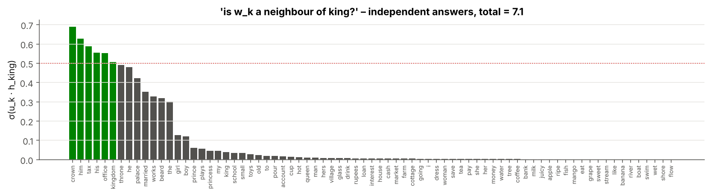

# 07 · Negative Sampling

> **Module:** [03 - Text to Numbers and Word Embeddings](../) · **Notebook:** [`07_negative_sampling.ipynb`](07_negative_sampling.ipynb) · **Script:** [`07_negative_sampling.py`](07_negative_sampling.py)
> **Course notes:** pages 15–17: *"Negative sampling: 1 positive + k negative"*, the sigmoid $\sigma$, *"10 × 300 = 3×10³ updates – roughly 10⁴ times faster"*, logistic regression $\Delta a=-\eta(y'-y)x$, $\Delta b=-\eta(y'-y)$ · **Paper:** Mikolov et al. 2013, *Distributed Representations of Words and Phrases*

---

## 📌 The core idea in one sentence

Instead of asking "which of the $n$ words is the neighbour?" (a softmax over everything), ask $k+1$ **yes/no questions**: "is $o$ a real neighbour of $c$?" (yes) and "is this random word a neighbour?" (no, $k$ times); each step now updates only $k+1$ rows of $U$ instead of $n$.



---

## 1. The variables you need first

| Symbol | Meaning |
|---|---|
| $\sigma(s)=\frac{1}{1+e^{-s}}$ | sigmoid: turns a score into a probability between 0 and 1 |
| $h=v_c$ | hidden vector of the input word (unchanged from notebook 04) |
| $u_j$ | output vector (row of $U$) of word $j$ |
| $k$ | number of **negative** samples per pair (notes: 5–20; we use 5) |
| $j_1,\dots,j_k$ | the negative words: random words that are (probably) not neighbours of $c$ |
| $\ell_j$ | label: 1 for the true word $o$, 0 for a negative |
| $f(w)$ | how often $w$ appears as a target in the data |
| $P_n(w)$ | the "noise" distribution negatives are drawn from: $P_n(w)\propto f(w)^{3/4}$ |

---

## 2. Warm-up: logistic regression (notes page 17)

One input $x$, weight $a$, bias $b$, label $y\in\lbrace0,1\rbrace$:

$$y'=\sigma(ax+b),\qquad E=-y\log y'-(1-y)\log(1-y')$$

Using $\sigma'(s)=\sigma(s)(1-\sigma(s))$ with $s=ax+b$:

$$\frac{\partial E}{\partial s}=y'-y\qquad\Rightarrow\qquad\boxed{\Delta a=-\eta\ (y'-y)\ x,\qquad\Delta b=-\eta\ (y'-y)}$$

The same shape as the softmax result of notebook 05: **prediction minus truth, times the input**.

```text
dE/da: formula -0.499480   numerical -0.499480
dE/db: formula -0.249740   numerical -0.249740
```



---

## 3. From one softmax to $k+1$ logistic regressions

For a pair $(c,o)$, all $k+1$ questions share the input $h=v_c$:

| word | score | label | want |
|---|---|---|---|
| true neighbour $o$ | $u_o\cdot h$ | 1 | $\sigma\to1$ |
| negative $j_i$ | $u_{j_i}\cdot h$ | 0 | $\sigma\to0$ |

The error is the sum of the $k+1$ binary cross-entropies (using $1-\sigma(s)=\sigma(-s)$):

$$E=-\log\sigma(u_o\cdot h)-\sum_{i=1}^{k}\log\sigma(-u_{j_i}\cdot h)$$

Each term is a logistic regression with input $h$ and weight $u_j$, so section 2 gives the gradients directly:

$$\boxed{\Delta u_j=-\eta\ \big(\sigma(u_j\cdot h)-\ell_j\big)\ h}\qquad\boxed{\Delta v_c=-\eta\sum_{j\in\lbrace o,j_1..j_k\rbrace}\big(\sigma(u_j\cdot h)-\ell_j\big)\ u_j}$$

**Every other row of $U$ is untouched.** In notebook 05 the push-away term $-\eta\ y_kh$ hit **all** $n$ words; here only a random **sample** of $k$ words is pushed away.

```text
n =      75, d = 10, k = 5:  full softmax         760   negative sampling     70   ratio 11×
n = 100,000, d = 300, k = 9:  full softmax  30,000,300   negative sampling  3,300   ratio 9,091×
```

(Notes: *"10 × 300 = 3×10³ updates, roughly 10⁴ times faster"*.)

---

## 4. Which words to use as negatives?

| choice | problem |
|---|---|
| uniform $1/n$ | rare words, which the model hardly knows, are picked as often as *the* |
| frequency $f(w)$ | almost every negative is *the*, *i*, *like*; rare words never get pushed away |
| **$f(w)^{3/4}$** (word2vec) | in between: big counts shrink more than small ones ($1000^{0.75}\approx178$, $10^{0.75}\approx5.6$) |

```text
top-5 words: ['the', 'like', 'i', 'bank', 'boy']
their share  –  frequency: [0.185 0.089 0.067 0.017 0.015]    f^0.75: [0.105 0.061 0.049 0.017 0.016]
```



---

## 5. Training

Same corpus, $d=10$, $k=5$, $\eta=0.05$, 5 epochs:

```text
epoch 1:  mean loss (last 2000 pairs) = 2.112   time = 0.86 s
epoch 2:  mean loss (last 2000 pairs) = 2.004   time = 0.81 s
epoch 3:  mean loss (last 2000 pairs) = 2.014   time = 0.68 s
epoch 4:  mean loss (last 2000 pairs) = 1.960   time = 0.71 s
epoch 5:  mean loss (last 2000 pairs) = 2.028   time = 0.84 s

158,670 SGD steps, 11,106,900 parameter values updated in total
```



The start is $(k+1)\log2\approx4.16$ (every $\sigma\approx0.5$). This is a **different** error from notebook 06, so the two loss values cannot be compared directly.

**Are the vectors still good?**

```text
  king → [('prince', 0.76), ('man', 0.62), ('school', 0.58), ('market', 0.57), ('small', 0.56)]
  girl → [('woman', 0.75), ('princess', 0.61), ('throne', 0.6), ('farm', 0.6), ('kingdom', 0.59)]
 mango → [('banana', 0.99), ('apple', 0.98), ('grape', 0.98), ('tree', 0.82), ('juicy', 0.81)]
   tea → [('coffee', 0.99), ('milk', 0.98), ('water', 0.97), ('glass', 0.79), ('hot', 0.78)]
  loan → [('account', 0.99), ('interest', 0.99), ('money', 0.98), ('rupees', 0.77), ('apple', 0.75)]
 river → [('boat', 0.99), ('stream', 0.98), ('fish', 0.98), ('wet', 0.84), ('swim', 0.82)]
  bank → [('shore', 0.79), ('rupees', 0.78), ('pay', 0.77), ('save', 0.77), ('flow', 0.77)]
    he → [('his', 0.99), ('beard', 0.97), ('him', 0.97), ('woman', 0.6), ('prince', 0.55)]
king − man + woman = ['queen', 'princess', 'beard']   ✅ (expected queen)
prince − boy + girl = ['princess', 'queen', 'hers']   ✅ (expected princess)
queen − woman + man = ['king', 'prince', 'market']   ✅ (expected king)
man − boy + princess = ['queen', 'woman', 'hers']   ✅ (expected queen)
girl − woman + king = ['prince', 'boy', 'market']   ✅ (expected prince)
```



---

## 6. The outputs no longer sum to 1

Each word has its own independent sigmoid; nothing ties them together (notes: *"outputs may not sum to 1"*). The model answers "is this a plausible neighbour?" for each word separately; it does not give a probability distribution.

```text
  king:  Σ_k σ(u_k·h) =   7.09    most likely neighbours: [('crown', 0.69), ('him', 0.63), ('tax', 0.59), ('his', 0.56), ('office', 0.55)]
 mango:  Σ_k σ(u_k·h) =   4.10    most likely neighbours: [('ripe', 0.82), ('sweet', 0.58), ('eat', 0.53), ('i', 0.46), ('tree', 0.42)]
   the:  Σ_k σ(u_k·h) =  11.26    most likely neighbours: [('king', 0.45), ('i', 0.37), ('bank', 0.33), ('queen', 0.32), ('wet', 0.25)]
```



---

## 7. The speed-up

```text
full softmax      : 760 values per step
negative sampling : 70 values per step   ((k+2)·d = 70)
```

With only 75 words, Python's per-step overhead dominates, so an epoch is no faster than in notebook 06. The real difference appears as $n$ grows:

```text
n =     100:  full    0.039 ms   negative sampling  0.045 ms   speed-up     0.9×
n =   1,000:  full    0.303 ms   negative sampling  0.045 ms   speed-up     6.7×
n =  10,000:  full    5.918 ms   negative sampling  0.046 ms   speed-up   128.7×
n =  50,000:  full   37.445 ms   negative sampling  0.063 ms   speed-up   598.0×
n = 100,000:  full   79.228 ms   negative sampling  0.027 ms   speed-up  2931.8×
```

The cost of negative sampling depends on $k$ and $d$, **not on the vocabulary**. The budget is fixed at **training time** (notes: *"budget at training time → negative sampling"*).

---

## 8. Code, step by step

| code | formula |
|---|---|
| `ids = [o, j1..jk]`, `labels = [1, 0..0]` | the $k+1$ questions |
| `s = sigmoid(U[ids] @ h)` | $\sigma(u_j\cdot h)$: only $k+1$ dot products |
| `g = s - labels` | $\partial E/\partial s_j=\sigma(s_j)-\ell_j$ |
| `grad_h = g @ U[ids]` | $\sum_jg_ju_j$ |
| `np.subtract.at(U, ids, eta * np.outer(g, h))` | $\Delta u_j$ for $k+1$ rows (a word drawn twice gets both updates) |
| `V[:, c] -= eta * grad_h` | $\Delta v_c$ |

<details>
<summary><b>Click to expand: the core code</b></summary>

```python
import numpy as np

def sigmoid(s):
    return 1.0 / (1.0 + np.exp(-s))


def logreg_grad(a, b, x, y):
    """Error and gradients of one logistic-regression example."""
    y_pred = sigmoid(a * x + b)
    E = -y * np.log(y_pred) - (1 - y) * np.log(1 - y_pred)
    return E, (y_pred - y) * x, (y_pred - y)

freq = np.bincount(pairs[:, 1], minlength=n).astype(float)

def noise_distribution(freq, power=0.75):
    p = freq ** power
    return p / p.sum()

P_noise = noise_distribution(freq)
order = np.argsort(-freq)
print("top-5 words:", [vocab[i] for i in order[:5]])
print("their share  –  frequency:", (freq[order[:5]] / freq.sum()).round(3), "   f^0.75:", P_noise[order[:5]].round(3))

def draw_negatives(rng, n_pairs, k, P_noise):
    return rng.choice(len(P_noise), size=(n_pairs, k), p=P_noise)

demo = draw_negatives(np.random.default_rng(0), 3, 5, P_noise)
for (c, o), neg in zip(pairs[:3], demo):
    print(f"pair ({vocab[c]} → {vocab[o]})   negatives: {[vocab[j] for j in neg]}")

class SkipGramNS:
    """Skip-gram word2vec trained with negative sampling."""

    def __init__(self, n, d, k=5, seed=0):
        rng = np.random.default_rng(seed)
        self.n, self.d, self.k = n, d, k
        self.V = rng.normal(0, 0.1, (d, n))
        self.U = rng.normal(0, 0.1, (n, d))
        self.steps = 0
        self.values_updated = 0

def sgd_step(self, c, o, negatives, eta):
    h = self.V[:, c].copy()
    ids = np.concatenate(([o], negatives))
    labels = np.zeros(len(ids)); labels[0] = 1.0
    s = sigmoid(self.U[ids] @ h)
    E = -np.log(s[0]) - np.log(1.0 - s[1:]).sum()
    g = s - labels                              # dE/ds_j
    grad_h = g @ self.U[ids]                    # dE/dv_c
    np.subtract.at(self.U, ids, eta * np.outer(g, h))   # only k+1 rows of U
    self.V[:, c] -= eta * grad_h                # one column of V
    self.steps += 1
    self.values_updated += len(ids) * self.d + self.d
    return E

SkipGramNS.sgd_step = sgd_step

def train_epoch(self, pairs, eta, rng, P_noise, log_every=2000):
    perm = rng.permutation(len(pairs))
    negatives = draw_negatives(rng, len(pairs), self.k, P_noise)
    curve, running = [], []
    for (c, o), neg in zip(pairs[perm], negatives):
        running.append(self.sgd_step(c, o, neg, eta))
        if len(running) == log_every:
            curve.append(np.mean(running)); running = []
    return curve

SkipGramNS.train_epoch = train_epoch
```
</details>

The complete runnable version is [`07_negative_sampling.py`](07_negative_sampling.py).

---

## 9. Summary

| | full softmax | negative sampling |
|---|---|---|
| question per pair | which of $n$ words? | $k+1$ yes/no questions |
| error | $-\log y_o$ | $-\log\sigma(u_o\cdot h)-\sum_j\log\sigma(-u_j\cdot h)$ |
| rows of $U$ updated | $n$ | $k+1$ |
| values per step | $(n+1)d$ | $(k+2)d$ |
| outputs sum to 1? | yes | **no** |
| word vectors | good | similar quality (all analogies correct) |

## 10. What is in the notebook

| Section | Content |
|---|---|
| 2 | logistic regression, its gradient and check, sigmoid / BCE plots |
| 3 | the negative-sampling error and gradients, update counts |
| 5 | the $f^{3/4}$ noise distribution, bulk sampling |
| 6 | `SkipGramNS`, one method per cell |
| 7–8 | training, neighbours, analogies, 2-D map |
| 9 | outputs that do not sum to 1 |
| 10 | update counts and time per step vs $n$ |

```bash
jupyter notebook 07_negative_sampling.ipynb     # or:  python 07_negative_sampling.py
```

## ✍️ Exercises
1. Train with uniform negatives and with plain frequency. Which analogies break?
2. Try $k=1$ and $k=20$. How do the vectors and the time per epoch change?
3. Why does word2vec also **subsample** very frequent words such as *the*?

**Previous:** [06 - Naive Training](../06%20-%20Naive%20Training/) · **Next:** [08 - Hierarchical Softmax](../08%20-%20Hierarchical%20Softmax/)
