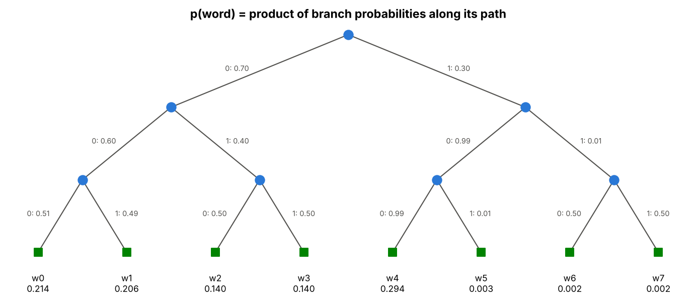
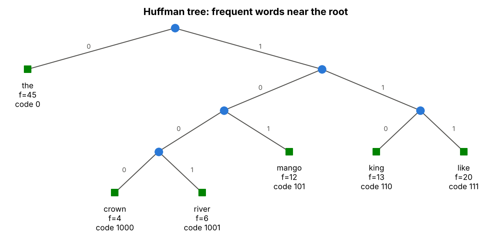
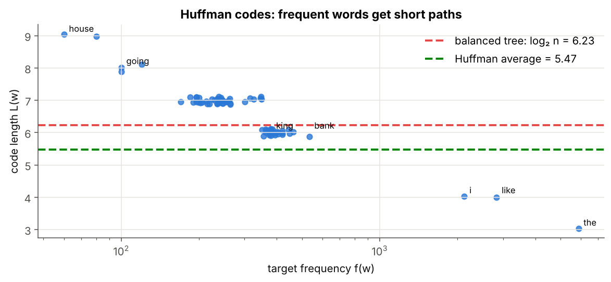
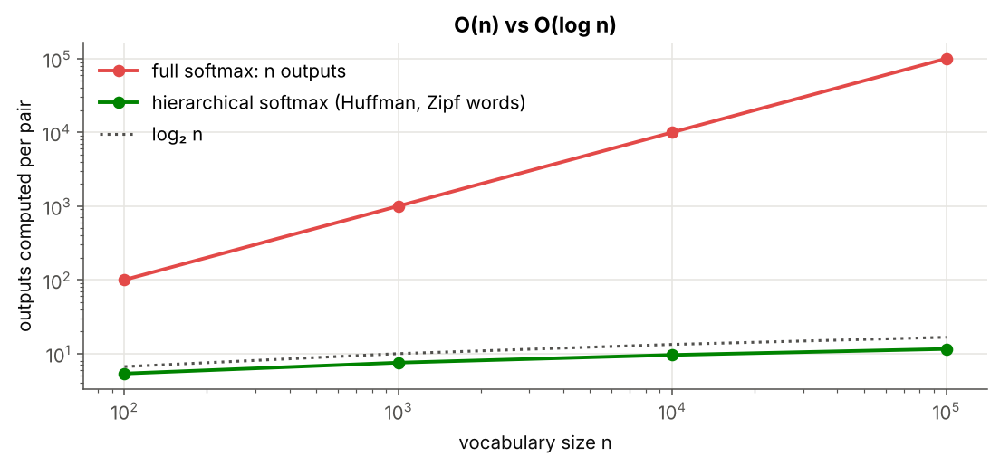
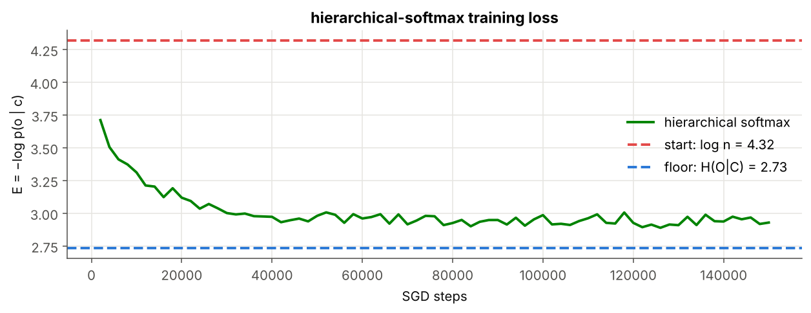
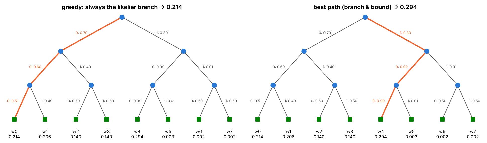
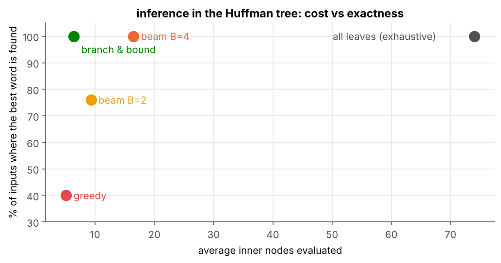

# 08 · Hierarchical Softmax

> **Module:** [03 - Text to Numbers and Word Embeddings](../) · **Notebook:** [`08_hierarchical_softmax.ipynb`](08_hierarchical_softmax.ipynb) · **Script:** [`08_hierarchical_softmax.py`](08_hierarchical_softmax.py)
> **Course notes:** pages 18–20: *"binary tree (Huffman), n leaves = words, n − 1 inner neurons"*, codes *left = 0, right = 1* (*w₁: 00, w₅: 10, w₄: 0111*), *"average path length O(log n)"*, *"p(word) = product along the path"*; inference by greedy, beam search, branch and bound; the greedy-failure example $0.7\times0.6\times0.51$ vs $0.3\times0.99\times0.99$

---

## 📌 The core idea in one sentence

Put the words at the leaves of a binary tree and replace the single $n$-way choice by a **sequence of left/right decisions** from the root; the probability of a word is the product along its path, it still sums to 1 over all words, and training a pair costs only the $\approx\log_2n$ nodes on one path.



---

## 1. The variables you need first

| Symbol | Meaning |
|---|---|
| tree | binary tree with $n$ **leaves** (one per word) and $n-1$ **inner nodes** |
| $u_j$ | a $d$-vector stored at inner node $j$; $U$ is now $(n-1)\times d$, one row per **inner node** |
| $\text{path}(w)$ | the inner nodes from the root to the leaf of $w$; $L(w)$ = their number (code length) |
| $b_j(w)$ | the bit at node $j$ on the way to $w$: 0 = **left**, 1 = **right** (notes) |
| $s_j(w)$ | sign of that move: $+1$ for left, $-1$ for right |
| $\sigma$ | sigmoid. At node $j$: $P(\text{left})=\sigma(u_j\cdot h)$, $P(\text{right})=\sigma(-u_j\cdot h)$ |
| $f(w)$ | frequency of $w$ as a target |
| $B$ | beam width (inference) |

---

## 2. A word is a path

$$p(w\mid h)=\prod_{j\in\text{path}(w)}\sigma\big(s_j(w)\ u_j\cdot h\big)$$

**Why it sums to 1.** At every node the two branches split the incoming probability into two parts that add up to it ($\sigma(a)+\sigma(-a)=1$). Nothing is created or lost on the way down, so the leaves receive exactly the 1 that started at the root.

```text
  w0: 0.2142
  w1: 0.2058
  w2: 0.1400
  w3: 0.1400
  w4: 0.2940
  w5: 0.0030
  w6: 0.0015
  w7: 0.0015
  sum = 1.0
```

---

## 3. Which tree? Huffman coding

The cost of a word is its path length, so frequent words should sit near the root. **Huffman's algorithm**:

1. Every word starts as its own tree, weighted by $f(w)$.
2. Repeatedly join the **two lightest** trees under a new inner node (lighter one left = bit 0) whose weight is their sum.
3. After $n-1$ joins one tree is left.

```text
  the    f = 45   code = 0      length 1
  like   f = 20   code = 111    length 3
  king   f = 13   code = 110    length 3
  mango  f = 12   code = 101    length 3
  river  f =  6   code = 1001   length 4
  crown  f =  4   code = 1000   length 4

  average code length = 2.20 bits   (balanced tree: log2(6) = 2.58, rounded up to 3)
```



**On our corpus:**

```text
inner nodes          : 74  (= n − 1 = 74)
code length          : min 3, max 9
average (per pair)   : 5.47 nodes
log2 n               : 6.23
entropy of f (bits)  : 5.42   ← Huffman's average is always within 1 bit of this
  the    f =  5878   code = 111
  like   f =  2836   code = 1101
  king   f =   380   code = 001100
  mango  f =   195   code = 0100001
  going  f =   100   code = 01011100
```



**Scaling.** On Zipf-distributed vocabularies ($f\propto1/\text{rank}$), the average path stays **below** $\log_2n$:

```text
n =     100:  average path =  5.35    log2 n =  6.64
n =   1,000:  average path =  7.52    log2 n =  9.97
n =  10,000:  average path =  9.56    log2 n = 13.29
n = 100,000:  average path = 11.53    log2 n = 16.61
```



---

## 4. Training: the gradient along one path

For a pair $(c,o)$, $E=-\log p(o\mid h)$ (a **real** probability, the same quantity as in notebook 06); the log turns the product into a sum:

$$E=-\sum_{j\in\text{path}(o)}\log\sigma\big(s_j\ u_j\cdot h\big)$$

Each term is a logistic regression (notebook 07) with label $\ell_j=1$ for left and 0 for right. With $a_j=u_j\cdot h$:

$$\frac{\partial E}{\partial a_j}=\sigma(a_j)-\ell_j\qquad\boxed{\Delta u_j=-\eta\ (\sigma(u_j\cdot h)-\ell_j)\ h,\ j\in\text{path}(o)}\qquad\boxed{\Delta v_c=-\eta\sum_{j\in\text{path}(o)}(\sigma(u_j\cdot h)-\ell_j)\ u_j}$$

Only the $L(o)$ nodes on the path change. Checks before training:

```text
Σ_w p(w | king)               = 1.0
p(queen | king), one path     = 0.01497
p(queen | king), whole tree   = 0.01497
dE/dU relative error: 2.4e-09   rows changed: 7 of 74 (path length 7)
dE/dV relative error: 8.8e-10
```

**Training** ($d=10$, $\eta=0.05$, 5 epochs):

```text
epoch 1:  mean loss = 3.002   time = 0.88 s
epoch 2:  mean loss = 2.961   time = 0.72 s
epoch 3:  mean loss = 2.949   time = 0.71 s
epoch 4:  mean loss = 2.927   time = 0.77 s
epoch 5:  mean loss = 2.929   time = 0.74 s

values updated per step: 64.7  (full softmax: 760)
```



The loss reaches about 2.93, as low as the full softmax (2.95), with about 65 values updated per step instead of 760. The outputs remain a true distribution:

```text
  king: Σ p = 1.000000   top: [('the', 0.202), ('works', 0.114), ('his', 0.108), ('kingdom', 0.089), ('palace', 0.081)]
 mango: Σ p = 1.000000   top: [('i', 0.164), ('like', 0.163), ('the', 0.156), ('eat', 0.12), ('tree', 0.114)]
```

---

## 5. Inference: which word is most likely?

Training needs one known path. At inference time we often want $\arg\max_wp(w\mid h)$ without evaluating all $n$ leaves:

| method | idea | exact? | cost |
|---|---|---|---|
| **greedy** | take the more likely branch at every node | no | one path ($\approx\log n$; worst case $O(n)$) |
| **beam search** | keep the $B$ best partial paths at each step | better as $B$ grows | $\approx B\log n$, fixed **in advance** |
| **branch and bound** | always expand the most probable open node; stop when it is a leaf | **yes** | depends on $h$, **not controllable** |

Branch and bound is exact because probabilities only **shrink** going down: once the best open item is a leaf, nothing else can beat it.

**The notes' example, where greedy fails:**

```text
greedy          → w0  p = 0.214   nodes evaluated = 3
beam B=2        → w4  p = 0.294   nodes evaluated = 5
branch & bound  → w4  p = 0.294   nodes evaluated = 5
true best       → w4  p = 0.294
```



**On the trained model**, for every input word:

```text
greedy          exact answer for 30/75 words   avg nodes evaluated   5.1 (max  9)   avg p found / best p = 0.723
beam B=2        exact answer for 57/75 words   avg nodes evaluated   9.3 (max 16)   avg p found / best p = 0.914
beam B=4        exact answer for 75/75 words   avg nodes evaluated  16.5 (max 23)   avg p found / best p = 1.000
branch & bound  exact answer for 75/75 words   avg nodes evaluated   6.4 (max 13)   avg p found / best p = 1.000
exhaustive      exact answer for 75/75 words   nodes evaluated 74
```



Greedy is cheapest but often wrong. Beam search improves with $B$ at a predictable cost, which is why the notes recommend it when there is a **budget at inference time**. Branch and bound is always exact, but its cost varies from input to input.

---

## 6. Code, step by step

| code | meaning |
|---|---|
| `heapq.heappop` twice, `children[next_id] = (a, b)` | Huffman join of the two lightest trees |
| `paths[leaf] = (nodes - n, signs, code)` | inner-node rows, $s_j$ and bit string for each word |
| `a = U[nodes] @ h` | $a_j=u_j\cdot h$ along one path |
| `g = sigmoid(a) - (signs > 0)` | $\sigma(a_j)-\ell_j$ |
| `U[nodes] -= eta * np.outer(g, h)` | $\Delta u_j$ on the path only |
| `V[:, c] -= eta * g @ U[nodes]` | $\Delta v_c$ |
| `heapq` on $-p$ | branch and bound (best-first) |

<details>
<summary><b>Click to expand: the core code</b></summary>

```python
import numpy as np, heapq

def leaf_probabilities(children, n_leaves, p_left):
    """p[w] for every leaf, given P(left) at each inner node (a dict or a function)."""
    get = p_left if callable(p_left) else p_left.__getitem__
    p = np.zeros(len(children)); root = len(children) - 1
    p[root] = 1.0
    for node in range(root, n_leaves - 1, -1):               # parents before children
        left, right = children[node]
        pl = get(node)
        p[left], p[right] = p[node] * pl, p[node] * (1 - pl)
    return p[:n_leaves]

p_toy = leaf_probabilities(toy_children, 8, toy_p_left)
for w, p in zip(toy_words, p_toy):
    print(f"  {w}: {p:.4f}")
print("  sum =", p_toy.sum())

def build_huffman(freq):
    """children[node] = (left, right). Leaves 0..n-1, inner nodes n..2n-2, root = 2n-2."""
    n_leaves = len(freq)
    heap = [(float(f), i) for i, f in enumerate(freq)]      # (weight, node id)
    heapq.heapify(heap)
    children = np.full((2 * n_leaves - 1, 2), -1)
    next_id = n_leaves
    while len(heap) > 1:
        w1, a = heapq.heappop(heap)                          # lightest
        w2, b = heapq.heappop(heap)                          # second lightest
        children[next_id] = (a, b)
        heapq.heappush(heap, (w1 + w2, next_id))
        next_id += 1
    return children

def tree_paths(children, n_leaves):
    """For every leaf: (row indices of the inner nodes on its path, signs, code string)."""
    paths = {}
    stack = [(len(children) - 1, [], [], "")]
    while stack:
        node, nodes, signs, code = stack.pop()
        if node < n_leaves:
            paths[node] = (np.array(nodes, dtype=int) - n_leaves, np.array(signs), code)
            continue
        left, right = children[node]
        stack.append((left, nodes + [node], signs + [1.0], code + "0"))
        stack.append((right, nodes + [node], signs + [-1.0], code + "1"))
    return paths

class SkipGramHS:
    """Skip-gram word2vec with a Huffman-tree hierarchical softmax."""

    def __init__(self, n, d, children, seed=0):
        rng = np.random.default_rng(seed)
        self.n, self.d, self.children = n, d, children
        self.paths = tree_paths(children, n)
        self.V = rng.normal(0, 0.1, (d, n))             # word vectors (columns)
        self.U = rng.normal(0, 0.1, (n - 1, d))         # one row per INNER NODE
        self.steps = 0
        self.values_updated = 0

def sigmoid(a):
    return 1.0 / (1.0 + np.exp(-a))


def word_probability(self, c, w):
    nodes, signs, _ = self.paths[w]
    return np.prod(sigmoid(signs * (self.U[nodes] @ self.V[:, c])))


def all_probabilities(self, c):
    p_left = sigmoid(self.U @ self.V[:, c])               # P(left) at every inner node
    return leaf_probabilities(self.children, self.n, lambda node: p_left[node - self.n])

SkipGramHS.word_probability = word_probability
SkipGramHS.all_probabilities = all_probabilities

def sgd_step(self, c, o, eta):
    h = self.V[:, c].copy()
    nodes, signs, _ = self.paths[o]
    a = self.U[nodes] @ h
    E = -np.log(sigmoid(signs * a)).sum()
    g = sigmoid(a) - (signs > 0)                    # dE/da_j = σ(a_j) − ℓ_j
    grad_h = g @ self.U[nodes]
    self.U[nodes] -= eta * np.outer(g, h)           # L(o) rows of U
    self.V[:, c] -= eta * grad_h                    # one column of V
    self.steps += 1
    self.values_updated += (len(nodes) + 1) * self.d
    return E

SkipGramHS.sgd_step = sgd_step

def greedy(children, n_leaves, p_left):
    get = p_left if callable(p_left) else p_left.__getitem__
    node, p, evals = len(children) - 1, 1.0, 0
    while node >= n_leaves:
        pl = get(node); evals += 1
        node, p = (children[node][0], p * pl) if pl >= 0.5 else (children[node][1], p * (1 - pl))
    return node, p, evals

def beam_search(children, n_leaves, p_left, B=3):
    get = p_left if callable(p_left) else p_left.__getitem__
    beam, evals = [(1.0, len(children) - 1)], 0
    while any(node >= n_leaves for _, node in beam):
        candidates = []
        for p, node in beam:
            if node < n_leaves:
                candidates.append((p, node)); continue
            pl = get(node); evals += 1
            candidates += [(p * pl, children[node][0]), (p * (1 - pl), children[node][1])]
        beam = sorted(candidates, reverse=True)[:B]
    p, node = beam[0]
    return node, p, evals

def branch_and_bound(children, n_leaves, p_left):
    get = p_left if callable(p_left) else p_left.__getitem__
    heap, evals = [(-1.0, len(children) - 1)], 0
    while True:
        neg_p, node = heapq.heappop(heap)
        if node < n_leaves:
            return node, -neg_p, evals
        pl = get(node); evals += 1
        heapq.heappush(heap, (neg_p * pl, children[node][0]))
        heapq.heappush(heap, (neg_p * (1 - pl), children[node][1]))
```
</details>

The complete runnable version (tree drawings, all plots) is [`08_hierarchical_softmax.py`](08_hierarchical_softmax.py).

---

## 7. Summary

| | full softmax | negative sampling | hierarchical softmax |
|---|---|---|---|
| output layer | $n$ scores + softmax | $k+1$ sigmoids | $L(o)\approx\log_2n$ sigmoids |
| rows of $U$ | $n$ (one per word) | $n$ | $n-1$ (one per inner node) |
| updated per step | $n$ rows | $k+1$ rows | $L(o)$ rows |
| $\sum_wp(w)=1$? | yes | no | **yes** |
| most likely word | all $n$ | – | greedy / beam / branch and bound |

## 8. What is in the notebook

| Section | Content |
|---|---|
| 2 | toy tree, leaf probabilities, tree drawing |
| 3 | Huffman algorithm, codes, code length vs frequency, Zipf scaling |
| 5 | `SkipGramHS`, sum-to-1 and gradient checks |
| 6 | training, neighbours, analogies |
| 7 | greedy, beam search, branch and bound; the notes' greedy failure; cost vs exactness |

```bash
jupyter notebook 08_hierarchical_softmax.ipynb     # or:  python 08_hierarchical_softmax.py
```

## ✍️ Exercises
1. Use a **balanced** tree instead of Huffman. How do the average path length and time per epoch change?
2. Build frequencies $1,2,4,8,\dots$. What is the longest Huffman path? Why is greedy then $O(n)$ in the worst case?
3. Count the nodes branch and bound evaluates for *the* vs *going*. Why the difference?

**Previous:** [07 - Negative Sampling](../07%20-%20Negative%20Sampling/) · **Next:** [09 - Comparing Training Variants](../09%20-%20Comparing%20Training%20Variants/)
