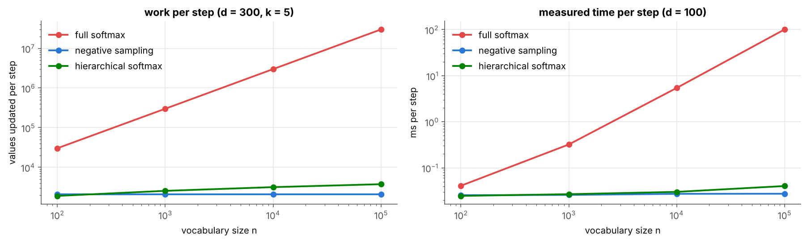
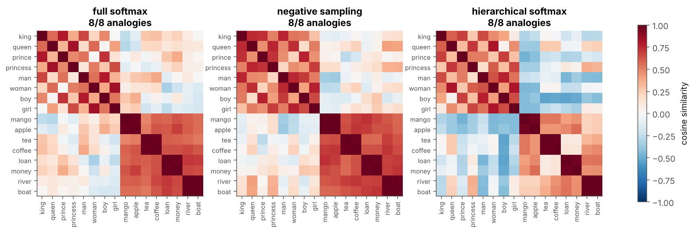
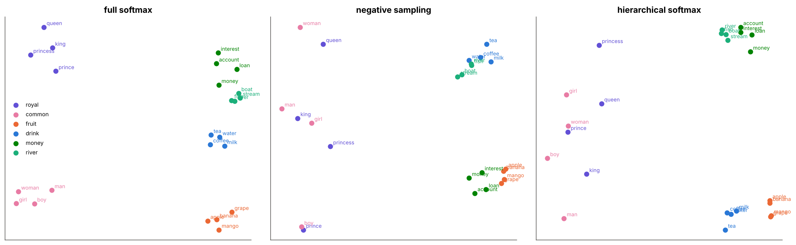
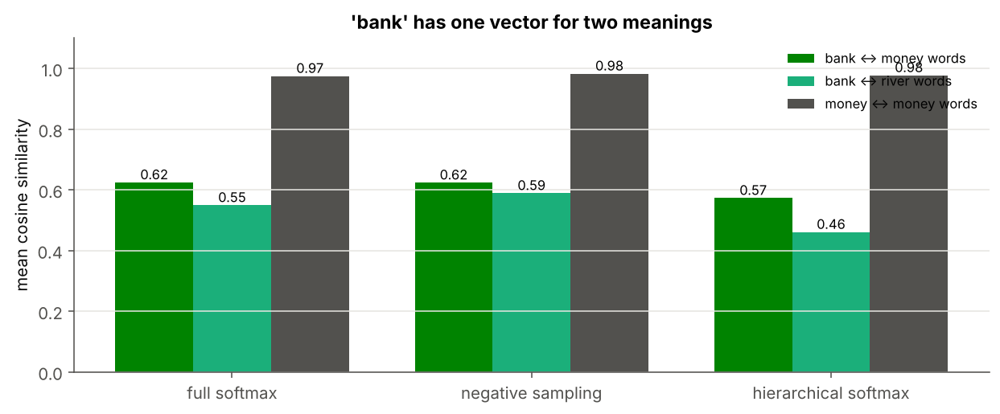

# 09 · Comparing the Training Variants

> **Module:** [03 - Text to Numbers and Word Embeddings](../) · **Notebook:** [`09_comparing_training_variants.ipynb`](09_comparing_training_variants.ipynb) · **Script:** [`09_comparing_training_variants.py`](09_comparing_training_variants.py)
> **Course notes:** pages 14–20: *"three variants: fundamentally different models but identical"*, *"budget at inference time → beam search; budget at training time → negative sampling"*, *"outputs may not sum to 1"*

---

## 📌 The core idea in one sentence

Full softmax, negative sampling and hierarchical softmax share the same input side (the word vectors $V$) and differ only in how the output is scored and trained; on the same data they learn word vectors of the same quality, but their cost per step is $O(n)$, $O(k)$ and $O(\log n)$.



---

## 1. The three losses, side by side

For one pair $(c,o)$ with $h=v_c$:

| variant | error $E$ | rows of $U$ changed | values per step |
|---|---|---|---|
| full softmax | $-\log\frac{e^{u_o\cdot h}}{\sum_{m=1}^ne^{u_m\cdot h}}$ | all $n$ | $(n+1)d$ |
| negative sampling | $-\log\sigma(u_o\cdot h)-\sum_{i=1}^k\log\sigma(-u_{j_i}\cdot h)$ | $k+1$ | $(k+2)d$ |
| hierarchical softmax | $-\sum_{j\in\text{path}(o)}\log\sigma(s_j\ u_j\cdot h)$ | $L(o)\approx\log_2n$ | $(L+1)d$ |

Variables: $n$ vocabulary size, $d$ embedding size, $k$ negatives, $L(o)$ Huffman path length, $s_j=\pm1$ for left/right, $\sigma$ the sigmoid. The input side is identical: that is what the notes mean by *"fundamentally different models but identical"*.

---

## 2. Same data, same start, three update rules

Each update rule is a plain function `step(V, U, c, o, eta, extra)`, so one training loop serves all three. All runs use the same seed, $d=10$, $\eta=0.05$, 5 epochs.

```text
full softmax          final loss 2.962   0.53 s/epoch    760.0 values per step
negative sampling     final loss 2.003   0.79 s/epoch     70.0 values per step
hierarchical softmax  final loss 2.940   0.89 s/epoch     64.7 values per step
```

The loss values are not comparable across methods (negative sampling sums $k+1$ binary errors). Full and hierarchical softmax both measure $-\log p(o\mid c)$ and end up close.

---

## 3. Quality of the word vectors

**Analogies** (status, gender and age are the hidden attributes of the corpus):

```text
full softmax          8/8 correct
negative sampling     8/8 correct
hierarchical softmax  8/8 correct
```

**Nearest neighbours:**

```text
king:
   full softmax          ['prince', 'man', 'queen', 'kingdom']
   negative sampling     ['man', 'queen', 'prince', 'old']
   hierarchical softmax  ['prince', 'man', 'queen', 'village']
girl:
   full softmax          ['woman', 'princess', 'sweet', 'boy']
   negative sampling     ['woman', 'princess', 'boy', 'plays']
   hierarchical softmax  ['woman', 'princess', 'boy', 'man']
mango:
   full softmax          ['banana', 'apple', 'grape', 'juicy']
   negative sampling     ['banana', 'apple', 'grape', 'tree']
   hierarchical softmax  ['banana', 'grape', 'apple', 'ripe']
tea:
   full softmax          ['milk', 'water', 'coffee', 'cup']
   negative sampling     ['milk', 'coffee', 'water', 'pour']
   hierarchical softmax  ['coffee', 'milk', 'water', 'cup']
loan:
   full softmax          ['money', 'interest', 'account', 'pay']
   negative sampling     ['interest', 'money', 'account', 'save']
   hierarchical softmax  ['interest', 'account', 'money', 'going']
river:
   full softmax          ['fish', 'boat', 'stream', 'shore']
   negative sampling     ['fish', 'boat', 'stream', 'swim']
   hierarchical softmax  ['fish', 'boat', 'stream', 'swim']
```

**Do they learn the same geometry?** Correlation between the three 75 × 75 cosine-similarity matrices:

```text
full softmax          [1.   0.65 0.65]
negative sampling     [0.65 1.   0.66]
hierarchical softmax  [0.65 0.66 1.  ]
```

About 0.65: the methods agree on the main groups but differ in details (where function and context words end up).





---

## 4. Cost as the vocabulary grows

Values updated per step for $d=300$, $k=5$, Huffman paths on Zipf words:

```text
n =     100:  full       30,300   NS  2,100   HS    1,906  (L = 5.4)
n =   1,000:  full      300,300   NS  2,100   HS    2,555  (L = 7.5)
n =  10,000:  full    3,000,300   NS  2,100   HS    3,169  (L = 9.6)
n = 100,000:  full   30,000,300   NS  2,100   HS    3,758  (L = 11.5)
```

Measured milliseconds per step ($d=100$):

```text
n =     100: full softmax   0.041 ms   negative sampling   0.025 ms   hierarchical softmax   0.025 ms
n =   1,000: full softmax   0.321 ms   negative sampling   0.026 ms   hierarchical softmax   0.027 ms
n =  10,000: full softmax   5.422 ms   negative sampling   0.027 ms   hierarchical softmax   0.030 ms
n = 100,000: full softmax 100.843 ms   negative sampling   0.027 ms   hierarchical softmax   0.040 ms
```

Full softmax grows like $n$; negative sampling and hierarchical softmax stay almost flat.

---

## 5. What can each trained model do?

| | full softmax | negative sampling | hierarchical softmax |
|---|---|---|---|
| $p(w\mid c)$ for one $w$ | $O(n)$ (needs the denominator) | not available | $O(\log n)$, one path |
| distribution sums to 1 | yes | **no** | yes |
| most likely $w$ | $O(n)$ | largest $\sigma$, not a probability | greedy / beam / branch and bound |
| budget set at | – | **training** time ($k$) | **inference** time (beam width $B$) |

```text
full softmax          Σ over all words =   1.000    top-3 for 'king': ['the', 'beard', 'him']
negative sampling     Σ over all words =   5.371    top-3 for 'king': ['tax', 'married', 'office']
hierarchical softmax  Σ over all words =   1.000    top-3 for 'king': ['the', 'married', 'him']
```

---

## 6. A shared limitation: one vector per word

*bank* is used for money (*bank, pay, rupees*) and for rivers (*bank, flow, shore*), but every method gives it **one** column of $V$. It ends up between the two groups, close to neither:

```text
full softmax          bank·money 0.62   bank·river 0.55   (money words among themselves 0.97)
negative sampling     bank·money 0.62   bank·river 0.59   (money words among themselves 0.98)
hierarchical softmax  bank·money 0.57   bank·river 0.46   (money words among themselves 0.98)
```



Fixing this needs **context-dependent** vectors, where *bank* gets a different vector in each sentence. That is what later models (ELMo, Transformers, BERT) do.

---

## 7. Which one when?

| | full softmax | negative sampling | hierarchical softmax |
|---|---|---|---|
| idea | one $n$-way choice | $k+1$ yes/no questions | $\approx\log_2n$ left/right decisions |
| real probability distribution | yes | no | yes |
| word-vector quality (here) | 8/8 analogies | 8/8 | 8/8 |
| best for | small vocabularies, exact probabilities | **training budget**: fast, simple, the default in practice | **inference budget**: need $p(w\mid c)$ or the top word quickly |

---

## 8. Code, step by step

<details>
<summary><b>Click to expand: the three update rules and the shared training loop</b></summary>

```python
import numpy as np, heapq, time

def sigmoid(a):
    return 1.0 / (1.0 + np.exp(-a))


def step_full(V, U, c, o, eta, extra):
    h = V[:, c].copy()
    z = U @ h
    y = np.exp(z - z.max()); y /= y.sum()
    e = y.copy(); e[o] -= 1.0
    grad_h = U.T @ e
    U -= eta * np.outer(e, h)
    V[:, c] -= eta * grad_h
    return -np.log(y[o]), U.size + V.shape[0]

def step_ns(V, U, c, o, eta, negatives):
    h = V[:, c].copy()
    ids = np.concatenate(([o], negatives))
    labels = np.zeros(len(ids)); labels[0] = 1.0
    s = sigmoid(U[ids] @ h)
    g = s - labels
    grad_h = g @ U[ids]
    np.subtract.at(U, ids, eta * np.outer(g, h))
    V[:, c] -= eta * grad_h
    return -np.log(s[0]) - np.log(1 - s[1:]).sum(), (len(ids) + 1) * len(h)

def build_huffman(freq):
    """children[node] = (left, right); leaves 0..n-1, inner nodes n..2n-2, root last."""
    n_leaves = len(freq)
    heap = [(float(f), i) for i, f in enumerate(freq)]
    heapq.heapify(heap)
    children = np.full((2 * n_leaves - 1, 2), -1)
    for next_id in range(n_leaves, 2 * n_leaves - 1):
        w1, a = heapq.heappop(heap)
        w2, b = heapq.heappop(heap)
        children[next_id] = (a, b)
        heapq.heappush(heap, (w1 + w2, next_id))
    return children


def tree_paths(children, n_leaves):
    """leaf → (rows of U on its path, signs +1 left / −1 right)."""
    paths, stack = {}, [(len(children) - 1, [], [])]
    while stack:
        node, nodes, signs = stack.pop()
        if node < n_leaves:
            paths[node] = (np.array(nodes, dtype=int) - n_leaves, np.array(signs)); continue
        stack.append((children[node][0], nodes + [node], signs + [1.0]))
        stack.append((children[node][1], nodes + [node], signs + [-1.0]))
    return paths

children = build_huffman(freq)
paths = tree_paths(children, n)

def step_hs(V, U, c, o, eta, extra):
    h = V[:, c].copy()
    nodes, signs = paths[o]
    a = U[nodes] @ h
    g = sigmoid(a) - (signs > 0)
    grad_h = g @ U[nodes]
    U[nodes] -= eta * np.outer(g, h)
    V[:, c] -= eta * grad_h
    return -np.log(sigmoid(signs * a)).sum(), (len(nodes) + 1) * len(h)

P_noise = freq ** 0.75 / (freq ** 0.75).sum()

def train(step, u_rows, d=10, eta=0.05, epochs=5, k=5, seed=0):
    rng = np.random.default_rng(seed)
    V = rng.normal(0, 0.1, (d, n))
    U = rng.normal(0, 0.1, (u_rows, d))
    log = {"loss": [], "time": [], "values": 0, "steps": 0}
    for ep in range(epochs):
        perm = rng.permutation(N)
        negs = rng.choice(n, size=(N, k), p=P_noise) if step is step_ns else [None] * N
        t0, total = time.perf_counter(), 0.0
        for (c, o), extra in zip(pairs[perm], negs):
            E, changed = step(V, U, c, o, eta, extra)
            total += E; log["values"] += changed; log["steps"] += 1
        log["time"].append(time.perf_counter() - t0)
        log["loss"].append(total / N)
    return V, U, log

runs = {}
for name, step, rows in [("full softmax", step_full, n), ("negative sampling", step_ns, n), ("hierarchical softmax", step_hs, n - 1)]:
    V, U, log = train(step, rows)
    runs[name] = {"V": V, "U": U, "log": log}
    print(f"{name:<21} final loss {log['loss'][-1]:.3f}   {np.mean(log['time']):.2f} s/epoch   "
          f"{log['values'] / log['steps']:6.1f} values per step")
```
</details>

The complete runnable version is [`09_comparing_training_variants.py`](09_comparing_training_variants.py).

## 9. What is in the notebook

| Section | Content |
|---|---|
| 1 | the three losses |
| 3–4 | three update functions, one shared training loop |
| 5 | analogies, neighbours, similarity agreement, side-by-side maps |
| 6 | values and time per step vs $n$ |
| 7 | probabilities: sum to 1 or not |
| 8 | the *bank* limitation |
| 9 | which one when |

```bash
jupyter notebook 09_comparing_training_variants.ipynb     # or:  python 09_comparing_training_variants.py
```

## ✍️ Exercises
1. Double the corpus and measure time per epoch. Which method scales best with **more data**?
2. Run all three with $d=2$. Which separates the groups best?
3. Add sentences that use *bank* only in the river sense, 10× more often. How does *bank* move?
4. Use $(V+U^\top)/2$ as word vectors for full softmax and negative sampling. Why is this not possible for hierarchical softmax?

**Previous:** [08 - Hierarchical Softmax](../08%20-%20Hierarchical%20Softmax/) · **Back to:** [module overview](../)
