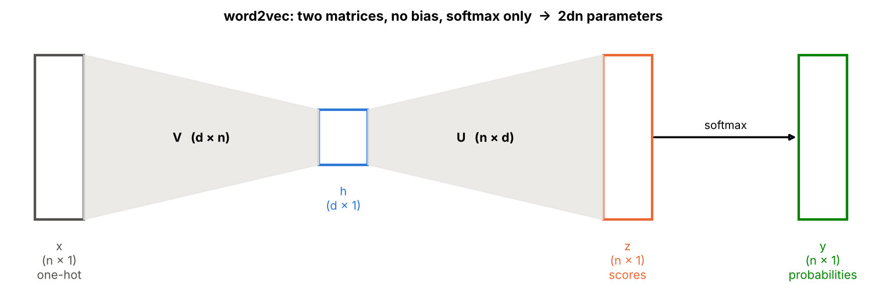
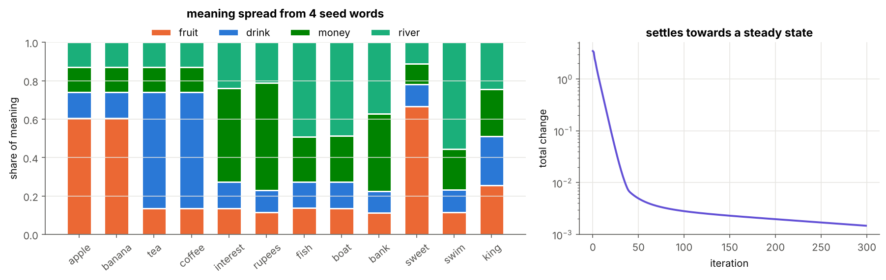

# 03 · Text to Numbers and Word Embeddings

**From "a word is a string" to "king − man + woman = queen".** A hands-on, NumPy-only walk from the simplest ways of turning words into numbers (characters, one-hot, TF-IDF) to word2vec and its three training variants. Every idea is derived step by step in the notation of the course notes, implemented from scratch, checked numerically, and visualised.

> 📝 **Course notes:** pages 6–20 of the handwritten notes (text → numbers, one-hot, TF-IDF, PageRank, distributional semantics, word2vec, gradients, negative sampling, hierarchical softmax, inference).
> 📗 **Further reading:** Xin Rong, *word2vec Parameter Learning Explained*; Mikolov et al. 2013, *Efficient Estimation of Word Representations in Vector Space* and *Distributed Representations of Words and Phrases*. New to backprop? Start with [module 02](../02%20-%20Feed-Forward%20Networks%20and%20Backpropagation/).


---

## Why this module?

Networks need numbers, and text is made of words. The obvious encodings fail in instructive ways:

1. **Characters** measure spelling: *nice* looks like *mice*, not like *good*.
2. **One-hot vectors** make every word equally far from every other ($\sqrt2$): no similarity at all.
3. **TF-IDF** captures which documents a word appears in, but gives huge, sparse vectors.

The fix is the **distributional hypothesis**: *a word is known by the company it keeps*. This module builds it up in four steps:

| Question | Answer | Notebooks |
|---|---|---|
| How do we turn text into numbers at all? | characters, one-hot, TF-IDF | 01 |
| Can we get meaning from context alone? | co-occurrence counts, PPMI, SVD; solve the recursion like PageRank | 02–03 |
| Can a network *learn* dense word vectors? | word2vec: predict a neighbour, keep the weights | 04–06 |
| How do we make that fast? | negative sampling, hierarchical softmax | 07–09 |

---

## 📖 Notation (identical to the course notes)

| Symbol | Shape | Meaning |
|---|---|---|
| $n$ | – | vocabulary size |
| $d$ | – | embedding size (notes: typically 300) |
| $x$ | $n\times1$ | one-hot vector of the **input** word |
| $V$ | $d\times n$ | **input** matrix; column $v_k$ is the **word vector** of $w_k$ |
| $h=Vx$ | $d\times1$ | hidden vector, simply the column $v_c$ of the input word $c$ |
| $U$ | $n\times d$ | **output** matrix; row $u_k$ is the output vector of $w_k$ |
| $z=Uh$ | $n\times1$ | scores, $z_k=u_k\cdot h$ |
| $y=\text{softmax}(z)$ | $n\times1$ | predicted probability of each word being the neighbour |
| $o$ | – | the true output (context) word |
| $E=-\log y_o$ | – | error of one training pair |
| $\delta_{ok}$ | – | 1 if $k=o$, else 0 |
| $\eta$ | – | learning rate |
| $k$ | – | negative samples per pair |

No biases and no activation except the softmax: the model has exactly $2dn$ parameters.

---

## Word2vec in one picture



$$x\ \xrightarrow{\ V\ }\ h=v_c\ \xrightarrow{\ U\ }\ z=Uh\ \xrightarrow{\text{softmax}}\ y,\qquad E=-\log y_o$$

The gradients (notebook 05) are "prediction minus truth":

$$\Delta u_k=\eta\ (\delta_{ok}-y_k)\ h\qquad\Delta v_c=\eta\Big(u_o-\sum_{i=1}^{n}y_i\ u_i\Big)$$

**Intuition.** The input word's vector moves from what the model *expected* (the average output vector $\sum_iy_iu_i$) towards what *actually* happened ($u_o$). Words with similar neighbours are pushed in the same directions, so they end up close together.

**The problem.** Every step touches all $n$ rows of $U$: about $3\times10^7$ numbers for $d=300$, $n=10^5$. The two fixes:

| | full softmax | negative sampling | hierarchical softmax |
|---|---|---|---|
| question per pair | which of $n$ words? | $k+1$ yes/no questions | $\approx\log_2n$ left/right decisions |
| values updated per step | $(n+1)d$ | $(k+2)d$ | $(L+1)d$ |
| outputs sum to 1? | yes | no | yes |
| budget is set at | – | training time | inference time |

---

## Learning path

| # | Topic | Core idea | Highlights |
|---|---|---|---|
| 01 | [One-Hot and TF-IDF](01%20-%20One-Hot%20and%20TF-IDF/) | one-hot: all words $\sqrt2$ apart; $TF\times IDF$ | equidistance heat-map, TF-IDF matrix, words as TF-IDF rows |
| 02 | [Distributional Semantics and Co-occurrence](02%20-%20Distributional%20Semantics%20and%20Co-occurrence/) | $X_{ij}$ counts, $PPMI=\max(\log\frac{P(i,j)}{P(i)P(j)},0)$, SVD | missing-word game, king − man + woman = queen from counts |
| 03 | [PageRank Analogy](03%20-%20PageRank%20Analogy/) | solve $r=Mr$ by iterating | damping, meaning spread from 4 seed words |
| 04 | [Word2Vec Model](04%20-%20Word2Vec%20Model/) | $h=Vx$ is a lookup; $2dn$ parameters | skip-gram / CBOW data, untrained $E\approx\log n$ |
| 05 | [Softmax and Cross-Entropy Gradients](05%20-%20Softmax%20and%20Cross-Entropy%20Gradients/) | $\partial E/\partial z=y-t$ | quotient-rule derivation, gradient check, update geometry |
| 06 | [Naive Training](06%20-%20Naive%20Training/) | SGD over all pairs | loss vs the entropy floor, analogies, $O(n)$ cost per step |
| 07 | [Negative Sampling](07%20-%20Negative%20Sampling/) | $k+1$ logistic regressions, $f^{3/4}$ noise | ~2,900× faster per step at $n=10^5$, outputs do not sum to 1 |
| 08 | [Hierarchical Softmax](08%20-%20Hierarchical%20Softmax/) | Huffman tree, $p(w)=\prod\sigma(\pm u_j\cdot h)$ | greedy vs beam vs branch and bound |
| 09 | [Comparing Training Variants](09%20-%20Comparing%20Training%20Variants/) | same vectors, different cost | side-by-side quality and cost, the *bank* limitation |

Every notebook has a variable table before any formula, step-by-step derivations, small explained code cells, separate plot cells, a summary and exercises.

---

## The toy corpus

All word2vec notebooks share one generated corpus (1,520 sentences, $n=75$ words, 31,734 skip-gram pairs with window 3) whose words have **hidden meanings we know in advance**: 8 people with attributes *royal/common*, *male/female*, *adult/young*, and 4 kinds of things (fruit, drink, money, river). *bank* belongs to both money and river. Because the true structure is known, we can check whether the learned vectors actually recover it.

---

## Key results you will reproduce

| Result | Figure |
|---|---|
| One-hot: every pair of words is $\sqrt2$ apart, cosine 0 |  |
| PPMI + SVD already gives *king − man + woman ≈ queen*, with parallel gender arrows |  |
| Meaning spreads from 4 seed words through the word graph, like PageRank |  |
| Every row of $U$ changes in an update, but only one column of $V$ |  |
| Full-softmax training: loss 4.32 → 2.95 (floor 2.73); all 5 analogies correct |  |
| Full softmax costs ~79 ms per step at $n=10^5$; negative sampling ~0.03 ms |  |
| Greedy decoding in the Huffman tree fails on the notes' example (0.214 vs 0.294) |  |
| All three variants get 8/8 analogies; *bank* stays stuck between its two meanings |  |

Also checked in the notebooks:
- analytic gradients match numerical gradients to about $10^{-9}$–$10^{-10}$ (softmax and hierarchical softmax);
- the hierarchical-softmax probabilities sum to exactly 1, the negative-sampling outputs do not;
- the PageRank steady state equals the eigenvector of $M$ with eigenvalue 1.

---

## Quick start

```bash
pip install numpy matplotlib jupyter
jupyter notebook                      # open any .ipynb
python "06 - Naive Training/06_naive_training.py"   # or run the plain-Python version
```

Each sub-folder has the notebook (with outputs pre-rendered), an equivalent commented `.py` script, and a README. Everything uses only NumPy + Matplotlib and runs in seconds on a laptop CPU.

## Folder structure

```
03 - Text to Numbers and Word Embeddings/
├── README.md                                      ← you are here
├── figures/                                       ← all images used in the READMEs (generated by the notebooks)
├── 01 - One-Hot and TF-IDF/                         README + notebook + script
├── 02 - Distributional Semantics and Co-occurrence/ README + notebook + script
├── 03 - PageRank Analogy/                           README + notebook + script
├── 04 - Word2Vec Model/                             README + notebook + script
├── 05 - Softmax and Cross-Entropy Gradients/        README + notebook + script
├── 06 - Naive Training/                             README + notebook + script
├── 07 - Negative Sampling/                          README + notebook + script
├── 08 - Hierarchical Softmax/                       README + notebook + script
└── 09 - Comparing Training Variants/                README + notebook + script
```

## Topics
- [x] 01 - One-Hot and TF-IDF
- [x] 02 - Distributional Semantics and Co-occurrence
- [x] 03 - PageRank Analogy
- [x] 04 - Word2Vec Model
- [x] 05 - Softmax and Cross-Entropy Gradients
- [x] 06 - Naive Training
- [x] 07 - Negative Sampling
- [x] 08 - Hierarchical Softmax
- [x] 09 - Comparing Training Variants

**Previous module:** [02 - Feed-Forward Networks and Backpropagation](../02%20-%20Feed-Forward%20Networks%20and%20Backpropagation/) · **Next module:** [04 - Computation Graphs and Autodiff](../04%20-%20Computation%20Graphs%20and%20Autodiff/)
